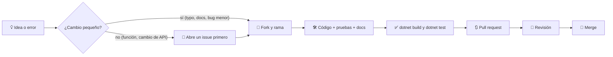

# Contribuir a AiSdk.Net

[English](CONTRIBUTING.md) · **Español**

¡Antes que nada, gracias! 💜 AiSdk.Net es un proyecto open source creado por
[Esteban Cortes (@ecr17dev)](https://github.com/ecr17dev), y toda contribución suma: reportes de errores,
documentación, ejemplos, pruebas, nuevos proveedores o funciones. Puedes escribir issues y pull requests en
**inglés o español**.

## 🧭 Cómo fluye una contribución



## 🚀 Preparar el entorno

Requisitos: [SDK de .NET 10](https://dotnet.microsoft.com/download). Opcional: `tesseract-ocr`, `poppler-utils`
y `ffmpeg` para las pruebas de documentos, y PostgreSQL con pgvector para las de pgvector.

```bash
git clone https://github.com/<tu-usuario>/AiSdk.Net.git
cd AiSdk.Net
dotnet build AiSdk.slnx           # debe terminar con 0 warnings (los warnings son errores)
dotnet test tests/AiSdk.Tests     # pruebas unitarias, sin red
dotnet run --project samples/QuickStart -- mock agent
```

Las pruebas en vivo llaman a APIs reales y se omiten si la clave no está definida:

```bash
export OPENAI_API_KEY=...         # o ANTHROPIC_API_KEY, GEMINI_API_KEY, MISTRAL_API_KEY, COHERE_API_KEY
export AISDK_TEST_OPENAI_MODEL=gpt-5   # opcional: elige el modelo
dotnet test tests/AiSdk.IntegrationTests
```

## 🗂️ Dónde está cada cosa

| Carpeta | Contenido |
|---|---|
| `src/AiSdk` | Núcleo (`Ai.*`, agentes, herramientas, orquestación, skills, artifacts, middleware) |
| `src/AiSdk.<Proveedor>` | Un proyecto por proveedor |
| `src/AiSdk.<Función>` | Paquetes opcionales (Documents, Workflows, Mcp, AspNetCore, PgVector, VectorData…) |
| `tests/AiSdk.Tests` | Pruebas unitarias con `MockLanguageModel` y `FakeHandler` (sin red) |
| `tests/AiSdk.IntegrationTests` | Pruebas en vivo (se omiten sin claves) |
| `samples/` | Ejemplos ejecutables |
| `docs/wiki` | La wiki (páginas en inglés + páginas `es-*` en español), se publica automáticamente |
| `docs/assets` | SVG animados (textos cortos: se muestran como imágenes) |

## ✍️ Pautas

- **Pruebas:** cada corrección o función trae su prueba unitaria. Los cambios de proveedor verifican la petición
  HTTP exacta con `FakeHandler`. Evita retardos fijos (`Task.Delay`) y relojes reales en las pruebas; ver
  [docs/quality/test-anti-patterns.es.md](docs/quality/test-anti-patterns.es.md).
- **Warnings:** la compilación trata los warnings como errores con `AnalysisLevel=latest-recommended`. Corrige la
  causa; usa `[SuppressMessage]` solo con una justificación escrita.
- **Paquetes:** las versiones están en `Directory.Packages.props` (Central Package Management). No agregues
  `Version=` a `PackageReference`.
- **API pública:** mantén los nombres coherentes con la API existente (y con el AI SDK de Vercel cuando haya un
  equivalente). Agrega documentación XML a los miembros públicos nuevos.
- **Estilo:** imita el código que lo rodea: nombres, comentarios e idioms. El `.editorconfig` define lo básico.
- **Documentación:** si cambias un comportamiento, actualiza la página de la wiki en `docs/wiki` en **ambos
  idiomas** si puedes (inglés `Pagina.md` y español `es-Pagina.md`). Si solo escribes uno, indícalo en el PR y
  alguien ayudará con el otro.
- **Commits:** pequeños, enfocados y con un mensaje claro.
- **Seguridad:** nunca subas API keys ni secretos. Reporta vulnerabilidades en privado, ver [SECURITY.md](SECURITY.md).

## 🏷️ Buenos lugares para empezar

- Issues con [`good first issue`](https://github.com/bluesmilecl/AiSdk.Net/labels/good%20first%20issue)
  o [`help wanted`](https://github.com/bluesmilecl/AiSdk.Net/labels/help%20wanted)
- La [hoja de ruta](https://github.com/bluesmilecl/AiSdk.Net/wiki/es-Hoja-de-ruta)
- Traducir o mejorar una página de la wiki
- Agregar un ejemplo en `samples/QuickStart`

## 📜 Código de conducta

Este proyecto sigue el [Contributor Covenant](CODE_OF_CONDUCT.es.md). Al participar aceptas respetarlo.

## ⚖️ Licencia

Al contribuir aceptas que tus aportes se publiquen bajo la [licencia MIT](LICENSE) del proyecto.
