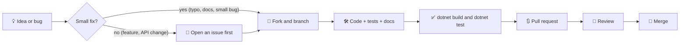

# Contributing to AiSdk.Net

**English** · [Español](CONTRIBUTING.es.md)

First of all, thank you! 💜 AiSdk.Net is an open-source project created by
[Esteban Cortes (@ecr17dev)](https://github.com/ecr17dev), and every contribution helps: bug reports, docs,
examples, tests, new providers or features. You can write issues and pull requests in **English or Spanish**.

## 🧭 How contributions flow



## 🚀 Getting set up

Requirements: [.NET 10 SDK](https://dotnet.microsoft.com/download). Optional: `tesseract-ocr`, `poppler-utils`
and `ffmpeg` for the document tests, PostgreSQL with pgvector for the pgvector tests.

```bash
git clone https://github.com/<you>/sdk-agent-ia-net.git
cd sdk-agent-ia-net
dotnet build AiSdk.slnx           # must finish with 0 warnings (warnings are errors)
dotnet test tests/AiSdk.Tests     # unit tests, no network needed
dotnet run --project samples/QuickStart -- mock agent
```

Live tests call real APIs and are skipped when the key is not set:

```bash
export OPENAI_API_KEY=...         # or ANTHROPIC_API_KEY, GEMINI_API_KEY, MISTRAL_API_KEY, COHERE_API_KEY
export AISDK_TEST_OPENAI_MODEL=gpt-5   # optional: choose the model
dotnet test tests/AiSdk.IntegrationTests
```

## 🗂️ Where things live

| Folder | Content |
|---|---|
| `src/AiSdk` | Core (`Ai.*`, agents, tools, orchestration, skills, artifacts, middleware) |
| `src/AiSdk.<Provider>` | One project per provider |
| `src/AiSdk.<Feature>` | Optional packages (Documents, Workflows, Mcp, AspNetCore, PgVector, VectorData…) |
| `tests/AiSdk.Tests` | Unit tests with `MockLanguageModel` and `FakeHandler` (no network) |
| `tests/AiSdk.IntegrationTests` | Live tests (skipped without keys) |
| `samples/` | Runnable examples |
| `docs/wiki` | The wiki (English pages + `es-*` Spanish pages), published automatically |
| `docs/assets` | Animated SVGs (keep text short; they are rendered as images) |

## ✍️ Guidelines

- **Tests:** every bug fix or feature comes with a unit test. Provider changes assert the exact HTTP request
  through `FakeHandler`. Avoid fixed delays (`Task.Delay`) and real clocks in tests; see
  [docs/quality/test-anti-patterns.md](docs/quality/test-anti-patterns.md).
- **Warnings:** the build treats warnings as errors with `AnalysisLevel=latest-recommended`. Fix the cause; use
  `[SuppressMessage]` only with a written justification.
- **Packages:** versions live in `Directory.Packages.props` (Central Package Management). Do not add `Version=`
  to `PackageReference`.
- **Public API:** keep names consistent with the existing API (and with the Vercel AI SDK when there is an
  equivalent). Add XML docs to new public members.
- **Style:** match the surrounding code: naming, comments and idioms. The `.editorconfig` holds the basics.
- **Docs:** if you change behavior, update the matching wiki page in `docs/wiki` in **both languages** when you
  can (English `Page.md` and Spanish `es-Pagina.md`). If you only write one language, say so in the PR and
  someone will help with the other.
- **Commits:** small, focused commits with a clear message (imperative mood is great: "Add Gemini embeddings").
- **Security:** never commit API keys or secrets. Report vulnerabilities privately, see [SECURITY.md](SECURITY.md).

## 🏷️ Good places to start

- Issues labelled [`good first issue`](https://github.com/bluesmilecl/sdk-agent-ia-net/labels/good%20first%20issue)
  or [`help wanted`](https://github.com/bluesmilecl/sdk-agent-ia-net/labels/help%20wanted)
- The [Roadmap](https://github.com/bluesmilecl/sdk-agent-ia-net/wiki/Roadmap)
- Translating or improving a wiki page
- Adding a sample to `samples/QuickStart`

## 📜 Code of Conduct

This project follows the [Contributor Covenant](CODE_OF_CONDUCT.md). By participating you agree to uphold it.

## ⚖️ License

By contributing, you agree that your contributions are licensed under the project's [MIT license](LICENSE).
