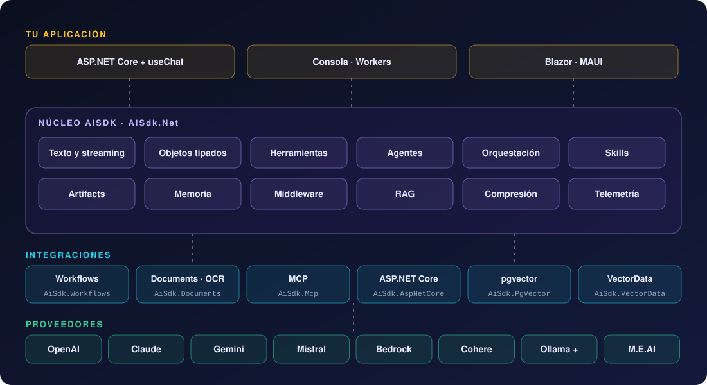
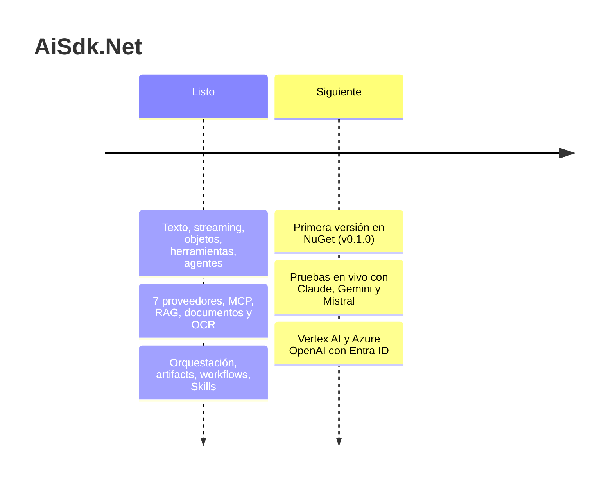

<div align="center">



<br>

[](https://github.com/bluesmilecl/AiSdk.Net/actions/workflows/ci.yml)
[](https://www.nuget.org/packages/AiSdk.Net)
[](https://dotnet.microsoft.com/)
[](LICENSE)
[](CONTRIBUTING.es.md)
[](https://github.com/bluesmilecl/AiSdk.Net/wiki/es-Inicio)

[English](README.md) · **Español**

[Inicio rápido](#-inicio-rápido) · [Funciones](#-funciones) · [Documentación](https://github.com/bluesmilecl/AiSdk.Net/wiki/es-Inicio) · [Ejemplos](samples/QuickStart/Program.cs) · [Contribuir](CONTRIBUTING.es.md)

</div>

---

**AiSdk.Net** es un SDK open source para construir **aplicaciones y agentes de IA en .NET 10**. Inspirado en el
[AI SDK de Vercel](https://ai-sdk.dev) y el [AI SDK de Laravel](https://laravel.com/docs/ai-sdk), ofrece
**una sola API independiente del proveedor** para texto, streaming, objetos tipados, herramientas, agentes,
orquestación multi-agente, RAG, Skills, workflows durables, MCP y más, desde una app de consola hasta un backend
ASP.NET Core para `useChat`.

<table>
<tr>
<td width="33%" valign="top">

### 🧠 Agentes que actúan
Bucle de herramientas, sub-agentes, aprobación humana, memoria y **orquestación multi-agente** (router,
supervisor, traspasos, evaluador-optimizador).

</td>
<td width="33%" valign="top">

### 🔌 Cualquier modelo
**OpenAI, Claude, Gemini, Mistral, Bedrock, Cohere**, cualquier servidor compatible con OpenAI (Ollama, Groq,
DeepSeek…) y todo lo de Microsoft.Extensions.AI.

</td>
<td width="33%" valign="top">

### 🏗️ Listo para producción
Workflows durables, OpenTelemetry, reintentos y fallback, analizadores con cero warnings, más de 200 pruebas y
pruebas en vivo contra APIs reales.

</td>
</tr>
</table>

## 🚀 Inicio rápido

```bash
dotnet add package AiSdk.Net.OpenAI   # o .Anthropic, .Google, .Mistral, .Bedrock, .Cohere
```

```csharp
using System.ComponentModel;
using AiSdk;
using AiSdk.OpenAI;

var clima = Tool.FromDelegate("clima", "Obtiene el clima actual de una ciudad",
    ([Description("Nombre de la ciudad")] string ciudad) => new { ciudad, temperaturaC = 14, lluvia = "80%" });

var agente = new ToolLoopAgent(new AgentSettings
{
    Model = OpenAIProvider.Default.Responses("gpt-5"),   // lee OPENAI_API_KEY
    Instructions = "Eres un asistente meteorológico amable.",
    Tools = [clima],
});

await foreach (var token in agente.Stream("¿Llevo paraguas en Santiago?").TextStream)
{
    Console.Write(token);
}
```

<div align="center">

</div>

> [!TIP]
> ¿Sin API key? Todos los ejemplos funcionan con un modelo simulado:
> `dotnet run --project samples/QuickStart -- mock agent`.
> Hay más de 25 ejemplos: `text`, `stream`, `tools`, `agent`, `object`, `rag`, `orchestrate`, `artifact`, `workflow`, `skills`…

## 🔁 El bucle del agente

<div align="center">

</div>

El agente llama al modelo, ejecuta las herramientas que pide, le devuelve los resultados y repite hasta que se
cumple una condición `StopWhen`. Puedes intervenir cada paso (`PrepareStep`, `OnStepFinish`), exigir aprobación
humana para herramientas sensibles y enviar todo en streaming a la interfaz.

## ✨ Funciones

| | | | |
|:---:|:---:|:---:|:---:|
| 💬<br>**Texto y streaming**<br><sub>`GenerateTextAsync` · `StreamText`</sub> | 🧾<br>**Objetos tipados**<br><sub>`GenerateObjectAsync<T>` con JSON Schema</sub> | 🛠️<br>**Herramientas**<br><sub>desde cualquier método, esquema automático</sub> | 🤖<br>**Agentes**<br><sub>`ToolLoopAgent` o tu propia clase `Agent`</sub> |
| 🕸️<br>**Multi-agente**<br><sub>cadena, paralelo, router, supervisor, traspasos</sub> | 🎓<br>**Skills**<br><sub>estándar abierto Agent Skills + Skills de Anthropic</sub> | 🖼️<br>**Artifacts**<br><sub>HTML, React y diagramas versionados, como Claude</sub> | 📄<br>**Word, PDF, Excel**<br><sub>generados por código o por el agente</sub> |
| ⏱️<br>**Workflows durables**<br><sub>pasos, esperas, aprobaciones, cron, webhooks</sub> | 📚<br>**RAG**<br><sub>pgvector, Qdrant, Pinecone, Azure AI Search…</sub> | 🔎<br>**Documentos → Markdown**<br><sub>PDF, Office, imágenes, audio, video + OCR</sub> | 🗜️<br>**Compresión de contexto**<br><sub>resúmenes incrementales, map-reduce</sub> |
| 🔌<br>**Cliente MCP**<br><sub>herramientas, recursos, prompts, sampling</sub> | 🌐<br>**Backend para useChat**<br><sub>ASP.NET Core, streams reanudables</sub> | 🎨<br>**Imágenes y voz**<br><sub>generación, voz, transcripción</sub> | 📈<br>**Observabilidad**<br><sub>OpenTelemetry, callbacks, middleware</sub> |

## 🌐 Proveedores

<div align="center">

</div>

| Paquete | Destacado |
|---|---|
| `AiSdk.Net.OpenAI` | Responses y Chat Completions, herramientas de servidor, embeddings, imágenes, voz, transcripción; cualquier servidor compatible |
| `AiSdk.Net.Anthropic` | Messages API de Claude, razonamiento extendido, web search/fetch, ejecución de código, citas, caché de prompts, **Skills** |
| `AiSdk.Net.Google` | Gemini con firmas de razonamiento, Google Search, ejecución de código, embeddings, Imagen |
| `AiSdk.Net.Mistral` | Chat, razonamiento de Magistral, herramientas, salida estructurada, embeddings, OCR |
| `AiSdk.Net.Bedrock` | API Converse (Claude, Llama, Nova, Mistral…) con SigV4 o API key |
| `AiSdk.Net.Cohere` | Rerank y Embed |
| `AiSdk.Net.Extensions.AI` | Cualquier `IChatClient` / `IEmbeddingGenerator` de Microsoft.Extensions.AI |

## 🏛️ Arquitectura

<div align="center">

</div>

<details>
<summary><b>📦 Los 15 paquetes</b></summary>

| Paquete | Qué hace |
|---|---|
| `AiSdk.Net` | Núcleo: API `Ai.*`, herramientas, agentes, orquestación, artifacts, skills, middleware, registro, embeddings, UI stream, `MockLanguageModel` |
| `AiSdk.Net.OpenAI` · `.Anthropic` · `.Google` · `.Mistral` · `.Bedrock` · `.Cohere` | Proveedores nativos |
| `AiSdk.Net.Mcp` | Cliente Model Context Protocol (stdio y Streamable HTTP) |
| `AiSdk.Net.Extensions.AI` | Adaptador de Microsoft.Extensions.AI |
| `AiSdk.Net.Extensions.DependencyInjection` | `services.AddAiSdk(...)`, `IHttpClientFactory`, agentes en el contenedor |
| `AiSdk.Net.AspNetCore` | `ToUIMessageStreamResult()`, `MapArtifacts()`, `MapWorkflows()`, `MapSkills()` |
| `AiSdk.Net.Documents` | Documentos → Markdown con OCR; generación de Word, PDF y Excel |
| `AiSdk.Net.Workflows` | Workflows durables, triggers y automatizaciones |
| `AiSdk.Net.PgVector` | Almacén PostgreSQL + pgvector con búsqueda híbrida |
| `AiSdk.Net.VectorData` | Cualquier conector de Microsoft.Extensions.VectorData |

</details>

## 📚 Documentación

La guía completa está en la **[wiki](https://github.com/bluesmilecl/AiSdk.Net/wiki/es-Inicio)** (también en [`docs/wiki`](docs/wiki)), en inglés y español.

| 🚀 Empezar | 🧠 Agentes | 📚 Datos | 🌐 Integrar |
|---|---|---|---|
| [Primeros pasos](https://github.com/bluesmilecl/AiSdk.Net/wiki/es-Primeros-pasos) | [Herramientas y agentes](https://github.com/bluesmilecl/AiSdk.Net/wiki/es-Herramientas-y-agentes) | [RAG y almacenes vectoriales](https://github.com/bluesmilecl/AiSdk.Net/wiki/es-RAG-y-almacenes-vectoriales) | [Proveedores](https://github.com/bluesmilecl/AiSdk.Net/wiki/es-Proveedores) |
| [Texto, streaming y objetos](https://github.com/bluesmilecl/AiSdk.Net/wiki/es-Texto-streaming-y-objetos) | [Orquestación multi-agente](https://github.com/bluesmilecl/AiSdk.Net/wiki/es-Orquestacion-multi-agente) | [Documentos, OCR y contexto](https://github.com/bluesmilecl/AiSdk.Net/wiki/es-Documentos-OCR-y-contexto) | [ASP.NET Core y useChat](https://github.com/bluesmilecl/AiSdk.Net/wiki/es-ASP.NET-Core-y-useChat) |
| [Arquitectura](https://github.com/bluesmilecl/AiSdk.Net/wiki/es-Arquitectura) | [Skills](https://github.com/bluesmilecl/AiSdk.Net/wiki/es-Skills) | [Artifacts y documentos Office](https://github.com/bluesmilecl/AiSdk.Net/wiki/es-Artifacts-y-documentos-Office) | [MCP](https://github.com/bluesmilecl/AiSdk.Net/wiki/es-MCP) |
| [Preguntas frecuentes](https://github.com/bluesmilecl/AiSdk.Net/wiki/es-Preguntas-frecuentes) | [Workflows y automatizaciones](https://github.com/bluesmilecl/AiSdk.Net/wiki/es-Workflows-y-automatizaciones) | [Pruebas y telemetría](https://github.com/bluesmilecl/AiSdk.Net/wiki/es-Pruebas-y-telemetria) | [Equivalencias (Vercel / Laravel)](https://github.com/bluesmilecl/AiSdk.Net/wiki/es-Equivalencias) |

## 🧪 Calidad

- ✅ **0 warnings** con `AnalysisLevel=latest-recommended` y warnings como errores
- ✅ **Más de 200 pruebas unitarias** (xunit.v3) y **pruebas en vivo** contra APIs reales, que se omiten sin API key
- ✅ Central Package Management, `Directory.Build.props` por capas, Source Link y paquetes de símbolos
- ✅ Publicación en NuGet con **trusted publishing** (OIDC), sin API keys de larga duración

Detalle en [docs/quality](docs/quality) y en la página [Calidad](https://github.com/bluesmilecl/AiSdk.Net/wiki/es-Calidad) de la wiki.

## 🗺️ Hoja de ruta



Revisa la [hoja de ruta completa](https://github.com/bluesmilecl/AiSdk.Net/wiki/es-Hoja-de-ruta) y los [issues abiertos](https://github.com/bluesmilecl/AiSdk.Net/issues).

## 🤝 Contribuir

Toda contribución es bienvenida: reportes de errores, documentación, ejemplos, nuevos proveedores. Empieza por
[CONTRIBUTING.es.md](CONTRIBUTING.es.md) y busca issues con la etiqueta
[`good first issue`](https://github.com/bluesmilecl/AiSdk.Net/labels/good%20first%20issue).
Respeta el [Código de conducta](CODE_OF_CONDUCT.es.md) y reporta vulnerabilidades según [SECURITY.md](SECURITY.md).

<a href="https://github.com/bluesmilecl/AiSdk.Net/graphs/contributors">
  
</a>

## 👤 Autor

<table>
<tr>
<td align="center">
<a href="https://github.com/ecr17dev"><br><b>Esteban Cortes</b></a><br>
<sub>Creador y mantenedor · <a href="https://github.com/ecr17dev">@ecr17dev</a></sub>
</td>
</tr>
</table>

Si AiSdk.Net te sirve, **dale una ⭐**: ayuda a que otros desarrolladores .NET lo encuentren.

[](https://star-history.com/#bluesmilecl/AiSdk.Net&Date)

## 📄 Licencia

[MIT](LICENSE) © Esteban Cortes ([@ecr17dev](https://github.com/ecr17dev))
