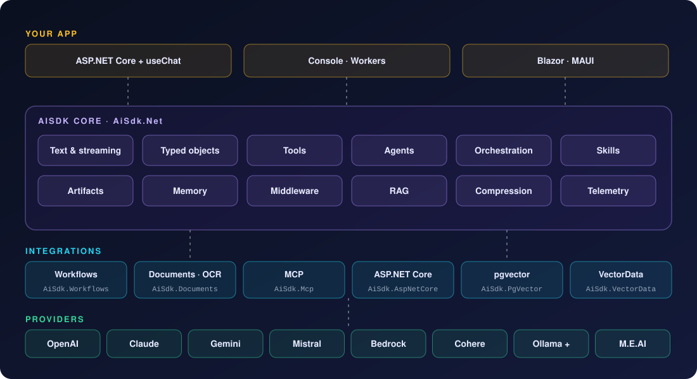
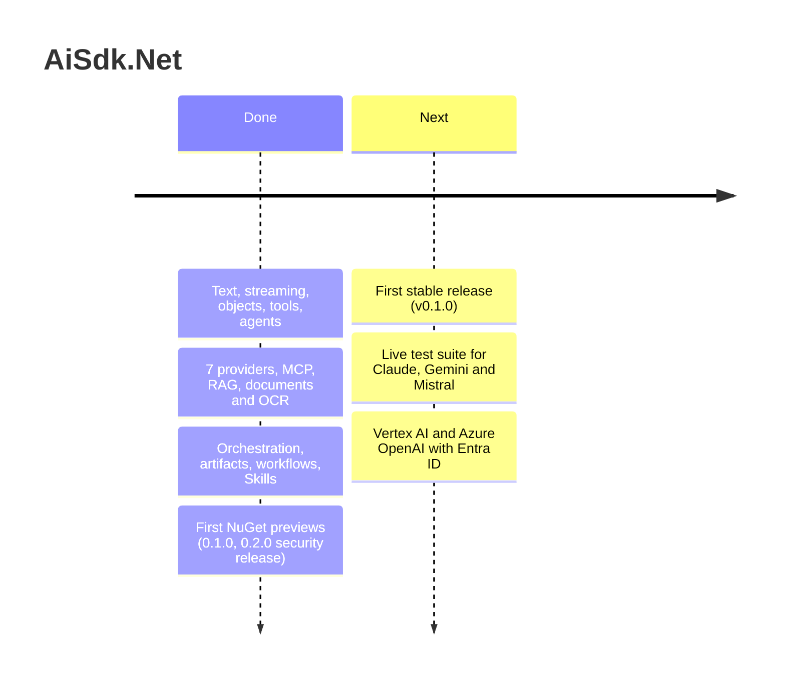

<div align="center">



<br>

[](https://github.com/bluesmilecl/AiSdk.Net/actions/workflows/ci.yml)
[](https://www.nuget.org/packages/AiSdk.Net)
[](https://dotnet.microsoft.com/)
[](LICENSE)
[](CONTRIBUTING.md)
[](https://github.com/bluesmilecl/AiSdk.Net/wiki)

**English** · [Español](README.es.md)

[Quick start](#-quick-start) · [Features](#-features) · [Docs](https://github.com/bluesmilecl/AiSdk.Net/wiki) · [Examples](samples/QuickStart/Program.cs) · [Contributing](CONTRIBUTING.md)

</div>

---

**AiSdk.Net** is an open-source SDK for building **AI apps and agents in .NET 10**. Inspired by the
[Vercel AI SDK](https://ai-sdk.dev) and the [Laravel AI SDK](https://laravel.com/docs/ai-sdk), it gives you
**one provider-agnostic API** for text, streaming, typed objects, tools, agents, multi-agent orchestration,
RAG, Skills, durable workflows, MCP and more, from a console app to an ASP.NET Core backend for `useChat`.

<table>
<tr>
<td width="33%" valign="top">

### 🧠 Agents that act
Tool loops, sub-agents, human approval, memory and **multi-agent orchestration** (router, supervisor,
handoffs, evaluator-optimizer).

</td>
<td width="33%" valign="top">

### 🔌 Any model
**OpenAI, Claude, Gemini, Mistral, Bedrock, Cohere**, any OpenAI-compatible server (Ollama, Groq,
DeepSeek…) and anything in Microsoft.Extensions.AI.

</td>
<td width="33%" valign="top">

### 🏗️ Built for production
Durable workflows, OpenTelemetry, retries and fallbacks, analyzers with zero warnings, 200+ tests and
live tests against real APIs.

</td>
</tr>
</table>

## 🚀 Quick start

> [!NOTE]
> AiSdk.Net is in **preview** (`0.2.0-preview.1` on [NuGet](https://www.nuget.org/packages/AiSdk.Net)): install it
> with `--prerelease`. The API may still change before the first stable version.

```bash
dotnet add package AiSdk.Net.OpenAI --prerelease   # or .Anthropic, .Google, .Mistral, .Bedrock, .Cohere
```

```csharp
using System.ComponentModel;
using AiSdk;
using AiSdk.OpenAI;

var weather = Tool.FromDelegate("weather", "Gets the current weather for a city",
    ([Description("City name")] string city) => new { city, temperatureC = 14, rain = "80%" });

var agent = new ToolLoopAgent(new AgentSettings
{
    Model = OpenAIProvider.Default.Responses("gpt-5"),   // reads OPENAI_API_KEY
    Instructions = "You are a friendly weather assistant.",
    Tools = [weather],
});

await foreach (var token in agent.Stream("Should I take an umbrella in Santiago?").TextStream)
{
    Console.Write(token);
}
```

<div align="center">

</div>

> [!TIP]
> No API key? Every example runs against a mock model:
> `dotnet run --project samples/QuickStart -- mock agent`.
> There are 25+ examples: `text`, `stream`, `tools`, `agent`, `object`, `rag`, `orchestrate`, `artifact`, `workflow`, `skills`…

## 🔁 The agent loop

<div align="center">

</div>

The agent calls the model, runs the tools it asks for, feeds the results back and repeats until a
`StopWhen` condition is met. You can hook every step (`PrepareStep`, `OnStepFinish`), require human
approval for sensitive tools and stream everything to the UI.

## ✨ Features

| | | | |
|:---:|:---:|:---:|:---:|
| 💬<br>**Text & streaming**<br><sub>`GenerateTextAsync` · `StreamText`</sub> | 🧾<br>**Typed objects**<br><sub>`GenerateObjectAsync<T>` with JSON Schema</sub> | 🛠️<br>**Tools**<br><sub>from any method, automatic schema</sub> | 🤖<br>**Agents**<br><sub>`ToolLoopAgent` or your own `Agent` class</sub> |
| 🕸️<br>**Multi-agent**<br><sub>chain, parallel, router, supervisor, handoffs</sub> | 🎓<br>**Skills**<br><sub>open Agent Skills standard + Anthropic Skills</sub> | 🖼️<br>**Artifacts**<br><sub>versioned HTML, React, diagrams, like Claude</sub> | 📄<br>**Word, PDF, Excel**<br><sub>generated by code or by the agent</sub> |
| ⏱️<br>**Durable workflows**<br><sub>steps, sleeps, approvals, cron, webhooks</sub> | 📚<br>**RAG**<br><sub>pgvector, Qdrant, Pinecone, Azure AI Search…</sub> | 🔎<br>**Documents → Markdown**<br><sub>PDF, Office, images, audio, video + OCR</sub> | 🗜️<br>**Context compression**<br><sub>incremental summaries, map-reduce</sub> |
| 🔌<br>**MCP client**<br><sub>tools, resources, prompts, sampling</sub> | 🌐<br>**useChat backend**<br><sub>ASP.NET Core, resumable streams</sub> | 🎨<br>**Images & voice**<br><sub>generation, speech, transcription</sub> | 📈<br>**Observability**<br><sub>OpenTelemetry, callbacks, middleware</sub> |

## 🌐 Providers

<div align="center">

</div>

| Package | Highlights |
|---|---|
| `AiSdk.Net.OpenAI` | Responses and Chat Completions, server tools, embeddings, images, speech, transcription; any OpenAI-compatible server |
| `AiSdk.Net.Anthropic` | Claude Messages API, extended thinking, web search/fetch, code execution, citations, prompt caching, **Skills** |
| `AiSdk.Net.Google` | Gemini with thought signatures, Google Search grounding, code execution, embeddings, Imagen |
| `AiSdk.Net.Mistral` | Chat, Magistral reasoning, tools, structured output, embeddings, OCR |
| `AiSdk.Net.Bedrock` | Converse API (Claude, Llama, Nova, Mistral…) with SigV4 or API key |
| `AiSdk.Net.Cohere` | Rerank and Embed |
| `AiSdk.Net.Extensions.AI` | Any `IChatClient` / `IEmbeddingGenerator` from Microsoft.Extensions.AI |

## 🏛️ Architecture

<div align="center">

</div>

<details>
<summary><b>📦 All 15 packages</b></summary>

| Package | What it does |
|---|---|
| `AiSdk.Net` | Core: `Ai.*` API, tools, agents, orchestration, artifacts, skills, middleware, registry, embeddings, UI stream, `MockLanguageModel` |
| `AiSdk.Net.OpenAI` · `.Anthropic` · `.Google` · `.Mistral` · `.Bedrock` · `.Cohere` | Native providers |
| `AiSdk.Net.Mcp` | Model Context Protocol client (stdio and Streamable HTTP) |
| `AiSdk.Net.Extensions.AI` | Microsoft.Extensions.AI adapter |
| `AiSdk.Net.Extensions.DependencyInjection` | `services.AddAiSdk(...)`, `IHttpClientFactory`, agents in the container |
| `AiSdk.Net.AspNetCore` | `ToUIMessageStreamResult()`, `MapArtifacts()`, `MapWorkflows()`, `MapSkills()` |
| `AiSdk.Net.Documents` | Documents → Markdown with page-by-page OCR; Word, PDF and Excel generation; external tools through a configurable runner (sandbox, clean environment) |
| `AiSdk.Net.Workflows` | Durable workflows, triggers and automations |
| `AiSdk.Net.PgVector` | PostgreSQL + pgvector store with hybrid search and metadata filters served by the index |
| `AiSdk.Net.VectorData` | Any Microsoft.Extensions.VectorData connector |

</details>

## 📚 Documentation

The full guide lives in the **[wiki](https://github.com/bluesmilecl/AiSdk.Net/wiki)** (also browsable in [`docs/wiki`](docs/wiki)), in English and Spanish.

| 🚀 Start | 🧠 Agents | 📚 Data | 🌐 Integrate |
|---|---|---|---|
| [Getting started](https://github.com/bluesmilecl/AiSdk.Net/wiki/Getting-Started) | [Tools and agents](https://github.com/bluesmilecl/AiSdk.Net/wiki/Tools-and-Agents) | [RAG and vector stores](https://github.com/bluesmilecl/AiSdk.Net/wiki/RAG-and-Vector-Stores) | [Providers](https://github.com/bluesmilecl/AiSdk.Net/wiki/Providers) |
| [Text, streaming and objects](https://github.com/bluesmilecl/AiSdk.Net/wiki/Text-Streaming-and-Objects) | [Multi-agent orchestration](https://github.com/bluesmilecl/AiSdk.Net/wiki/Multi-Agent-Orchestration) | [Documents, OCR and context](https://github.com/bluesmilecl/AiSdk.Net/wiki/Documents-OCR-and-Context) | [ASP.NET Core and useChat](https://github.com/bluesmilecl/AiSdk.Net/wiki/ASP.NET-Core-and-useChat) |
| [Architecture](https://github.com/bluesmilecl/AiSdk.Net/wiki/Architecture) | [Skills](https://github.com/bluesmilecl/AiSdk.Net/wiki/Skills) | [Artifacts and Office documents](https://github.com/bluesmilecl/AiSdk.Net/wiki/Artifacts-and-Office-Documents) | [MCP](https://github.com/bluesmilecl/AiSdk.Net/wiki/MCP) |
| [FAQ](https://github.com/bluesmilecl/AiSdk.Net/wiki/FAQ) | [Workflows and automations](https://github.com/bluesmilecl/AiSdk.Net/wiki/Workflows-and-Automations) | [Testing and telemetry](https://github.com/bluesmilecl/AiSdk.Net/wiki/Testing-and-Telemetry) | [Feature map (Vercel / Laravel)](https://github.com/bluesmilecl/AiSdk.Net/wiki/Feature-Map) |

## 🧪 Quality

- ✅ **0 warnings** with `AnalysisLevel=latest-recommended` and warnings as errors
- ✅ **200+ unit tests** (xunit.v3), integration tests against PostgreSQL + pgvector and **live tests** against real APIs, skipped when no key or database is set
- ✅ Central Package Management, layered `Directory.Build.props`, Source Link and symbol packages
- ✅ NuGet **trusted publishing** (OIDC), no long-lived API keys

Details in [docs/quality](docs/quality) and the [Quality](https://github.com/bluesmilecl/AiSdk.Net/wiki/Quality) wiki page.

## 🗺️ Roadmap



See the full [roadmap](https://github.com/bluesmilecl/AiSdk.Net/wiki/Roadmap) and [open issues](https://github.com/bluesmilecl/AiSdk.Net/issues).

## 🤝 Contributing

Contributions of every size are welcome: bug reports, docs, examples, new providers. Start with
[CONTRIBUTING.md](CONTRIBUTING.md) and look for issues labelled
[`good first issue`](https://github.com/bluesmilecl/AiSdk.Net/labels/good%20first%20issue).
Please follow the [Code of Conduct](CODE_OF_CONDUCT.md) and report vulnerabilities as described in [SECURITY.md](SECURITY.md).

<a href="https://github.com/bluesmilecl/AiSdk.Net/graphs/contributors">
  
</a>

## 👥 Creators

<table>
<tr>
<td align="center">
<a href="https://github.com/bluesmilecl"><br><b>Bluesmile</b></a><br>
<sub>Creator · <a href="https://github.com/bluesmilecl">@bluesmilecl</a></sub>
</td>
<td align="center">
<a href="https://github.com/ecr17dev"><br><b>Esteban Cortes</b></a><br>
<sub>Creator and maintainer · <a href="https://github.com/ecr17dev">@ecr17dev</a></sub>
</td>
</tr>
</table>

If AiSdk.Net helps you, **give it a ⭐**: it helps other .NET developers find it.

[](https://star-history.com/#bluesmilecl/AiSdk.Net&Date)

## 📄 License

[MIT](LICENSE) © Bluesmile ([@bluesmilecl](https://github.com/bluesmilecl)) and Esteban Cortes ([@ecr17dev](https://github.com/ecr17dev))
