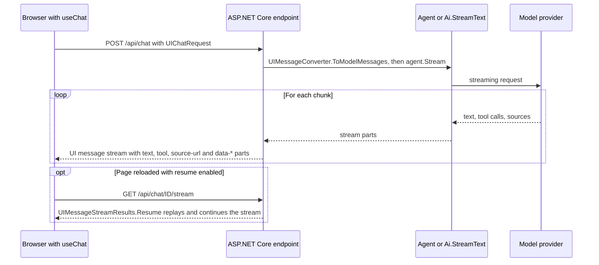

# ASP.NET Core and useChat

> 🇪🇸 [Leer en español](es-ASP.NET-Core-y-useChat)



## ASP.NET Core + `useChat`

```csharp
builder.Services.AddAiSdk(ai => ai
    .AddAnthropic()
    .AddOpenAI()
    .AddAlias("chat", "anthropic:claude-opus-5-5")
    .AddDefaultModel("chat")
    .AddAgent<SupportAgent>());

app.MapPost("/api/chat", (UIChatRequest req, SupportAgent agent, HttpContext http) =>
    agent.Stream(new AgentCallOptions
    {
        Messages = UIMessageConverter.ToModelMessages(req.Messages),
        CancellationToken = http.RequestAborted,
    }).ToUIMessageStreamResult());
```

On the frontend: `useChat({ transport: new DefaultChatTransport({ api: "/api/chat" }) })`.

**Custom data** (`data-*` parts in `useChat`): from a tool with `ctx.WriteData("progress", new { percent = 50 }, id: "p")`,
or by composing the stream:

```csharp
app.MapPost("/api/report", (UIChatRequest req, ILanguageModel model) =>
    UIMessageStreamResults.Create(writer =>
    {
        writer.WriteData("status", new { step = "searching" }, id: "status");
        writer.Merge(Ai.StreamText(new() { Model = model, Messages = UIMessageConverter.ToModelMessages(req.Messages) }));
        return Task.CompletedTask;
    }));
```

**Resumable streams**: generation keeps going even if the user reloads the page, and `useChat({ resume: true })` picks it up again.

```csharp
builder.Services.AddAiSdk(ai => ai.AddAnthropic().AddResumableStreams());   // or your own IResumableStreamStore backed by Redis

app.MapPost("/api/chat", (UIChatRequest req, SupportAgent agent, IResumableStreamStore store) =>
    agent.Stream(UIMessageConverter.ToModelMessages(req.Messages)).ToResumableUIMessageStreamResult(store, req.Id!));

app.MapGet("/api/chat/{id}/stream", (string id, IResumableStreamStore store) => UIMessageStreamResults.Resume(store, id));
```

> [!TIP]
> See `samples/ChatApi` for a complete, runnable example.

## Microsoft.Extensions.AI

```csharp
using AiSdk.Extensions.AI;

IChatClient azure = /* AzureOpenAIClient, OllamaApiClient, ... */;
ILanguageModel model = azure.AsLanguageModel();   // now usable with Ai.*, agents and middleware
```

---

**Next:** [Testing and Telemetry](Testing-and-Telemetry) ➡️
