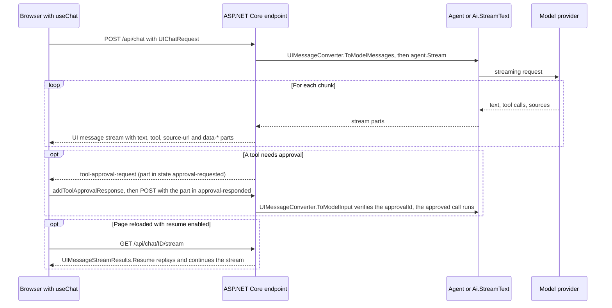

# ASP.NET Core and useChat

> 🇪🇸 [Leer en español](es-ASP.NET-Core-y-useChat)



## ASP.NET Core + `useChat`

```csharp
builder.Services.AddAiSdk(ai => ai
    .AddAnthropic()
    .AddOpenAI()
    .AddAlias("chat", "anthropic:claude-opus-5-5")
    .AddDefaultModel("chat")
    .AddAgent<SupportAgent>());

app.MapPost("/api/chat", (UIChatRequest req, SupportAgent agent, HttpContext http) =>
    agent.Stream(new AgentCallOptions
    {
        Messages = UIMessageConverter.ToModelMessages(req.Messages),
        CancellationToken = http.RequestAborted,
    }).ToUIMessageStreamResult());
```

On the frontend: `useChat({ transport: new DefaultChatTransport({ api: "/api/chat" }) })`.

**Custom data** (`data-*` parts in `useChat`): from a tool with `ctx.WriteData("progress", new { percent = 50 }, id: "p")`,
or by composing the stream:

```csharp
app.MapPost("/api/report", (UIChatRequest req, ILanguageModel model) =>
    UIMessageStreamResults.Create(writer =>
    {
        writer.WriteData("status", new { step = "searching" }, id: "status");
        writer.Merge(Ai.StreamText(new() { Model = model, Messages = UIMessageConverter.ToModelMessages(req.Messages) }));
        return Task.CompletedTask;
    }));
```

**Resumable streams**: generation keeps going even if the user reloads the page, and `useChat({ resume: true })` picks it up again.

```csharp
builder.Services.AddAiSdk(ai => ai.AddAnthropic().AddResumableStreams());   // or your own IResumableStreamStore backed by Redis

app.MapPost("/api/chat", (UIChatRequest req, SupportAgent agent, IResumableStreamStore store) =>
    agent.Stream(UIMessageConverter.ToModelMessages(req.Messages)).ToResumableUIMessageStreamResult(store, req.Id!))
    .RequireAuthorization();

app.MapGet("/api/chat/{id}/stream", (string id, IResumableStreamStore store) => UIMessageStreamResults.Resume(store, id))
    .RequireAuthorization();
```

The stream is stored under the chat id **and its owner**: the authenticated user, or the `owner` you pass (for example a
session id issued by your server in an anonymous app). Another user who knows or guesses the chat id can neither replace
nor resume it. Without an owner, `ToResumableUIMessageStreamResult` fails and `Resume` answers 204.

## ✅ Tool approval with `useChat`

A tool marked with `.RequireApproval()` runs on the server only after the user approves it in the chat, using the AI SDK's
own protocol (`tool-approval-request`, part states `approval-requested` / `approval-responded` / `output-denied`,
`addToolApprovalResponse`). Works with `ai@6` and `ai@7`.

```csharp
app.MapPost("/api/chat", (UIChatRequest req, SupportAgent agent, HttpContext http) =>
{
    var chatId = req.Id ?? Guid.NewGuid().ToString("N");
    var approvals = ToolApprovalProtection.ForChat(http, chatId);   // approvalIds signed for this user and chat
    var input = UIMessageConverter.ToModelInput(req.Messages, new()
    {
        ToolApprovals = approvals,
        ServerExecutedTools = ["send_email"],
    });
    return agent.Stream(new AgentCallOptions
    {
        Messages = input.Messages,
        ToolApprovals = input.ToolApprovals,   // verified answers: approved calls run before the model is called
        DeferToolApprovals = true,             // new calls that need approval are sent to the browser
        CancellationToken = http.RequestAborted,
    }).ToUIMessageStreamResult(toolApprovals: approvals);   // also ToResumableUIMessageStreamResult(..., toolApprovals:)
}).RequireAuthorization();
```

```tsx
import { useChat } from "@ai-sdk/react";
import { DefaultChatTransport, lastAssistantMessageIsCompleteWithApprovalResponses } from "ai";

const { messages, sendMessage, addToolApprovalResponse } = useChat({
  transport: new DefaultChatTransport({ api: "/api/chat" }),
  sendAutomaticallyWhen: lastAssistantMessageIsCompleteWithApprovalResponses, // send the answer back right away
});

// Inside messages.map(m => m.parts.map(part => ...)):
if (part.type === "tool-send_email") {
  switch (part.state) {
    case "approval-requested":
      return (
        <div key={part.toolCallId}>
          Send an email to {part.input.to}?
          <button onClick={() => addToolApprovalResponse({ id: part.approval.id, approved: true })}>Approve</button>
          <button onClick={() => addToolApprovalResponse({ id: part.approval.id, approved: false, reason: "Not now" })}>
            Deny
          </button>
        </div>
      );
    case "output-available": return <div key={part.toolCallId}>Sent.</div>;
    case "output-denied": return <div key={part.toolCallId}>Not sent: you denied it.</div>;
    case "output-error": return <div key={part.toolCallId}>{part.errorText}</div>;
  }
}
```

1. The model calls `send_email`; the loop stops and the stream sends `tool-approval-request` (`approvalId`, `toolCallId`),
   so `useChat` shows the part in state `approval-requested` with its `input`.
2. `addToolApprovalResponse` moves it to `approval-responded`, and `sendAutomaticallyWhen` posts the conversation again.
3. `ToModelInput` returns the decision only if its `approvalId` verifies for that exact call. An approved call runs with
   the input the model produced (`tool-output-available`); a denied one never runs, the browser gets
   `tool-output-denied` (`output-denied`) and the model gets "the user denied it" plus the reason.

**Why approvals can't be forged.** The browser sends the whole conversation back, so it could invent a call, change the
input of a real one, or reuse an approval. The `approvalId` is therefore not random: it is an ASP.NET Core Data
Protection token that binds the approval to the user, the chat, the tool call id, the tool name and a SHA-256 of the
call's input (canonical JSON, unchanged by the browser's `JSON.parse`/`stringify`), and it expires after one hour
(`lifetime`). An invented id, another user's or chat's approval, an expired one, or a valid id with a changed input or
call id is rejected: the tool does not run and the model gets an error. No state is kept on the server: within its
lifetime the same user could resend an approval they already used. If the approver is not the person chatting, or a call
must never repeat, keep the conversation on the server (`AgentSession.StreamApprovalsAsync`) or use a
[workflow](Workflows-and-Automations) with an approval event. With several instances, share the Data Protection key
ring; outside ASP.NET Core use `ToolApprovalProtector.CreateHmac(key, scope)`.

## 🔒 Security

The browser is not trusted: everything in a `UIChatRequest` (messages, chat id, tool results) can be forged.

- `UIMessageConverter.ToModelMessages` drops `system` messages sent by the client (opt in with
  `new UIMessageConverterOptions { AllowSystemMessages = true }`) and skips invalid parts (malformed `data:` URLs,
  URLs other than http/https, unexpected JSON types) instead of failing with a 500.
- The client sends back the results of tools your server ran: list those tools in
  `new UIMessageConverterOptions { ServerExecutedTools = ["get_weather"] }` so their forgeable parts are dropped.
  Keep instructions and sensitive data on the server (agent instructions, history stored with `AgentSession`).
- Tool approvals are only accepted with an `approvalId` your server signed for that user, chat and exact call
  (`UIMessageConverter.ToModelInput` + `ToolApprovalProtection.ForChat`); `ToModelMessages` ignores them. Without
  `toolApprovals` on the stream, a call waiting for approval is reported as an error instead (fails closed).
- Errors are masked: the browser receives a generic message for stream errors **and tool errors**
  (`tool-output-error`), while the model still sees the real text. To show details, pass `onError`; tool errors arrive
  as `ToolErrorException` (`onError: ex => env.IsDevelopment() ? ex.Message : "Something went wrong."`).
- `MapArtifacts`, `MapWorkflows` and `MapSkills` require authorization by default: configure authentication
  (`AddAuthentication` + `AddAuthorization`) or opt out explicitly with `AllowAnonymous = true`. See
  [Artifacts](Artifacts-and-Office-Documents) and [Workflows](Workflows-and-Automations).
- CORS: allow only your frontend origins (`WithOrigins(...)`), never `AllowAnyOrigin`. A header token
  (`Authorization: Bearer`, set with `DefaultChatTransport({ headers })`) avoids CSRF; with cookies keep `SameSite`.

> [!TIP]
> See `samples/ChatApi` for a complete, runnable example.

## Microsoft.Extensions.AI

`AiSdk.Net.Extensions.AI` connects AiSdk.Net and Microsoft.Extensions.AI (MEAI) in both directions.

### Use an MEAI client in AiSdk.Net

```csharp
using AiSdk.Extensions.AI;

IChatClient azure = /* AzureOpenAIClient, OllamaApiClient, ... */;
ILanguageModel model = azure.AsLanguageModel();   // now usable with Ai.*, agents and middleware
IEmbeddingModel embeddings = generator.AsEmbeddingModel();   // from an IEmbeddingGenerator<string, Embedding<float>>
```

### Use an AiSdk.Net provider from MEAI code

`AsIChatClient()` exposes any `ILanguageModel` as an `IChatClient`, and `AsIEmbeddingGenerator()` exposes any
`IEmbeddingModel` as an `IEmbeddingGenerator<string, Embedding<float>>`. Semantic Kernel, Microsoft Agent Framework,
MEAI middleware (`FunctionInvokingChatClient`, OpenTelemetry, caching), Aspire and evaluation libraries can then use
any AiSdk.Net provider:

```csharp
using AiSdk.Anthropic;
using AiSdk.Extensions.AI;
using AiSdk.OpenAI;
using Microsoft.Extensions.AI;

IChatClient client = AnthropicProvider.Default.Messages("claude-opus-5-5")
    .AsIChatClient()
    .AsBuilder()
    .UseFunctionInvocation()   // MEAI runs the tools
    .Build();

var response = await client.GetResponseAsync("What's the weather in Santiago?", new ChatOptions
{
    Tools = [AIFunctionFactory.Create((string city) => $"Sunny in {city}", "get_weather", "Gets the weather")],
});

IEmbeddingGenerator<string, Embedding<float>> generator =
    OpenAIProvider.Default.Embedding("text-embedding-3-small").AsIEmbeddingGenerator();
```

How the adapter maps things:

| MEAI | AiSdk.Net |
|---|---|
| `ChatMessage` with `TextContent`, `TextReasoningContent`, `DataContent`/`UriContent`/`HostedFileContent`, `FunctionCallContent`, `FunctionResultContent` | `ModelMessage` with `TextPart`, `ReasoningPart`, `ImagePart`/`FilePart`, `ToolCallPart`, `ToolResultPart` (tool results go in a tool message) |
| `ChatOptions.Instructions` | A system message before the conversation |
| `Temperature`, `TopP`, `TopK`, `MaxOutputTokens`, penalties, `StopSequences`, `Seed` | The same request settings |
| `ResponseFormat` (JSON / JSON schema), so `GetResponseAsync<T>()` works | `ResponseFormat.Json(schema, name, description)` |
| `Tools` (`AIFunctionDeclaration`: name, description, schema) and `ToolMode` | Tool declarations and `ToolChoice`; hosted tools are ignored |
| `RawRepresentationFactory` returning `ProviderOptions` or a `LanguageModelRequest` | Provider options, headers and provider-defined tools |
| `ChatResponse`: `Usage`, `FinishReason`, `ResponseId`, `ModelId`, `CreatedAt` | `Usage` (including reasoning and cached tokens), finish reason, response metadata |
| `GetService<ChatClientMetadata>()` | Provider name, model id and the optional endpoint passed to `AsIChatClient(uri)` |

> [!IMPORTANT]
> The `IChatClient` never executes tools: each call makes one model call and returns `FunctionCallContent`, so
> `FunctionInvokingChatClient` (or your code) runs them. Tools the provider executed itself (web search, code
> execution) come back with `InformationalOnly = true` and are not run again.

- Reasoning signatures and other provider metadata travel in `TextReasoningContent.ProtectedData` and
  `AdditionalProperties`, so they survive streaming and a conversation history saved as JSON.
- `ChatOptions.ModelId`, `ConversationId`, `AllowMultipleToolCalls` and `Reasoning` are not mapped: the model is fixed
  and AiSdk.Net models are stateless. Use `ProviderOptions` for provider-specific settings such as reasoning effort.
- Converting back unwraps instead of wrapping twice: `model.AsIChatClient().AsLanguageModel()` returns `model`. Through
  an MEAI pipeline (for example `.UseOpenTelemetry()`), provider options, headers and provider-defined tools still
  reach the AiSdk.Net model.

---

**Next:** [Testing and Telemetry](Testing-and-Telemetry) ➡️
