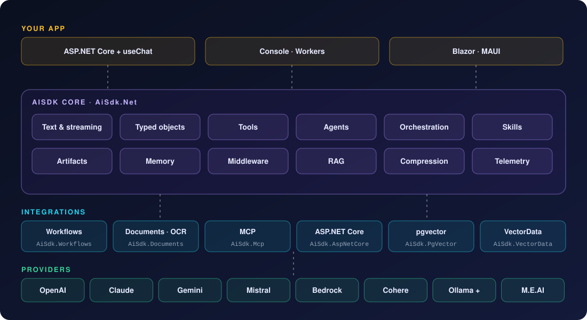
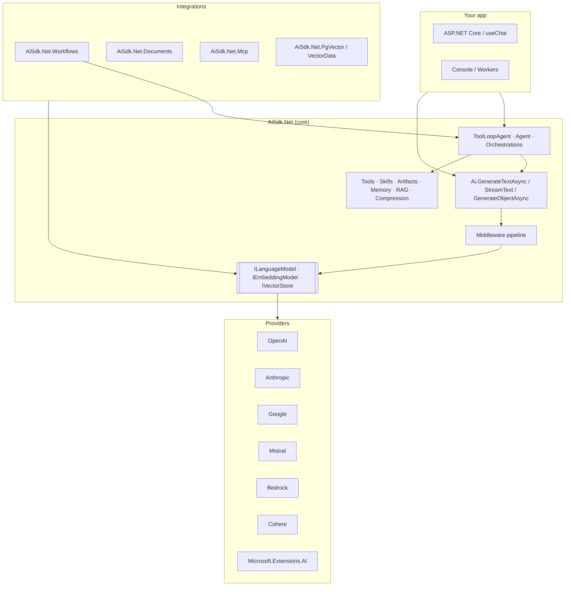
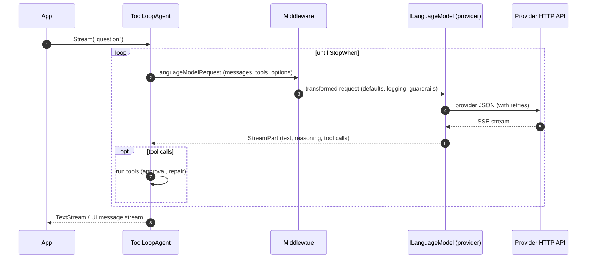

# 🏛️ Architecture

> 🇪🇸 [Leer en español](es-Arquitectura)



AiSdk.Net is a set of small packages around one core. Your app talks to the **core API** (`Ai.*`, agents,
orchestrations); the core talks to models only through the `ILanguageModel` abstraction, so providers,
middleware and test doubles are interchangeable.

## 🧱 Layers



## 🔄 Life of a request



## 📁 Repository layout

```
src/
  AiSdk/                      core
  AiSdk.OpenAI/               OpenAI provider + compatible servers
  AiSdk.Anthropic/            Claude provider
  AiSdk.Google/               Gemini provider
  AiSdk.Mistral/              Mistral provider
  AiSdk.Bedrock/              Amazon Bedrock provider
  AiSdk.Cohere/               Cohere reranking and embeddings
  AiSdk.Mcp/                  MCP client (stdio + HTTP)
  AiSdk.Extensions.AI/        Microsoft.Extensions.AI adapter
  AiSdk.Extensions.DependencyInjection/
  AiSdk.AspNetCore/
  AiSdk.Documents/            documents → Markdown, OCR, attachments middleware; Word/PDF/Excel generation
  AiSdk.Workflows/            durable workflows, triggers and automations
  AiSdk.PgVector/             PostgreSQL + pgvector store
  AiSdk.VectorData/           Microsoft.Extensions.VectorData adapter
skills/aisdk-net/             Agent Skill that teaches coding agents to use this SDK
docs/
  assets/                     animated SVGs and the package icon
  wiki/                       this wiki (synced by .github/workflows/wiki.yml)
  quality/                    quality reports (CPM, test audit, trusted publishing)
  nuget/                      README shipped inside the NuGet packages
samples/
  QuickStart/                 console examples (run with `mock` for no API key)
  ChatApi/                    backend for useChat
tests/AiSdk.Tests/            unit tests (mock models + fake HTTP)
tests/AiSdk.IntegrationTests/ live tests against real APIs (optional)
```

## 🧭 Design principles

| Principle | In practice |
|---|---|
| **One API, many providers** | Every provider implements `ILanguageModel`; switch models with one line or a `ProviderRegistry` alias |
| **Small packages** | The core has no provider dependencies; install only what you use |
| **Familiar names** | Mirrors the Vercel AI SDK (`generateText` → `GenerateTextAsync`) and Laravel AI concepts, see [Feature map](Feature-Map) |
| **Testable by default** | `MockLanguageModel` and fake HTTP handlers; no network in unit tests |
| **Observable** | Spans and metrics for every call, tool and agent, following the OpenTelemetry GenAI conventions |
| **Safe defaults** | Untrusted skills cannot run scripts, path traversal is rejected, webhook secrets are verified |

---

**Next:** [Quality](Quality) ➡️
