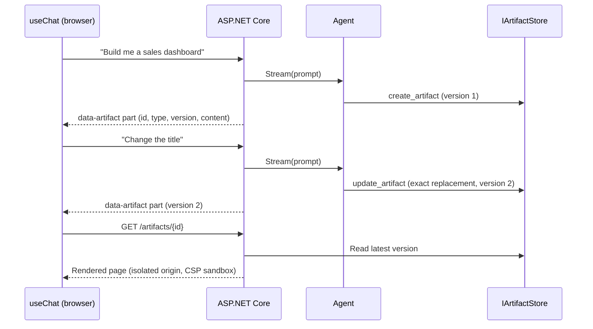

# Artifacts and Office documents

> 🇪🇸 [Leer en español](es-Artifacts-y-documentos-Office)



## 🖼️ Artifacts (like Claude)

Agents create substantial content that is shown separately from the chat (HTML pages, React components,
documents, code, Mermaid/SVG diagrams), edit it with exact replacements and keep every version.

```csharp
var store = new FileSystemArtifactStore("data/artifacts");          // or InMemoryArtifactStore, or your own IArtifactStore
var agent = new ToolLoopAgent(new()
{
    Model = claude,
    Instructions = ArtifactTools.Instructions,                     // when and how to create artifacts
    Tools = ArtifactTools.Create(store, new() { Url = a => $"/artifacts/{a.Id}" }),
});

app.MapArtifacts("/artifacts");   // GET /artifacts/{id}: page rendered on an isolated origin (CSP sandbox)
```

Tools: `create_artifact`, `update_artifact` (exact replacement), `rewrite_artifact`, `read_artifact`, `list_artifacts`.
Each change reaches `useChat` as a `data-artifact` part (with id, type, version and content) so it can be shown in a panel;
`ArtifactRenderer.ToHtml(artifact)` turns Markdown, Mermaid, React, SVG or CSV into a self-contained page.
With `Context["conversationId"]` each conversation only sees and edits its own artifacts.

> [!TIP]
> The frontend side (`useChat` and the `data-artifact` part) is covered in [ASP.NET Core and useChat](ASP.NET-Core-and-useChat).

## 📄 Generating Word, PDF and Excel

```csharp
var style = new DocumentStyleOptions { Title = "Q3 Report", Author = "Sales", TitlePage = true, HeaderText = "Confidential" };
File.WriteAllBytes("report.docx", DocumentGenerator.ToDocx(markdown, style));   // real Word styles, editable
File.WriteAllBytes("report.pdf", DocumentGenerator.ToPdf(markdown, style));     // no browser or native dependencies

var xlsx = new SpreadsheetBuilder { AllowFormulas = true }                       // trusted data: "=..." becomes a formula
    .AddSheet("Sales", sales, new SheetOptions { Totals = true })                 // from objects: automatic types and formats
    .AddSheet("Calculation", [new("Item"), new("Price", ColumnType.Currency), new("Qty"), new("Subtotal", ColumnType.Currency)],
              [["Table", 120.5, 2, "=B2*C2"]])                                    // formulas with "="
    .AddMarkdownTables(textWithTables)                                            // one sheet per Markdown table
    .Build();
```

- **Word**: headings, numbered and bulleted lists, tables with header rows, links, quotes, code, title page,
  header and "Page n of N". Validated with the official OpenXml validator.
- **PDF**: its own layout engine (line wrapping, tables that split across pages repeating the header, links,
  code, quotes, `\pagebreak`). Ships the *AiSdk Sans/Mono* fonts (derived from Liberation, OFL license) with
  accents, ñ, Greek and symbols; for other scripts: `PdfFonts.FromSingle(File.ReadAllBytes("NotoSansCJK.ttf"))`.
- **Excel**: typed columns (currency, percentage, dates...), styled header, filters, frozen pane, automatic
  widths, totals row with `SUM` and formulas; understands numbers like `1.234,50` and `12,5%`.
- **Links** in Word and PDF are only created for `http`, `https` and `mailto`; `file:`, UNC paths, `javascript:` or
  `data:` stay as plain text.

> [!WARNING]
> **Formulas are off by default** (since 0.2). Text that starts with `=`, `+`, `-` or `@` is written as text (with
> Excel's quote prefix), so data from end users (`AddSheet<T>`) or from a model (`AddMarkdownTables`, `ToXlsx`) cannot
> become `=HYPERLINK(...)`, `=WEBSERVICE(...)` or DDE that leaks data when the file is opened. Enable them with
> `AllowFormulas = true` for trusted data, optionally with `FormulaFilter = SpreadsheetBuilder.IsSafeFormula`
> (calculation functions only: no network, links, DDE or other workbooks).

For the **agent** to generate the files (they are stored as downloadable artifacts):

```csharp
Tools = DocumentTools.Create(new DocumentToolOptions { Store = store, ArtifactOptions = new() { Url = a => $"/artifacts/{a.Id}" } }),
// create_word_document, create_pdf, create_spreadsheet  (+ DocumentTools.Instructions in the system prompt)
```

`create_spreadsheet` keeps the model's calculation formulas (`=B2*C2`, `=SUM(D2:D9)`), but only those accepted by
`DocumentToolOptions.FormulaFilter` (by default `SpreadsheetBuilder.IsSafeFormula`); anything else is written as text.
The model may be following instructions injected in a page or email it read, and a network formula would leak data
when the user opens the file. `AllowFormulas = false` writes everything as text.

> [!NOTE]
> To go the other way (reading PDF, Office, images or audio into Markdown) see [Documents, OCR and context](Documents-OCR-and-Context).

---

➡️ Next: [Workflows and automations](Workflows-and-Automations)
