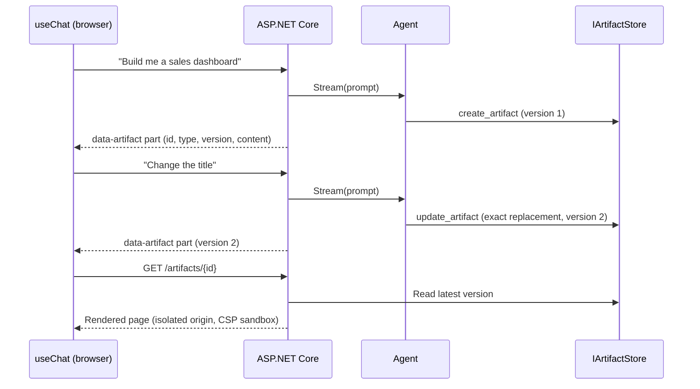

# Artifacts and Office documents

> 🇪🇸 [Leer en español](es-Artifacts-y-documentos-Office)



## 🖼️ Artifacts (like Claude)

Agents create substantial content that is shown separately from the chat (HTML pages, React components,
documents, code, Mermaid/SVG diagrams), edit it with exact replacements and keep every version.

```csharp
var store = new FileSystemArtifactStore("data/artifacts");          // or InMemoryArtifactStore, or your own IArtifactStore
var agent = new ToolLoopAgent(new()
{
    Model = claude,
    Instructions = ArtifactTools.Instructions,                     // when and how to create artifacts
    Tools = ArtifactTools.Create(store, new() { Url = a => $"/artifacts/{a.Id}" }),
});

// Per request: the user comes from your authentication, never from the request body.
var result = agent.Stream(new AgentCallOptions
{
    Messages = UIMessageConverter.ToModelMessages(req.Messages),
    Context = new Dictionary<string, object?> { ["conversationId"] = req.Id, ["userId"] = EndpointSecurity.GetUserId(http) },
});

app.MapArtifacts("/artifacts");   // requires authorization; each user only sees their own artifacts (CSP sandbox)
```

Tools: `create_artifact`, `update_artifact` (exact replacement), `rewrite_artifact`, `read_artifact`, `list_artifacts`.
Each change reaches `useChat` as a `data-artifact` part (with id, type, version and content) so it can be shown in a panel;
`ArtifactRenderer.ToHtml(artifact)` turns Markdown, Mermaid, React, SVG or CSV into a self-contained page.

The tools need `Context["userId"]` (the owner, from your authentication) and/or `Context["conversationId"]`, and **fail
without both** (`new ArtifactToolOptions { AllowUnscoped = true }` for single-user apps or scripts). Each conversation only
sees and edits its own artifacts, and a user never sees another user's, even when the (client-chosen) conversation id is
the same. Artifacts record their `Owner`; `ArtifactScope.CanAccess` applies the same rule in your own code.

### Serving artifacts safely

- `MapArtifacts` requires authorization (`new ArtifactEndpointOptions { AllowAnonymous = true }` to opt out) and serves
  each artifact only to its owner (`Artifact.Owner` equals the authenticated user). Customize it with
  `CanAccess = (http, artifact) => ...` (teams, admins, shared conversations); artifacts you cannot see answer 404.
- `GET /artifacts?conversationId=` lists metadata of that conversation that you may see; without it, your own artifacts.
  It never lists the whole store, and `FileSystemArtifactStore.ListAsync` no longer reads binaries (`Data` is null in listings).
- Everything the model writes is served with `Content-Security-Policy: sandbox ...` and `X-Content-Type-Options: nosniff`;
  raw HTML, SVG or XML (`/raw`) and files are downloads (`Content-Disposition: attachment`).
- Artifacts saved before 0.2 have no `Owner` and are not served by default: backfill it or decide with `CanAccess`.

> [!IMPORTANT]
> For defense in depth, serve artifacts from a dedicated origin (for example `artifacts.example.com`, without the app's
> cookies) and show them in an `<iframe>`.

> [!TIP]
> The frontend side (`useChat` and the `data-artifact` part) is covered in [ASP.NET Core and useChat](ASP.NET-Core-and-useChat).

## 📄 Generating Word, PDF and Excel

```csharp
var style = new DocumentStyleOptions { Title = "Q3 Report", Author = "Sales", TitlePage = true, HeaderText = "Confidential" };
File.WriteAllBytes("report.docx", DocumentGenerator.ToDocx(markdown, style));   // real Word styles, editable
File.WriteAllBytes("report.pdf", DocumentGenerator.ToPdf(markdown, style));     // no browser or native dependencies

var xlsx = new SpreadsheetBuilder()
    .AddSheet("Sales", sales, new SheetOptions { Totals = true })                 // from objects: automatic types and formats
    .AddSheet("Calculation", [new("Item"), new("Price", ColumnType.Currency), new("Qty"), new("Subtotal", ColumnType.Currency)],
              [["Table", 120.5, 2, "=B2*C2"]])                                    // formulas with "="
    .AddMarkdownTables(textWithTables)                                            // one sheet per Markdown table
    .Build();
```

- **Word**: headings, numbered and bulleted lists, tables with header rows, links, quotes, code, title page,
  header and "Page n of N". Validated with the official OpenXml validator.
- **PDF**: its own layout engine (line wrapping, tables that split across pages repeating the header, links,
  code, quotes, `\pagebreak`). Ships the *AiSdk Sans/Mono* fonts (derived from Liberation, OFL license) with
  accents, ñ, Greek and symbols; for other scripts: `PdfFonts.FromSingle(File.ReadAllBytes("NotoSansCJK.ttf"))`.
- **Excel**: typed columns (currency, percentage, dates...), styled header, filters, frozen pane, automatic
  widths, totals row with `SUM` and formulas; understands numbers like `1.234,50` and `12,5%`.

For the **agent** to generate the files (they are stored as downloadable artifacts):

```csharp
Tools = DocumentTools.Create(new DocumentToolOptions { Store = store, ArtifactOptions = new() { Url = a => $"/artifacts/{a.Id}" } }),
// create_word_document, create_pdf, create_spreadsheet  (+ DocumentTools.Instructions in the system prompt)
```

> [!NOTE]
> To go the other way (reading PDF, Office, images or audio into Markdown) see [Documents, OCR and context](Documents-OCR-and-Context).

---

➡️ Next: [Workflows and automations](Workflows-and-Automations)
