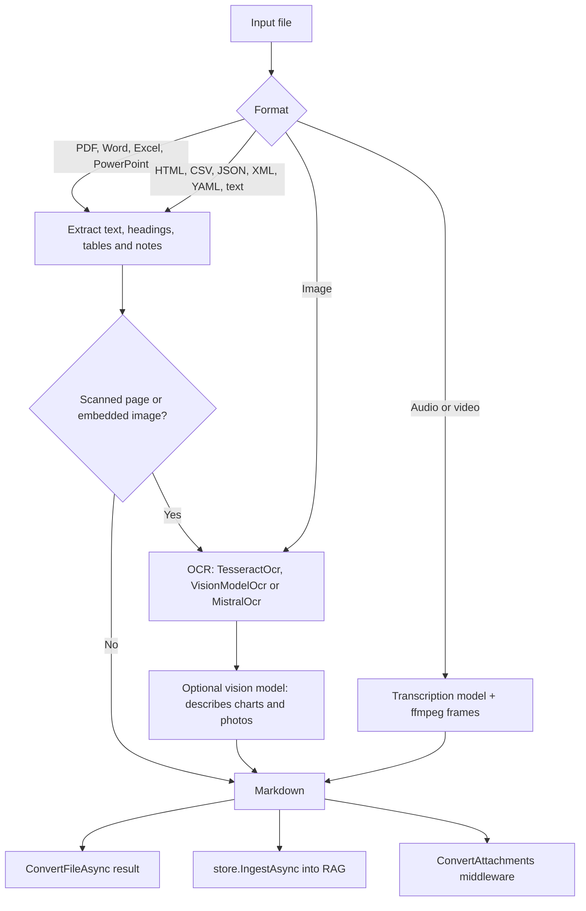

# Documents, OCR and Context Compression

> 🇪🇸 [Leer en español](es-Documentos-OCR-y-contexto)



## Documents to Markdown and OCR

`AiSdk.Documents` converts files into the format models read best and with the fewest tokens
(similar to MarkItDown or Docling). Images and scanned pages go through OCR; vision models
describe charts and photos; audio and video are transcribed.

| Format | Result |
|---|---|
| PDF | Text in reading order, headings by font size, no repeated headers/footers; scanned pages via OCR |
| Word (.docx) | Headings, numbered and bulleted lists, bold/italic, links, tables, embedded images (OCR/description) |
| Excel (.xlsx) | One table per sheet, dates and formula results, configurable row limit |
| PowerPoint (.pptx) | One section per slide with title, bullets, tables, images and speaker notes |
| HTML, CSV/TSV, JSON, XML, YAML, text | Clean Markdown, tables and code blocks |
| Images | Text (OCR) and/or description with a vision model |
| Audio / video | Transcription with timestamps; for video, a timeline with scenes (frames via `ffmpeg`) |

```csharp
var converter = new MarkdownConverter(new MarkdownConverterOptions
{
    Ocr = new TesseractOcr("spa+eng"),            // local; or MistralProvider.Default.Ocr(), or new VisionModelOcr(claude)
    VisionModel = anthropic.Messages("claude-opus-5-5"),   // optional: describes charts, photos and frames
    Transcription = openai.Transcription("gpt-4o-transcribe"),   // optional: audio and video
    Language = "es",
});

var result = await converter.ConvertFileAsync("scanned-contract.pdf");
Console.WriteLine(result.Markdown);          // also: Pages, Title, Warnings, EstimatedTokens

// Straight into RAG: by page and chunk, with source/page/title metadata
await store.IngestAsync(converter, await DocumentSource.FromFileAsync("manual.docx"));
```

Included OCR engines: `TesseractOcr` (no data sent to third parties; `apt install tesseract-ocr tesseract-ocr-spa`),
`VisionModelOcr` (any vision-capable model; reads tables and handwriting) and `MistralOcr` (accepts whole PDFs).
For scanned PDFs, `pdftoppm` (poppler-utils) is used if installed; otherwise, the embedded image of each page.
Scanned pages are rasterized and recognized one at a time (at most `MaxConcurrency` at once), so a long scan never
holds every page image in memory; a page that cannot be rasterized falls back to its embedded image. When the source
comes from `DocumentSource.FromFileAsync`, `pdftoppm` reads the original file instead of a temporary copy.
`Progress` reports the pages, how many go to OCR and how many are done:

```csharp
var converter = new MarkdownConverter(new()
{
    Ocr = new TesseractOcr("spa+eng"),
    Progress = new Progress<DocumentConversionProgress>(p => Console.WriteLine($"OCR {p.OcrPagesDone}/{p.OcrPages} of {p.Pages} pages")),
});
```

**External tools** (`tesseract`, `pdftoppm`, `ffmpeg`) are launched through `ExternalProcess.Runner`. Replace it at
startup to run them through a wrapper (sandbox, `nice`, a container) and without inheriting your app's secrets;
`TesseractOcr`, `PdftoppmRasterizer` and `MarkdownConverterOptions.ProcessRunner` also accept their own runner:

```csharp
ExternalProcess.Runner = new ExternalProcessRunner(new ExternalProcessOptions
{
    Wrapper = "nice",                                    // runs: nice -n 10 tesseract ...
    WrapperArguments = ["-n", "10"],
    AllowedEnvironmentVariables = [.. ExternalProcessOptions.CommonEnvironmentVariables, "SANDBOX_*"],
    EnvironmentVariables = new Dictionary<string, string?> { ["OMP_THREAD_LIMIT"] = "1" },   // one thread per Tesseract
});
```

> [!NOTE]
> `TesseractOcr` runs entirely on your machine, so it is the right choice when documents must not leave your infrastructure.

**Models without vision or file support**: the middleware replaces images, PDF, Office, audio and video with their
Markdown before calling the model (cached, so the history is not reprocessed on every turn):

```csharp
var model = mistral.Chat("mistral-small-latest")
    .WithMiddleware(DocumentMiddlewares.ConvertAttachments(converter, new AttachmentConversionOptions
    {
        Native = NativeAttachments.None,              // or Images | Pdf if the model supports them
        MaxTokensPerAttachment = 8000,
        CompressionEmbeddings = openai.Embedding("text-embedding-3-small"),   // keeps what is relevant to the question
    }));
```

## Context compression

```csharp
// Long conversations: trims old tool results and summarizes old turns
// (incrementally and cached) with a cheap model; it never separates a tool call from its result.
var model = claude.WithMiddleware(Middlewares.CompressContext(
    maxInputTokens: 50_000, summarizer: anthropic.Messages("claude-haiku-5-5"), keepRecentMessages: 8));

// Long texts
var relevant = await ContextCompressor.SelectRelevantAsync(embeddings, longText, question, maxTokens: 3000);
var summary = await ContextCompressor.SummarizeAsync(cheapModel, longText, targetTokens: 2000, focus: "deadlines and amounts");
var tokens = TokenEstimator.Estimate(longText);
```

---

**Next:** [MCP](MCP) ➡️
