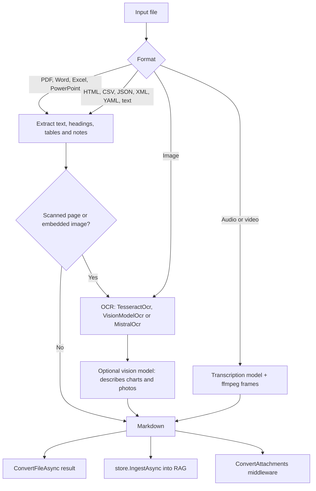

# Documents, OCR and Context Compression

> 🇪🇸 [Leer en español](es-Documentos-OCR-y-contexto)



## Documents to Markdown and OCR

`AiSdk.Documents` converts files into the format models read best and with the fewest tokens
(similar to MarkItDown or Docling). Images and scanned pages go through OCR; vision models
describe charts and photos; audio and video are transcribed.

| Format | Result |
|---|---|
| PDF | Text in reading order, headings by font size, no repeated headers/footers; scanned pages via OCR |
| Word (.docx) | Headings, numbered and bulleted lists, bold/italic, links, tables, embedded images (OCR/description) |
| Excel (.xlsx) | One table per sheet, dates and formula results, configurable row limit |
| PowerPoint (.pptx) | One section per slide with title, bullets, tables, images and speaker notes |
| HTML, CSV/TSV, JSON, XML, YAML, text | Clean Markdown, tables and code blocks |
| Images | Text (OCR) and/or description with a vision model |
| Audio / video | Transcription with timestamps; for video, a timeline with scenes (frames via `ffmpeg`) |

```csharp
var converter = new MarkdownConverter(new MarkdownConverterOptions
{
    Ocr = new TesseractOcr("spa+eng"),            // local; or MistralProvider.Default.Ocr(), or new VisionModelOcr(claude)
    VisionModel = anthropic.Messages("claude-opus-5-5"),   // optional: describes charts, photos and frames
    Transcription = openai.Transcription("gpt-4o-transcribe"),   // optional: audio and video
    Language = "es",
});

var result = await converter.ConvertFileAsync("scanned-contract.pdf");
Console.WriteLine(result.Markdown);          // also: Pages, Title, Warnings, EstimatedTokens

// Straight into RAG: by page and chunk, with source/page/title metadata
await store.IngestAsync(converter, await DocumentSource.FromFileAsync("manual.docx"));
```

Included OCR engines: `TesseractOcr` (no data sent to third parties; `apt install tesseract-ocr tesseract-ocr-spa`),
`VisionModelOcr` (any vision-capable model; reads tables and handwriting) and `MistralOcr` (accepts whole PDFs).
For scanned PDFs, `pdftoppm` (poppler-utils) is used if installed; otherwise, the embedded image of each page.
Scanned pages are rasterized and recognized one at a time (at most `MaxConcurrency` at once), so a long scan never
holds every page image in memory; a page that cannot be rasterized falls back to its embedded image. When the source
comes from `DocumentSource.FromFileAsync`, `pdftoppm` reads the original file instead of a temporary copy.
`Progress` reports the pages, how many go to OCR and how many are done:

```csharp
var converter = new MarkdownConverter(new()
{
    Ocr = new TesseractOcr("spa+eng"),
    Progress = new Progress<DocumentConversionProgress>(p => Console.WriteLine($"OCR {p.OcrPagesDone}/{p.OcrPages} of {p.Pages} pages")),
});
```

**External tools** (`tesseract`, `pdftoppm`, `ffmpeg`) are launched through `ExternalProcess.Runner`. By default each
tool only receives the variables in `ExternalProcessOptions.CommonEnvironmentVariables` (never your API keys or
connection strings), is stopped together with its child processes after 10 minutes (`Timeout`) and may write at most
64 MB to its standard output (`MaxOutputBytes`). `ffmpeg` and `ffprobe` only read the local file
(`-protocol_whitelist file`) with audio and video demuxers (`-format_whitelist`: no HLS, DASH or `concat` playlists that
would fetch URLs or other files) and only the first `MaxMediaDuration`. Temporary files live in a private directory
(0700 on Unix). Replace the runner at startup to run the tools through a wrapper (sandbox, `nice`, a container) or to
change those limits; `TesseractOcr`, `PdftoppmRasterizer` and `MarkdownConverterOptions.ProcessRunner` also accept
their own runner:

```csharp
ExternalProcess.Runner = new ExternalProcessRunner(new ExternalProcessOptions
{
    Wrapper = "nice",                                    // runs: nice -n 10 tesseract ...
    WrapperArguments = ["-n", "10"],
    AllowedEnvironmentVariables = [.. ExternalProcessOptions.CommonEnvironmentVariables, "SANDBOX_*"],
    EnvironmentVariables = new Dictionary<string, string?> { ["OMP_THREAD_LIMIT"] = "1" },   // one thread per Tesseract
    Timeout = TimeSpan.FromMinutes(2),
});
```

> [!WARNING]
> Since 0.2 the tools no longer inherit the whole environment of your application. If a tool needs another variable,
> add it to `AllowedEnvironmentVariables`; `AllowedEnvironmentVariables = null` restores the previous behavior.

### Limits for untrusted documents

A document can be small and still ask for a lot of work (a few KB of PDF with thousands of blank pages, a compressed
spreadsheet with a cell in column ZZZZZZ, deeply nested HTML). `MarkdownConverterOptions` bounds that work; when a
limit is exceeded the converter returns a partial result and explains it in `result.Warnings`:

| Option | Default | When exceeded |
|---|---|---|
| `MaxInputBytes` | 100 MB | `DocumentTooLargeException` (for files, checked before reading them) |
| `MaxPdfPages` | 1000 | only the first pages are processed |
| `MaxOcrPages` | 100 | scanned pages and embedded images beyond it are not sent to OCR or vision (caps OCR processes and paid calls) |
| `MaxRasterPixels` | 5000 px | huge pages are rasterized below 200 dpi; larger embedded images are skipped |
| `MaxNestingDepth` | 128 | HTML: deeper content becomes plain text; Office: `InvalidDataException` (the OpenXML SDK loads parts recursively) |
| `MaxHtmlBytes` | 10 MB | the rest of the HTML is skipped |
| `MaxOfficePartChars` | 32 million | `InvalidDataException` (Excel sheets are read up to that point) |
| `MaxRowsPerSheet` | 1000 | the remaining rows are counted, not rendered (also for CSV) |
| `MaxEmbeddedImageBytes` | 20 MB | the image is skipped |
| `MaxMediaDuration` | 1 hour | only the start of the video is analyzed |

Fixed limits: Markdown tables have at most 1,000,000 cells (`MarkdownTable.DefaultMaxCells`), Word tables at most 63
columns (also for `gridSpan`), Excel references beyond column `XFD` are ignored, list levels are 0 to 8 and CSV lines
are read up to 16,384 columns. HTML is parsed once with a depth guard, noise (`script`, `style`, `nav`...) is removed
from the DOM, and the conversion runs on a thread with its own large stack, so hostile HTML cannot crash the process.
To read uploads safely use `DocumentSource.FromStreamAsync(stream, maxBytes: ...)`.

> [!NOTE]
> `TesseractOcr` runs entirely on your machine, so it is the right choice when documents must not leave your infrastructure.

**Models without vision or file support**: the middleware replaces images, PDF, Office, audio and video with their
Markdown before calling the model (cached, so the history is not reprocessed on every turn):

```csharp
var model = mistral.Chat("mistral-small-latest")
    .WithMiddleware(DocumentMiddlewares.ConvertAttachments(converter, new AttachmentConversionOptions
    {
        Native = NativeAttachments.None,              // or Images | Pdf if the model supports them
        MaxTokensPerAttachment = 8000,
        CompressionEmbeddings = openai.Embedding("text-embedding-3-small"),   // keeps what is relevant to the question
    }));
```

Each attachment is replaced by `<document name="..." type="...">Markdown</document>`. The file name is escaped and any
`<document` or `</document` inside the content is neutralized (`&lt;/document`), so a file cannot close the wrapper and
inject text outside it.

`DownloadUrls = true` (off by default) also converts attachments referenced by URL. Whoever writes the message chooses
the URL and the content is shown to the model, so downloads go through `UrlDownloader`: http and https only, a direct
connection (no proxy) to the IP that was validated, never loopback, private networks (RFC 1918), link-local (including
the cloud metadata endpoint 169.254.169.254), CGNAT, IPv6 unique-local, multicast or their IPv4-mapped forms; at most 5
redirects, each one validated again; at most 25 MB (checked while streaming) and 30 seconds. `data:` URLs have the same
size limit. Adjust it with `MarkdownConverterOptions.UrlDownload`:

```csharp
var converter = new MarkdownConverter(new()
{
    UrlDownload = new UrlDownloadOptions
    {
        UrlValidator = url => url.Host.EndsWith(".example.com", StringComparison.OrdinalIgnoreCase),   // allowlist, every hop
        MaxBytes = 10 * 1024 * 1024,
        // AllowPrivateNetworks = true,   // only when the URLs come from a trusted source
    },
});
```

> [!WARNING]
> Since 0.2 `MarkdownConverterOptions.HttpClient` no longer exists: it is replaced by `UrlDownload`. A custom
> `HttpClient` could not enforce these checks. The downloader does not use a proxy (it would validate the proxy's IP,
> not the destination); behind a mandatory proxy, download the file yourself and pass its bytes.

## Context compression

```csharp
// Long conversations: trims old tool results and summarizes old turns
// (incrementally and cached) with a cheap model; it never separates a tool call from its result.
var model = claude.WithMiddleware(Middlewares.CompressContext(
    maxInputTokens: 50_000, summarizer: anthropic.Messages("claude-haiku-5-5"), keepRecentMessages: 8));

// Long texts
var relevant = await ContextCompressor.SelectRelevantAsync(embeddings, longText, question, maxTokens: 3000);
var summary = await ContextCompressor.SummarizeAsync(cheapModel, longText, targetTokens: 2000, focus: "deadlines and amounts");
var tokens = TokenEstimator.Estimate(longText);
```

---

**Next:** [MCP](MCP) ➡️
