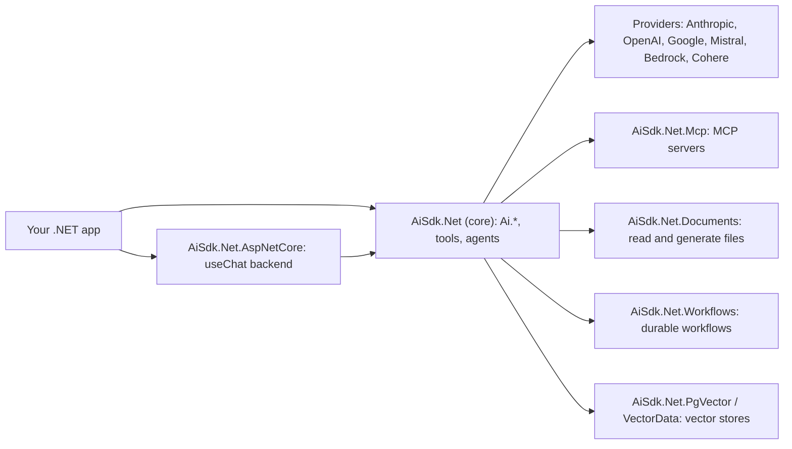

# Getting started

> 🇪🇸 [Leer en español](es-Primeros-pasos)

## 🗺️ How the packages fit together



## 📦 Installation

```bash
dotnet add package AiSdk.Net --prerelease               # core
dotnet add package AiSdk.Net.Anthropic --prerelease     # or AiSdk.Net.OpenAI, .Google, .Mistral, .Bedrock, .Cohere
dotnet add package AiSdk.Net.Mcp --prerelease           # MCP client
dotnet add package AiSdk.Net.AspNetCore --prerelease    # backend for useChat
dotnet add package AiSdk.Net.Documents --prerelease     # read (PDF/Office/images/audio/video → Markdown + OCR) and generate Word/PDF/Excel
dotnet add package AiSdk.Net.Workflows --prerelease     # durable workflows, triggers and automations
dotnet add package AiSdk.Net.Workflows.Postgres --prerelease  # PostgreSQL workflow store (several machines)
dotnet add package AiSdk.Net.PgVector --prerelease      # PostgreSQL + pgvector store
dotnet add package AiSdk.Net.VectorData --prerelease    # Qdrant, Pinecone, Azure AI Search… via Microsoft.Extensions.VectorData
```

> [!NOTE]
> Packages are named `AiSdk.Net.*` (the `AiSdk` id is already taken on nuget.org); namespaces are `AiSdk.*`.
> They are published by the `release.yml` workflow when a `vX.Y.Z` tag is created using NuGet trusted publishing (see [Quality](Quality)).

| Package | Contents |
|---|---|
| `AiSdk.Net` | Core: `Ai.*` API, tools, agents, multi-agent orchestrations, artifacts, `Output`, middleware, registry, embeddings, UI stream, `MockLanguageModel` |
| `AiSdk.Net.OpenAI` | OpenAI: Responses and Chat Completions APIs, server-side tools, embeddings, images, speech and transcription. `Chat` works with compatible servers (Ollama, Groq, DeepSeek, OpenRouter, LM Studio, vLLM…) |
| `AiSdk.Net.Anthropic` | Claude (Messages API): tools, streaming, signed reasoning, structured output, server-side tools (web search, web fetch, code execution), citations, prompt caching, refusal fallback |
| `AiSdk.Net.Google` | Gemini: tools, reasoning with signatures, Google Search with sources, code execution, URL context, embeddings, token counting and Imagen |
| `AiSdk.Net.Mistral` | Mistral AI: chat, Magistral reasoning, tools, structured output and embeddings |
| `AiSdk.Net.Bedrock` | Amazon Bedrock (Converse API): Claude, Llama, Nova, Mistral… with SigV4 or API key; Titan and Cohere embeddings |
| `AiSdk.Net.Cohere` | Reranking (Rerank) and embeddings (Embed) |
| `AiSdk.Net.Mcp` | MCP (Model Context Protocol) client: tools, resources, prompts, roots, sampling and elicitation; stdio and Streamable HTTP |
| `AiSdk.Net.Extensions.AI` | `Microsoft.Extensions.AI` adapter in both directions: any `IChatClient` / `IEmbeddingGenerator` as a model, and any model as an `IChatClient` / `IEmbeddingGenerator` |
| `AiSdk.Net.Extensions.DependencyInjection` | `services.AddAiSdk(...)`, `IHttpClientFactory`, agents in the container |
| `AiSdk.Net.AspNetCore` | `ToUIMessageStreamResult()` / `ToTextStreamResult()`, `MapArtifacts()` and `MapWorkflows()` for Minimal APIs |
| `AiSdk.Net.Documents` | `MarkdownConverter` (PDF, Word, Excel, PowerPoint, HTML, CSV/JSON, images, audio, video), OCR with Tesseract, `ConvertAttachments` middleware for models without vision; Word, PDF and Excel generation (`DocxWriter`, `PdfWriter`, `SpreadsheetBuilder`, `DocumentTools`) |
| `AiSdk.Net.Workflows` | `WorkflowEngine`: durable steps, `SleepAsync`, `WaitForEventAsync`, retries; automations by cron, interval, date, event or webhook; `AgentTasks` so agents can schedule tasks; `AddAiSdkWorkflows()` |
| `AiSdk.Net.Workflows.Postgres` | `PostgresWorkflowStore` and `UsePostgresStore()`: runs and automations in PostgreSQL, shared by several replicas (optimistic concurrency, partial indexes for the engine queries) |
| `AiSdk.Net.PgVector` | PostgreSQL + pgvector store: HNSW, `jsonb` filters, hybrid search (vectors + full text with RRF) |
| `AiSdk.Net.VectorData` | `VectorDataStore`: any Microsoft.Extensions.VectorData connector (Qdrant, Pinecone, Azure AI Search, Redis, Weaviate, MongoDB, Cosmos DB, SQL Server, Elasticsearch…) |

## 🚀 Quick start

```bash
dotnet build
dotnet test
# samples (no API key):
dotnet run --project samples/QuickStart -- mock agent
# with Claude or OpenAI:
export ANTHROPIC_API_KEY=...   # or OPENAI_API_KEY
dotnet run --project samples/QuickStart -- anthropic tools
dotnet run --project samples/QuickStart -- openai stream-object
```

Available samples: `text`, `stream`, `tools`, `agent`, `object`, `stream-object`, `session`, `subagents`,
`web-search`, `fallback`, `repair`, `mcp`, `image`, `speech`, `transcribe`, `rag`, `count-tokens`, `batch`,
`document`, `attachments`, `compress`, `orchestrate`, `artifact`, `generate-docs`, `workflow`, `skills`.

> [!TIP]
> The `mock` provider runs the samples offline with a scripted `MockLanguageModel`, so you can explore the API without an API key.

```bash
# MCP with any server (stdio):
dotnet run --project samples/QuickStart -- anthropic mcp npx -y @modelcontextprotocol/server-everything
# Any document to Markdown (PDF, Word, Excel, PowerPoint, image, audio, video):
dotnet run --project samples/QuickStart -- anthropic document report.pdf
# Model without vision reading a scanned receipt (local OCR):
dotnet run --project samples/QuickStart -- mistral attachments receipt.png
```

---

➡️ Next: [Text, streaming and objects](Text-Streaming-and-Objects)
