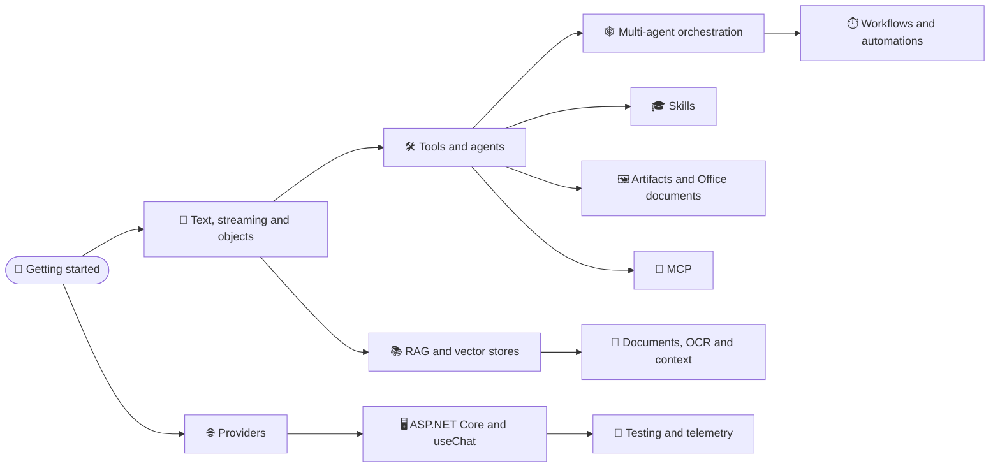

**English** · [Español](es-Inicio)

# Welcome to the AiSdk.Net wiki 👋

**AiSdk.Net** is the open-source AI and agents SDK for **.NET 10**, created by
**Esteban Cortes** ([@ecr17dev](https://github.com/ecr17dev)). One provider-agnostic API for text, streaming,
typed objects, tools, agents, multi-agent orchestration, RAG, Skills, durable workflows and MCP.

> [!TIP]
> New here? Read [Getting started](Getting-Started), run `dotnet run --project samples/QuickStart -- mock agent`
> (no API key needed) and then explore the guides below.

## 🗺️ Map of the documentation

## 📖 Guides

| | Guide | What you will learn |
|:---:|---|---|
| 🚀 | [Getting started](Getting-Started) | Packages, installation and running the samples |
| 💬 | [Text, streaming and objects](Text-Streaming-and-Objects) | `GenerateTextAsync`, `StreamText`, typed objects with JSON Schema |
| 🛠️ | [Tools and agents](Tools-and-Agents) | The tool loop, `ToolLoopAgent`, class-based agents, approvals, callbacks |
| 🕸️ | [Multi-agent orchestration](Multi-Agent-Orchestration) | Chains, parallel, router, supervisor, handoffs, evaluator-optimizer |
| 🎓 | [Skills](Skills) | Agent Skills: load, create, validate and run skills; Anthropic Skills |
| 🖼️ | [Artifacts and Office documents](Artifacts-and-Office-Documents) | Claude-like artifacts and Word, PDF and Excel generation |
| ⏱️ | [Workflows and automations](Workflows-and-Automations) | Durable steps, sleeps, approvals, cron, events and webhooks |
| 📚 | [RAG and vector stores](RAG-and-Vector-Stores) | Chunking, filters, hybrid search, reranking, pgvector, VectorData |
| 🔎 | [Documents, OCR and context](Documents-OCR-and-Context) | Any file to Markdown, OCR, models without vision, compression |
| 🔌 | [MCP](MCP) | Model Context Protocol client: tools, resources, prompts, sampling |
| 🌐 | [Providers](Providers) | OpenAI, Claude, Gemini, Mistral, Bedrock, Cohere, registry, middleware |
| 🖥️ | [ASP.NET Core and useChat](ASP.NET-Core-and-useChat) | Backend for AI SDK UI, resumable streams, Microsoft.Extensions.AI |
| 🧪 | [Testing and telemetry](Testing-and-Telemetry) | `MockLanguageModel`, live tests, OpenTelemetry |

## 📌 Reference

| | Page |
|:---:|---|
| 🏛️ | [Architecture](Architecture) |
| 🔁 | [Feature map (Vercel AI SDK / Laravel AI)](Feature-Map) |
| ✅ | [Quality](Quality) |
| 🗺️ | [Roadmap](Roadmap) |
| ❓ | [FAQ](FAQ) |

## 🤝 Contribute

Found a typo or want to improve a page? The wiki is generated from
[`docs/wiki`](https://github.com/bluesmilecl/AiSdk.Net/tree/HEAD/docs/wiki) in the main repository:
open a pull request there (see [CONTRIBUTING.md](https://github.com/bluesmilecl/AiSdk.Net/blob/HEAD/CONTRIBUTING.md)).
