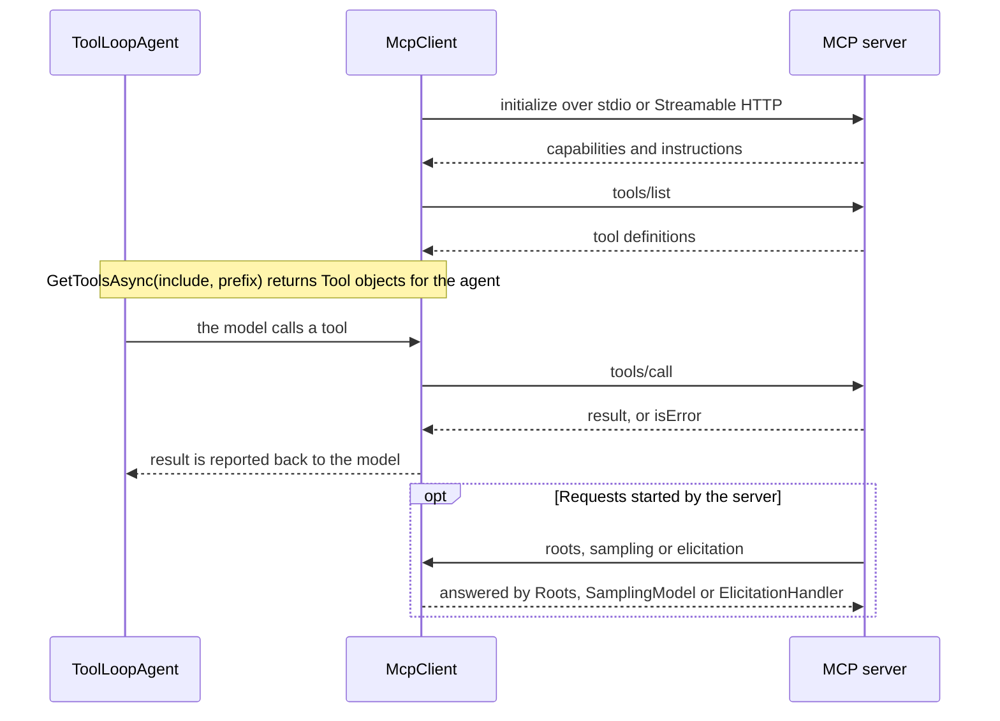

# MCP (Model Context Protocol)

> 🇪🇸 [Leer en español](es-MCP)



```csharp
using AiSdk.Mcp;

// stdio: launches the server as a process
await using var files = await McpClient.ConnectAsync(
    new StdioMcpTransport("npx", ["-y", "@modelcontextprotocol/server-filesystem", "/data"]));

// Streamable HTTP (with authentication headers); handles Mcp-Session-Id automatically
await using var remote = await McpClient.ConnectAsync(
    new HttpMcpTransport("https://mcp.example.com/mcp", new Dictionary<string, string> { ["Authorization"] = "Bearer ..." }));

List<Tool> tools = [.. await files.GetToolsAsync(), .. await remote.GetToolsAsync(prefix: "remote_")];
var agent = new ToolLoopAgent(new AgentSettings { Model = model, Tools = tools, Instructions = files.Instructions });
```

Besides tools: `ListResourcesAsync`, `ReadResourceAsync` / `ReadResourceAsPartsAsync`,
`ListResourceTemplatesAsync`, `ListPromptsAsync` and `GetPromptAsync` (returns ready-to-use `ModelMessage`s).
With `McpClientOptions` the client also handles requests from the server: `Roots`, `SamplingModel`
(the server generates text with one of your models) and `ElicitationHandler` (asks the user for data).

`GetToolsAsync(include, prefix)` filters tools and avoids name collisions. If an MCP tool
returns `isError`, the error is reported to the model. `ListToolsAsync`, `CallToolAsync` and
`SendRequestAsync` are also available for direct use.

> [!TIP]
> Use a different `prefix` for each server when you combine several MCP servers, so that two tools with the same name never collide.

---

**Next:** [Providers](Providers) ➡️
