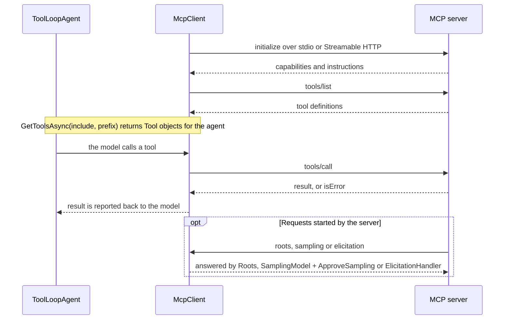

# MCP (Model Context Protocol)

> 🇪🇸 [Leer en español](es-MCP)



```csharp
using AiSdk.Mcp;

// stdio: launches the server as a process
await using var files = await McpClient.ConnectAsync(
    new StdioMcpTransport("npx", ["-y", "@modelcontextprotocol/server-filesystem", "/data"]));

// Streamable HTTP (with authentication headers); handles Mcp-Session-Id automatically
await using var remote = await McpClient.ConnectAsync(
    new HttpMcpTransport("https://mcp.example.com/mcp", new Dictionary<string, string> { ["Authorization"] = "Bearer ..." }));

List<Tool> tools = [.. await files.GetToolsAsync(), .. await remote.GetToolsAsync(prefix: "remote_")];
var agent = new ToolLoopAgent(new AgentSettings { Model = model, Tools = tools, Instructions = files.Instructions });
```

Besides tools: `ListResourcesAsync`, `ReadResourceAsync` / `ReadResourceAsPartsAsync`,
`ListResourceTemplatesAsync`, `ListPromptsAsync` and `GetPromptAsync` (returns ready-to-use `ModelMessage`s).
With `McpClientOptions` the client also handles requests from the server: `Roots`, `SamplingModel` + `ApproveSampling`
(the server generates text with one of your models, with the user's consent) and `ElicitationHandler` (asks the user for data).

`GetToolsAsync(include, prefix, existingTools)` filters tools and avoids name collisions. If an MCP tool
returns `isError`, the error is reported to the model. `ListToolsAsync`, `CallToolAsync` and
`SendRequestAsync` are also available for direct use.

> [!TIP]
> Use a different `prefix` (or `McpClientOptions.ToolNamePrefix`) for each server when you combine several MCP servers, and pass the other tools in `existingTools`: a name collision then fails right away with a clear error instead of being rejected by the provider.

## 🔒 Security

An MCP server is third-party code: treat its tools, descriptions and requests as untrusted input.

**stdio servers get a minimal environment.** `StdioMcpTransport` no longer passes the host's whole environment
(API keys, connection strings...). The child process only receives `StdioMcpTransport.DefaultInheritedVariables`
(`HOME, LOGNAME, PATH, SHELL, TERM, USER` on Linux/macOS; `APPDATA, HOMEDRIVE, HOMEPATH, LOCALAPPDATA, PATH,
PROCESSOR_ARCHITECTURE, SYSTEMDRIVE, SYSTEMROOT, TEMP, USERNAME, USERPROFILE` on Windows), the names in
`InheritedVariables` and the variables you pass explicitly. `InheritEnvironment = true` restores the old behaviour:
use it only with servers you trust.

```csharp
new StdioMcpTransport("npx", ["-y", "@acme/mcp-server"], new Dictionary<string, string> { ["ACME_TOKEN"] = token })
{
    InheritedVariables = ["HTTPS_PROXY", "NODE_EXTRA_CA_CERTS"],   // extra host variables the server may see
};
```

**Sampling needs the user's consent.** A bare `SamplingModel` is rejected by `ConnectAsync`: every
`sampling/createMessage` goes through `ApproveSampling`, which shows the server's system prompt and messages and returns
the request to run (possibly edited) or `null` to reject it. `ReviewSamplingResult` can review the answer before it is
sent back. The server's `maxTokens` is capped at `MaxSamplingTokens` (4096), at most `MaxConcurrentServerRequests` (4)
server requests run at once (the rest get an error), and the server only receives generic error messages (the details
go to the `ServerRequestFailed` event). A custom `SamplingHandler` owns the consent itself; throw
`McpRequestRejectedException` to reject.

```csharp
await using var mcp = await McpClient.ConnectAsync(transport, new McpClientOptions
{
    SamplingModel = model,
    ApproveSampling = async (request, ct) =>
        await ui.ConfirmAsync($"The server wants to use the model:\n{request.SystemPrompt}", ct) ? request : null,
});
```

**Robust HTTP.** `RequestTimeout` covers the whole request, including reading the response body; responses and SSE
events larger than `HttpMcpTransport.MaxMessageBytes` (16 MiB) are rejected; a broken or malformed SSE stream fails the
pending request immediately; `DisposeAsync` never throws and always closes the session (`DELETE`). Paginated listings
stop on a repeated cursor and after `MaxListPages` (100) pages. Over **stdio**, a line longer than
`StdioMcpTransport.MaxMessageBytes` (16 MiB) is discarded without buffering it, stderr lines passed to `OnStderr` are cut
at 64 KiB, and the message queue is bounded (a server that floods stdout blocks instead of filling memory).

> [!NOTE]
> **Roots and sampling are experimental (`AISDKMCP001`).** The MCP specification 2026-07-28 deprecates roots, sampling
> and logging (they remain for at least 12 months) and moves to a stateless protocol. The SDK keeps supporting them for
> 2025-11-25 servers, but `Roots`, `SetRootsAsync`, `SamplingModel`, `SamplingHandler`, `ApproveSampling` and related
> types may change before 1.0: using them produces the `AISDKMCP001` diagnostic (suppress it with
> `<NoWarn>$(NoWarn);AISDKMCP001</NoWarn>`). Tools, resources and prompts are stable.

**Tools are pinned.** The first time a tool is listed, the client stores a SHA-256 hash of its definition (name, title,
description, input schema and annotations). If a later listing returns a different definition (a "rug pull"),
`ToolDefinitionChanged` fires and, with the default `ToolChangePolicy = Reject`, the tool is flagged
(`McpToolInfo.DefinitionChanged`), omitted by `GetToolsAsync` and `CallToolAsync` refuses to call it. Save
`client.ToolHashes` and pass them back in `PinnedToolHashes` to detect changes across connections. Set
`RequireToolApproval = true` to make every tool of a server require human approval (`OnToolApproval`).

> [!WARNING]
> Tool descriptions reach the model verbatim and can contain hidden instructions ("tool poisoning"). Only connect
> servers you trust, review their tools before the first use (pinning protects what you approved, not what you never
> looked at) and require approval for tools with side effects.

---

**Next:** [Providers](Providers) ➡️
