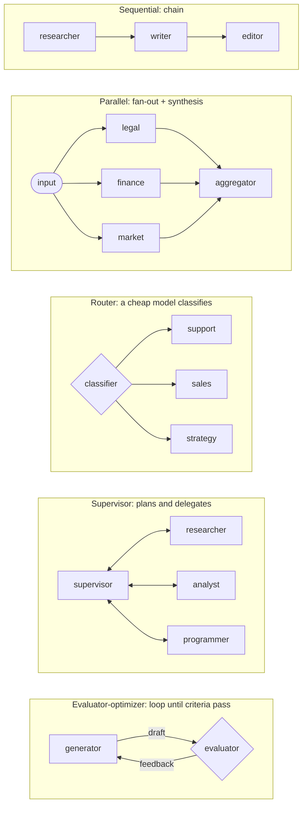

# Multi-agent orchestration

> 🇪🇸 [Leer en español](es-Orquestacion-multi-agente)

Ready-made patterns (see Anthropic's *Building effective agents*). Every agent and orchestration is an
`IOrchestrationNode`: they nest, can be exposed as a tool (`AsTool`) and run as steps of a workflow.



> [!NOTE]
> `Handoffs` is not drawn above: there, agents hand the conversation over to one another (e.g. `triage` → `sales` → `billing`) instead of being called by a coordinator.

```csharp
var team = Orchestrations.Parallel([legal, finance, market], aggregator: director);    // fan-out + synthesis
var pipeline = Orchestrations.Sequential(researcher, writer, editor);                   // chain
var router = Orchestrations.Router(cheapModel, support, sales, team.Named("strategy", "Business questions"));
var boss = Orchestrations.Supervisor(claude, researcher, analyst, programmer);          // plans and delegates (in parallel)
var chat = Orchestrations.Handoffs(triage, sales, billing);                             // they hand the conversation over
var reviewed = Orchestrations.EvaluatorOptimizer(writer, evaluator, "Formal tone, no errors, max. 200 words");

var result = await router.RunAsync("Should we open in Lima?", new OrchestrationOptions
{
    OnEvent = e => { Console.WriteLine(e); return ValueTask.CompletedTask; },   // agent start/end, routes, handoffs...
});
Console.WriteLine($"{result.Text} — {result.TotalUsage.TotalTokens} tokens, {result.Runs.Count} calls");

// Functions as steps, and orchestrations as tools of another agent
var clean = OrchestrationNodes.Function("clean", text => text.Trim());
var agent = new ToolLoopAgent(new() { Model = claude, Tools = [team.AsTool("committee", "Consults the committee")] });

// Handoffs inside an existing chat (continues with the appropriate agent)
var turn = await chat.RunAsync(history, startAgent: "triage");
```

> [!TIP]
> Orchestrations are nodes too, so you can run them as durable steps of a workflow: see [Workflows and automations](Workflows-and-Automations).

---

➡️ Next: [Skills](Skills)
