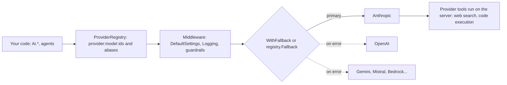

# Providers

> 🇪🇸 [Leer en español](es-Proveedores)



## Middleware and provider registry

```csharp
var model = AnthropicProvider.Default.Messages("claude-opus-5-5")
    .WithMiddleware(
        Middlewares.DefaultSettings(maxOutputTokens: 4000),
        Middlewares.Logging(Console.WriteLine),
        new MyGuardrailMiddleware());   // implements ILanguageModelMiddleware

var registry = new ProviderRegistry()
    .Register(AnthropicProvider.Default)
    .Register(OpenAIProvider.Default)
    .Alias("fast", "anthropic:claude-haiku-5-5");

var m = registry.LanguageModel("openai:gpt-5");
```

## Provider tools and sources

These are executed by the provider on its server, and the results arrive in the same response. The loop does not
execute them locally; the calls and results are kept in `result.Steps` with `ProviderExecuted = true`.

```csharp
// Claude
var result = await Ai.GenerateTextAsync(new GenerateTextOptions
{
    Model = anthropic.Messages("claude-opus-5-5"),
    Prompt = "What's new in .NET 10?",
    Tools = [AnthropicTools.WebSearch(maxUses: 3, allowedDomains: ["learn.microsoft.com"]), AnthropicTools.WebFetch()],
});

// OpenAI (Responses API)
var result2 = await Ai.GenerateTextAsync(new GenerateTextOptions
{
    Model = openai.Responses("gpt-5"),
    Prompt = "...",
    Tools = [OpenAITools.WebSearch(searchContextSize: "medium"), OpenAITools.CodeInterpreter()],
});

foreach (var source in result.Sources)
    Console.WriteLine($"{source.Title}: {source.Url}");
```

Available: `AnthropicTools.WebSearch`, `WebFetch`, `CodeExecution`, `ServerTool(type, name)`;
`OpenAITools.WebSearch`, `CodeInterpreter`, `FileSearch`, `ServerTool(type, name)`. With Claude, when the
API responds with `pause_turn` (a server tool needs more time), the provider continues the turn
automatically. Sources reach the frontend as `source-url` parts of the `useChat` protocol.

## More providers

```csharp
var gemini  = GoogleProvider.Default.Gemini("gemini-2.5-flash");            // GEMINI_API_KEY
var mistral = MistralProvider.Default.Chat("mistral-large-latest");         // MISTRAL_API_KEY
var nova    = BedrockProvider.Default.Converse("amazon.nova-pro-v1:0");     // AWS_REGION + AWS_BEARER_TOKEN_BEDROCK or AWS credentials
var claudeBedrock = new BedrockProvider(o => { o.Region = "us-east-1"; o.CredentialsProvider = MyCredentialsAsync; })
    .Converse("us.anthropic.claude-sonnet-4-5-20250929-v1:0");

Tools = [GoogleTools.GoogleSearch(), GoogleTools.CodeExecution(), GoogleTools.UrlContext()];
ProviderOptions = GoogleOptions.Create(thinkingBudget: 2048, includeThoughts: true);

var image = await Ai.GenerateImageAsync(new() { Model = GoogleProvider.Default.Image("imagen-4.0-generate-001"), Prompt = "...", AspectRatio = "16:9" });
```

Bedrock signs requests with AWS SigV4 (or uses the Bedrock API key) and reads the binary
`event-stream` format when streaming, without depending on the AWS SDK.

## Images, speech and transcription

```csharp
var image = await Ai.GenerateImageAsync(new GenerateImageOptions
{
    Model = openai.Image("gpt-image-1"), Prompt = "A robot programming in C#", Size = "1024x1024", N = 2,
});
await image.Image.SaveAsync("robot.png");

var speech = await Ai.GenerateSpeechAsync(new GenerateSpeechOptions
{
    Model = openai.Speech("gpt-4o-mini-tts"), Text = "Hello from .NET", Voice = "nova", Instructions = "Cheerful tone",
});

var transcript = await Ai.TranscribeAsync(new TranscribeOptions
{
    Model = openai.Transcription("whisper-1"), Audio = await File.ReadAllBytesAsync("audio.mp3"), Language = "es",
});
Console.WriteLine(transcript.Text);   // and transcript.Segments with timings (whisper-1)
```

The `IImageModel`, `ISpeechModel` and `ITranscriptionModel` interfaces let you add other providers;
the registry resolves them with `registry.ImageModel("openai:gpt-image-1")`, etc.

## Token counting, batches and files

```csharp
// Input tokens before sending (Anthropic, OpenAI Responses, Gemini)
int tokens = await Ai.CountTokensAsync(new GenerateTextOptions { Model = model, Prompt = "...", Tools = [weather] });

// Asynchronous batches at half price (Anthropic Message Batches or OpenAI Batch API)
IBatchClient batches = anthropic.Batches("claude-opus-5-5");     // or openai.Batches("gpt-5")
var job = await batches.CreateAsync([await options.ToBatchItemAsync("order-1"), ...]);
await batches.WaitForCompletionAsync(job.Id);
await foreach (var item in batches.GetResultsAsync(job.Id))
    Console.WriteLine($"{item.CustomId}: {item.Text}");

// Files API: upload once and reference by id
var file = await anthropic.Files.UploadAsync(bytes, "contract.pdf", "application/pdf");
var reply = await Ai.GenerateTextAsync(new() { Model = model, Messages = [ModelMessage.User(FilePart.FromFileId(file.Id), new TextPart("Summarize"))] });

// OpenAI vector stores for the FileSearch tool
var vs = await openai.VectorStores.CreateAsync("docs");
await openai.VectorStores.UploadFileAsync(vs.Id, bytes, "guide.md", "text/markdown");
await openai.VectorStores.WaitUntilReadyAsync(vs.Id);
Tools = [OpenAITools.FileSearch([vs.Id])];
```

## Provider notes

**Anthropic (Claude)**
- `AnthropicOptions.Create(effort, thinkingDisplay, cacheControl, betas, refusalFallback)` builds the most
  common options (`output_config.effort`, `thinking: {type: "adaptive"}`, automatic caching, `fallbacks: "default"`).
- Reasoning blocks are kept with their signature (`ProviderMetadata["anthropic.signature"]`) and
  sent back unchanged in the following turns.
- Recent Claude models reject `Temperature`/`TopP`/`TopK` and forced `ToolChoice`
  (`Required`/`Tool`); use `ToolChoice.Auto` and control effort with `effort`.
- When streaming, `eager_input_streaming: true` is sent on tools (configurable with
  `AnthropicProviderOptions.EagerInputStreaming`).

**OpenAI and compatible servers**
- `openai.Responses("gpt-5")` uses the Responses API (recommended): server tools, reasoning
  summaries and citations. `openai.Chat(...)` uses Chat Completions, which is what compatible servers
  implement. `registry.LanguageModel("openai:...")` picks Responses for OpenAI and Chat for compatible servers.
- `OpenAIOptions.Create(reasoningEffort, reasoningSummary, store, parallelToolCalls, serviceTier, user)`;
  with `store: false`, encrypted reasoning is requested so it can be sent back in the following turns.
- `ProviderOptions["openai"]` is merged into the request body.
- `UseLegacyMaxTokens = true` for servers that only accept `max_tokens`.

**Google Gemini**
- Reasoning signatures (`thoughtSignature`) are kept and sent back together with function calls.
- Structured output uses `responseJsonSchema`; tools use `parametersJsonSchema`.
- `GoogleOptions.Create(thinkingBudget, includeThoughts, thinkingLevel, safetySettings)`.

**Mistral**: `max_tokens`, `random_seed`, `tool_choice: "any"` and Magistral `thinking` blocks are handled automatically.

**Amazon Bedrock**: Converse has no universal JSON mode; structured output is requested with a system
instruction and validated when parsing. Model-specific options go in
`ProviderOptions["bedrock"]["additionalModelRequestFields"]`.

> [!TIP]
> Any provider-specific option can be passed through `ProviderOptions`, which is (deep-)merged
> into the JSON body of the request.

---

**Next:** [ASP.NET Core and useChat](ASP.NET-Core-and-useChat) ➡️
