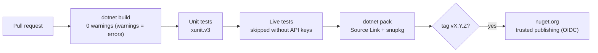

# ✅ Quality

> 🇪🇸 [Leer en español](es-Calidad)

AiSdk.Net follows the guidance of the official [dotnet/skills](https://github.com/dotnet/skills) to stay
professional and maintainable. Every item below is enforced by the build or CI, not just documented.



| Area | What we do | Report |
|---|---|---|
| 📦 Dependencies | **Central Package Management**: one version per package in `Directory.Packages.props` | [convert-to-cpm.md](https://github.com/bluesmilecl/AiSdk.Net/blob/HEAD/docs/quality/convert-to-cpm.md) |
| 🏗️ Build | Layered `Directory.Build.props` (root, `src/`, `tests/`): NuGet metadata, Source Link, symbols and XML docs in one place | |
| 🔍 Analyzers | `AnalysisLevel=latest-recommended`, `TreatWarningsAsErrors`: **0 warnings** | |
| 🧪 Tests | 550+ unit tests on **xunit.v3**, `TestContext.Current.CancellationToken`, explicit skips | |
| 🕵️ Test audit | Anti-pattern audit (timing races, clock and OS dependencies, permissive assertions): all high findings fixed | [test-anti-patterns.md](https://github.com/bluesmilecl/AiSdk.Net/blob/HEAD/docs/quality/test-anti-patterns.md) |
| 🌍 Live validation | `LiveFeatureTests` run skills, router, artifacts + Excel and map-reduce summaries against real models | |
| 🔐 Releases | NuGet **trusted publishing** with OIDC, no long-lived API keys | [nuget-trusted-publishing.md](https://github.com/bluesmilecl/AiSdk.Net/blob/HEAD/docs/quality/nuget-trusted-publishing.md) |
| 🛡️ Supply chain | Actions pinned by commit SHA, read-only `GITHUB_TOKEN` by default, provider keys only on the default branch, SLSA provenance attestations for every `.nupkg` (`gh attestation verify`), NuGetAudit (high/critical vulnerabilities fail the build), CodeQL and OpenSSF Scorecard | [`.github/workflows`](https://github.com/bluesmilecl/AiSdk.Net/tree/HEAD/.github/workflows) |

## Versioning and compatibility

- **Semantic Versioning from 1.0.** Minor and patch releases never break the public API; breaking changes wait for
  the next major version and are announced with `[Obsolete]` at least one minor release before.
- **The public API is tracked** with `Microsoft.CodeAnalysis.PublicApiAnalyzers`: every project has
  `PublicAPI.Shipped.txt` (what was released) and `PublicAPI.Unshipped.txt` (what the next release adds). The build
  fails if a public member changes without updating them, so no change slips in by accident.
- **Not covered by the guarantee:**
  - APIs marked `[Experimental]` (for example `AISDKMCP001`, MCP roots and sampling): they can change in a minor release.
  - Types in `AiSdk.Internal` (`JsonUtil`, `StreamAccumulator`): public for provider packages, but they can change.
  - The text of messages (exceptions, warnings, texts sent to the model): they are localized (English, Spanish) and
    can be reworded. Do not parse them.
  - Telemetry follows the OpenTelemetry GenAI semantic conventions, which are still in development upstream:
    attribute changes follow them and are listed in `CHANGELOG.md`.
- **Supported platform:** .NET 10. Security fixes go to the latest 1.x release (see `SECURITY.md`).

## Run the checks locally

```bash
dotnet build AiSdk.slnx            # must finish with 0 warnings
dotnet test tests/AiSdk.Tests
OPENAI_API_KEY=... dotnet test tests/AiSdk.IntegrationTests   # optional live tests
```

---

**Next:** [Roadmap](Roadmap) ➡️
