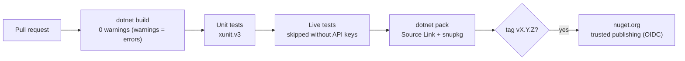

# ✅ Quality

> 🇪🇸 [Leer en español](es-Calidad)

AiSdk.Net follows the guidance of the official [dotnet/skills](https://github.com/dotnet/skills) to stay
professional and maintainable. Every item below is enforced by the build or CI, not just documented.



| Area | What we do | Report |
|---|---|---|
| 📦 Dependencies | **Central Package Management**: one version per package in `Directory.Packages.props` | [convert-to-cpm.md](https://github.com/bluesmilecl/sdk-agent-ia-net/blob/HEAD/docs/quality/convert-to-cpm.md) |
| 🏗️ Build | Layered `Directory.Build.props` (root, `src/`, `tests/`): NuGet metadata, Source Link, symbols and XML docs in one place | |
| 🔍 Analyzers | `AnalysisLevel=latest-recommended`, `TreatWarningsAsErrors`: **0 warnings** | |
| 🧪 Tests | 200+ unit tests on **xunit.v3**, `TestContext.Current.CancellationToken`, explicit skips | |
| 🕵️ Test audit | Anti-pattern audit (timing races, clock and OS dependencies, permissive assertions): all high findings fixed | [test-anti-patterns.md](https://github.com/bluesmilecl/sdk-agent-ia-net/blob/HEAD/docs/quality/test-anti-patterns.md) |
| 🌍 Live validation | `LiveFeatureTests` run skills, router, artifacts + Excel and map-reduce summaries against real models | |
| 🔐 Releases | NuGet **trusted publishing** with OIDC, no long-lived API keys | [nuget-trusted-publishing.md](https://github.com/bluesmilecl/sdk-agent-ia-net/blob/HEAD/docs/quality/nuget-trusted-publishing.md) |

## Run the checks locally

```bash
dotnet build AiSdk.slnx            # must finish with 0 warnings
dotnet test tests/AiSdk.Tests
OPENAI_API_KEY=... dotnet test tests/AiSdk.IntegrationTests   # optional live tests
```

---

**Next:** [Roadmap](Roadmap) ➡️
