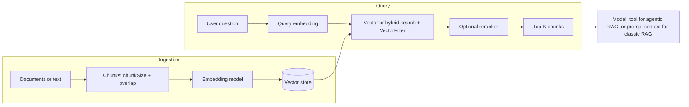

# RAG and Vector Stores

> 🇪🇸 [Leer en español](es-RAG-y-almacenes-vectoriales)



## RAG: vector store and reranking

```csharp
var store = new InMemoryVectorStore(openai.Embedding("text-embedding-3-small"));   // or your own IVectorStore (pgvector, Qdrant...)
await store.AddTextsAsync([("manual", File.ReadAllText("manual.md"))], chunkSize: 1000, overlap: 100);

// Agentic RAG: the agent searches when it needs to (with optional reranking)
var agent = new ToolLoopAgent(new AgentSettings
{
    Model = model,
    Tools = [store.AsTool(topK: 5, reranker: CohereProvider.Default.Reranking())],
});

// Classic RAG: context in the prompt
var context = await store.BuildContextAsync("How do I install it?");

// Direct reranking (Cohere, or EmbeddingRerankingModel with any embedding model)
var ranked = await Ai.RerankAsync(CohereProvider.Default.Reranking(), "capital of Chile", documents, topN: 3);
```

**Metadata filters** (each store translates them into its own language: SQL, Qdrant filters, OData…):

```csharp
var filter = VectorFilter.Eq("type", "manual") & (VectorFilter.In("country", "CL", "PE") | !VectorFilter.Exists("country"));
var hits = await store.SearchAsync("warranty", topK: 5, filter: filter);
var tool = store.AsTool(filter: VectorFilter.Eq("customer", customerId));   // multi-tenant
```

> [!TIP]
> Passing a `VectorFilter` to `AsTool` is an easy way to isolate tenants: the model can never search outside the filter.

**PostgreSQL + pgvector** (`AiSdk.PgVector`): creates the table and indexes (HNSW, GIN) automatically, and offers
hybrid search, which finds codes, names and acronyms that embeddings miss:

```csharp
await using var store = PgVectorStore.Create(connectionString, embeddings, new PgVectorStoreOptions
{
    Dimensions = 1536,
    Table = "documents",
    TextSearchConfig = "spanish",   // PostgreSQL text search configuration (e.g. "english", "spanish")
});
var hits = await store.HybridSearchAsync("error SKU-77812", topK: 5);
await store.DeleteWhereAsync(VectorFilter.Eq("source", "old-manual.pdf"));
var tool = store.AsTool(hybrid: true);
```

Filters run in SQL and equalities use the GIN metadata index (`metadata @> '{"key":"value"}'`). The HNSW index returns
at most `hnsw.ef_search` candidates (40 by default) and filters afterwards, so a selective filter (one user, one
tenant) could leave a search with fewer results than requested, or none. With `FilteredSearch = Auto` (the default),
when that happens the same query switches to an exact search over the rows that match the filter. `Approximate` keeps
only the HNSW index (fastest) and `Exact` always searches exactly over the filtered rows.

**Qdrant, Pinecone, Azure AI Search, Redis, Weaviate…** (`AiSdk.VectorData`): a single adapter over
Microsoft.Extensions.VectorData works with all of its connectors. Metadata used for filtering is
declared in `FilterableFields`:

```csharp
var qdrant = new QdrantVectorStore(new QdrantClient("localhost"), ownsClient: true);
var store = new VectorDataStore(qdrant, embeddings, new VectorDataStoreOptions
{
    CollectionName = "documents",
    Dimensions = 1536,
    FilterableFields = ["type", "country", "source"],
});
```

---

**Next:** [Documents, OCR and Context](Documents-OCR-and-Context) ➡️
