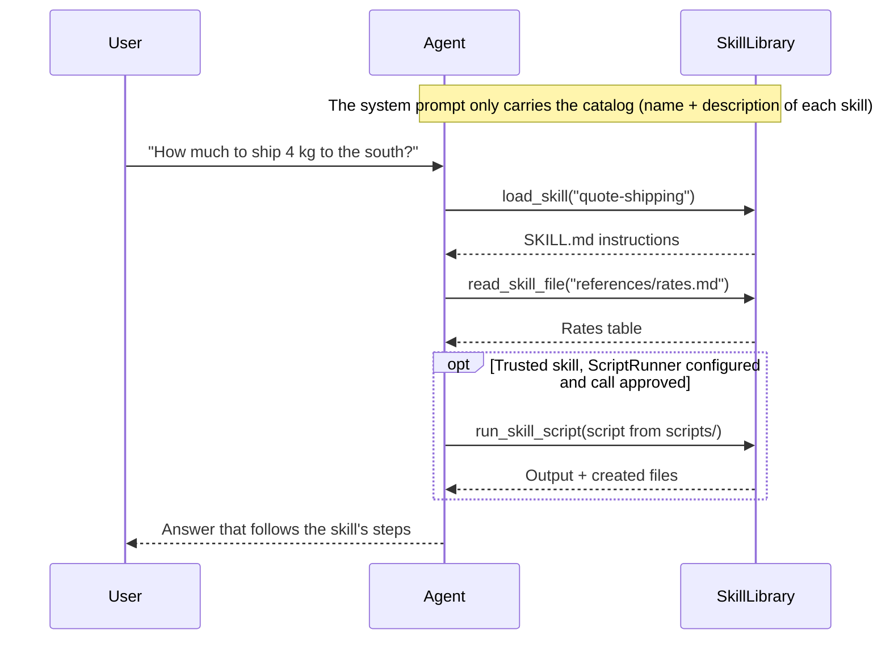

# Skills (Agent Skills)

> 🇪🇸 [Leer en español](es-Skills)

A skill is a folder with a `SKILL.md` (frontmatter `name` + `description` and Markdown instructions) and
optional files in `references/`, `scripts/` and `assets/`. It is the same format used by Claude Code,
GitHub Copilot and [dotnet/skills](https://github.com/dotnet/skills). The agent only sees the catalog (name and
description) and loads the rest when it needs it (`load_skill`, `read_skill_file`).

## 🪜 Progressive disclosure



## 🧩 Usage

```csharp
var library = new SkillLibrary();
library.LoadDirectory("skills", new SkillLoadOptions { Trusted = true });             // your skills
await library.LoadFromGitHubAsync("dotnet/skills", path: "plugins/dotnet-test");      // third-party (untrusted)

library.Add(new SkillBuilder("quote-shipping")
    .WithDescription("Calculates the cost of domestic shipments. USE FOR: shipping quotes, rates by weight.")
    .WithInstructions("# Quote shipping\n\n1. Ask for weight and region.\n2. Read [rates](references/rates.md).")
    .AddFile("references/rates.md", "| Region | Base | Per kg |\n|---|---|---|\n| RM | $3,000 | $500 |")
    .Build());                                                                         // untrusted unless Build(trusted: true)

var agent = new ToolLoopAgent(new AgentSettings
{
    Model = model,
    Skills = library,                                                                  // catalog + tools
    SkillOptions = new SkillToolOptions { ScriptRunner = new ProcessSkillScriptRunner() },  // scripts: opt-in, trusted only
    OnToolApproval = req => AskOperatorAsync(req.ToolCall),                            // each run_skill_script is approved
});

var prompt = library.TryInvokeSlashCommand("/quote-shipping 4 kg to the south");     // user commands
```

- **Validation** with the standard's rules (`SkillValidator.Validate`), size limits and safe paths;
  `Strict = false` accepts third-party skills with minor deviations.
- **Authoring skills:** `SkillLibrary.SaveAsync` / `PackAsync` (zip), `SkillGenerator.GenerateAsync(model, goal)`
  and the `create_skill` / `validate_skill` tools (`SkillAuthoringTools.Create`) so an agent can write its own.
- **DI and ASP.NET Core:** `services.AddAiSdk(ai => ai.AddSkills("skills"))` and `app.MapSkills()` (catalog, detail, zip);
  the endpoints require authorization by default (`new SkillEndpointOptions { AllowAnonymous = true }` to opt out).
- **Anthropic:** container Skills (`AnthropicSkills.Options([AnthropicSkill.Excel, AnthropicSkill.Custom(id)])`),
  download of generated files (`GetGeneratedFileIds` + `Files.DownloadAsync`) and the `/v1/skills` API (`anthropic.Skills`).
- The repository includes `skills/aisdk-net`, a skill that teaches a coding agent how to use this SDK.

## 🔐 Trust and security

- **Trust is explicit.** Third-party skills (GitHub, zip) load as untrusted; `LoadDirectory(dir, new() { Trusted = true })`,
  `AddSkills(dir)` and `LoadEmbedded` trust your own folders, and `SkillBuilder.Build()` is untrusted unless you call
  `Build(trusted: true)`.
- **Provenance survives restarts.** Every skill written by `create_skill`, and any untrusted skill saved with
  `SkillLibrary.SaveAsync`, gets a `.aisdk-provenance.json` marker. A skill with that marker always loads as untrusted,
  even from a trusted folder, so a prompt injection cannot turn into trusted code after a restart. To trust it, review it
  and delete the marker. `create_skill` also rejects scripts (`scripts/`, `.py`, `.sh`, `.js`...), hidden files and
  existing folders unless you enable `SkillAuthoringOptions.AllowScripts` / `AllowOverwrite`.
- **No escapes through links.** Symbolic links and junctions inside a skill (files or folders, at any depth) are ignored,
  so `references/x.md → /etc/hostname` cannot be read with `read_skill_file`; hidden files are not readable either.
- **Scripts are opt-in and approved.** They need a `ScriptRunner`, a trusted skill (`AllowUntrustedScripts` stays off) and,
  by default, **approval of every `run_skill_script` call** through `OnToolApproval`: instructions from any skill, or the
  result of another tool, could steer the model into running a trusted script. Without a handler the call fails with an
  explicit error; set `SkillToolOptions.RequireScriptApproval = false` only for harmless scripts.
- **`ProcessSkillScriptRunner`** runs with a clean environment (no secrets), always kills the process tree (timeout, error or
  caller cancellation), reads at most `MaxOutputChars` of stdout/stderr and caps the returned files (`MaxCreatedFiles`,
  `MaxCreatedFileBytes`, `MaxCreatedTotalBytes`; links and the rest are listed in `OmittedFiles`). It is not a sandbox:
  run third-party scripts in a container (implement `ISkillScriptRunner`).
- **Loading is isolated and bounded.** A later load never silently replaces a skill with the same name: the first one is
  kept and the conflict is reported in `LoadErrors` (`SkillLoadOptions.ReplaceExisting = true` to reload on purpose).
  Each broken skill fails on its own, and zips / GitHub downloads are capped (`MaxArchiveBytes`, `MaxArchiveExtractedBytes`,
  `MaxFileBytes`, `MaxFiles`).

> [!WARNING]
> Only configure a `ScriptRunner` for skills you trust, keep `AllowUntrustedScripts` off for third-party skills and keep
> script approval on unless the scripts are harmless with any argument.

---

➡️ Next: [Artifacts and Office documents](Artifacts-and-Office-Documents)
