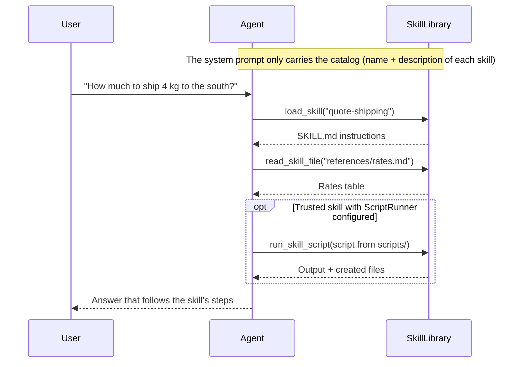

# Skills (Agent Skills)

> 🇪🇸 [Leer en español](es-Skills)

A skill is a folder with a `SKILL.md` (frontmatter `name` + `description` and Markdown instructions) and
optional files in `references/`, `scripts/` and `assets/`. It is the same format used by Claude Code,
GitHub Copilot and [dotnet/skills](https://github.com/dotnet/skills). The agent only sees the catalog (name and
description) and loads the rest when it needs it (`load_skill`, `read_skill_file`).

## 🪜 Progressive disclosure



## 🧩 Usage

```csharp
var library = new SkillLibrary();
library.LoadDirectory("skills", new SkillLoadOptions { Trusted = true });             // your skills
await library.LoadFromGitHubAsync("dotnet/skills", path: "plugins/dotnet-test");      // third-party (untrusted)

library.Add(new SkillBuilder("quote-shipping")
    .WithDescription("Calculates the cost of domestic shipments. USE FOR: shipping quotes, rates by weight.")
    .WithInstructions("# Quote shipping\n\n1. Ask for weight and region.\n2. Read [rates](references/rates.md).")
    .AddFile("references/rates.md", "| Region | Base | Per kg |\n|---|---|---|\n| RM | $3,000 | $500 |")
    .Build());

var agent = new ToolLoopAgent(new AgentSettings
{
    Model = model,
    Skills = library,                                                                  // catalog + tools
    SkillOptions = new SkillToolOptions { ScriptRunner = new ProcessSkillScriptRunner() },  // scripts: opt-in, trusted only
});

var prompt = library.TryInvokeSlashCommand("/quote-shipping 4 kg to the south");     // user commands
```

- **Validation** with the standard's rules (`SkillValidator.Validate`), size limits and safe paths;
  `Strict = false` accepts third-party skills with minor deviations.
- **Authoring skills:** `SkillLibrary.SaveAsync` / `PackAsync` (zip), `SkillGenerator.GenerateAsync(model, goal)`
  and the `create_skill` / `validate_skill` tools (`SkillAuthoringTools.Create`) so an agent can write its own.
- **Scripts** run with a clean environment (no secrets), a timeout and capture of created files; untrusted skills
  run nothing unless `AllowUntrustedScripts` is set.
- **DI and ASP.NET Core:** `services.AddAiSdk(ai => ai.AddSkills("skills"))` and `app.MapSkills()` (catalog, detail, zip).
- **Anthropic:** container Skills (`AnthropicSkills.Options([AnthropicSkill.Excel, AnthropicSkill.Custom(id)])`),
  download of generated files (`GetGeneratedFileIds` + `Files.DownloadAsync`) and the `/v1/skills` API (`anthropic.Skills`).
- The repository includes `skills/aisdk-net`, a skill that teaches a coding agent how to use this SDK.

> [!WARNING]
> Script execution is opt-in: only configure a `ScriptRunner` for skills you trust, and keep `AllowUntrustedScripts` off for third-party skills.

---

➡️ Next: [Artifacts and Office documents](Artifacts-and-Office-Documents)
