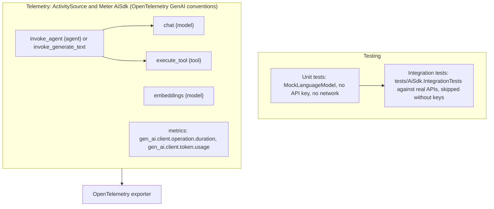

# Testing and Telemetry

> 🇪🇸 [Leer en español](es-Pruebas-y-telemetria)



## Testing

```csharp
var model = new MockLanguageModel()
    .ReturnsToolCall("get_weather", new { city = "Lima" })
    .ReturnsText("It's 21°C in Lima");

var result = await agent.GenerateAsync("...");
Assert.Equal(2, model.Requests.Count);
```

Integration tests against the real APIs live in `tests/AiSdk.IntegrationTests`: they run with
`dotnet test`, and each provider is skipped if its API key is not set (`ANTHROPIC_API_KEY`, `OPENAI_API_KEY`,
`GEMINI_API_KEY`, `MISTRAL_API_KEY`, `COHERE_API_KEY`, Bedrock with `AWS_REGION` + `AISDK_TEST_BEDROCK_MODEL`);
the model is changed with `AISDK_TEST_<PROVIDER>_MODEL` (e.g. `AISDK_TEST_OPENAI_MODEL=gpt-6-luna`). `LiveFeatureTests` validates
skills, skill generation, the router, artifacts + Excel and map-reduce compression with real models.
CI runs them with the repository secrets.

> [!NOTE]
> Current status: the OpenAI live tests pass (11 tests, including skills, router, artifacts and map-reduce).
> Anthropic, Gemini and Mistral are still pending. See the [Roadmap](Roadmap).

## Telemetry

AiSdk follows the [OpenTelemetry semantic conventions for generative AI](https://github.com/open-telemetry/semantic-conventions-genai),
so its traces and metrics show up in the Aspire dashboard, Grafana, Datadog, Azure Monitor and any other OpenTelemetry
backend without extra mapping. Spans come from the `ActivitySource` named `"AiSdk"` and metrics from the `Meter` named
`"AiSdk"` (both versioned with the package version). Nothing leaves your app until you wire OpenTelemetry:

```csharp
using AiSdk; // AiTelemetry

builder.Services.AddOpenTelemetry()
    .WithTracing(t => t.AddSource(AiTelemetry.SourceName))  // "AiSdk"
    .WithMetrics(m => m.AddMeter(AiTelemetry.MeterName));   // "AiSdk"
```

### Spans

An agent run with one tool call looks like this:

```text
invoke_agent support               Internal  (whole tool loop)
├── chat gpt-5                     Client    (step 1: the model asks for a tool)
├── execute_tool lookup_order      Internal
└── chat gpt-5                     Client    (step 2: final answer)
```

| Span | Kind | Emitted for | Main attributes |
| --- | --- | --- | --- |
| `invoke_agent {gen_ai.agent.name}` | Internal | The whole loop of an `Agent` or `ToolLoopAgent` (also in sessions, orchestrations and sub-agents used as tools) | `gen_ai.operation.name` = `invoke_agent`, `gen_ai.agent.name`, `gen_ai.agent.description`, `gen_ai.provider.name`, `gen_ai.request.model` (configured model), `gen_ai.conversation.id` (`AgentSession`), request parameters, `gen_ai.response.finish_reasons`, `gen_ai.usage.input_tokens` / `output_tokens` (totals) |
| `invoke_generate_text`, `invoke_stream_text`, `invoke_generate_object`, `invoke_stream_object` | Internal | The whole loop of `Ai.GenerateTextAsync`, `Ai.StreamText`, `Ai.GenerateObjectAsync` and `Ai.StreamObject` when no agent runs it | `gen_ai.operation.name` (same as the span name), `gen_ai.provider.name`, `gen_ai.request.model`, `gen_ai.response.finish_reasons`, total usage |
| `chat {gen_ai.request.model}` | Client | Each model call (one per step; retries are inside the span) | `gen_ai.operation.name` = `chat`, `gen_ai.provider.name`, `gen_ai.request.model`, `gen_ai.request.temperature`, `top_p`, `top_k`, `max_tokens`, `presence_penalty`, `frequency_penalty`, `stop_sequences`, `seed` (when set), `gen_ai.request.stream`, `gen_ai.output.type` (`json` for structured output), `gen_ai.response.id`, `gen_ai.response.model`, `gen_ai.response.finish_reasons`, `gen_ai.response.time_to_first_chunk` (streaming), `gen_ai.usage.input_tokens`, `gen_ai.usage.output_tokens`, `gen_ai.usage.cache_read.input_tokens`, `gen_ai.usage.reasoning.output_tokens`, `gen_ai.conversation.id` |
| `execute_tool {gen_ai.tool.name}` | Internal | Each tool that AiSdk runs locally | `gen_ai.operation.name` = `execute_tool`, `gen_ai.tool.name`, `gen_ai.tool.call.id`, `gen_ai.tool.type` = `function`, `gen_ai.tool.description`, `gen_ai.agent.name`, `gen_ai.conversation.id` |
| `embeddings {gen_ai.request.model}` | Client | Each embeddings call (`Ai.EmbedAsync`, every batch of `Ai.EmbedManyAsync`, vector stores) | `gen_ai.operation.name` = `embeddings`, `gen_ai.provider.name`, `gen_ai.request.model`, `gen_ai.usage.input_tokens` |

`gen_ai.agent.name` is the agent's `Name`. A `ToolLoopAgent` without a name reports no name (span `invoke_agent`), because
the default `"agent"` does not identify it.

`gen_ai.provider.name` uses the well-known values of the conventions:

| AiSdk provider id | `gen_ai.provider.name` |
| --- | --- |
| `openai` | `openai` |
| `anthropic` | `anthropic` |
| `google` | `gcp.gemini` |
| `bedrock` | `aws.bedrock` |
| `mistral` | `mistral` |
| `cohere` | `cohere` |
| `azure`, `vertex`, `xai`, `groq`, `deepseek`, `perplexity`, `ollama` | `azure.ai.openai`, `gcp.vertex_ai`, `x_ai`, `groq`, `deepseek`, `perplexity`, `ollama` |
| Anything else, e.g. `OpenAIProvider.Compatible("my-gateway", ...)` | The id itself (`my-gateway`) |

### Metrics

Recorded for every `chat` and `embeddings` call, with the bucket boundaries the conventions recommend (declared as
instrument advice, so the OpenTelemetry SDK applies them without a view):

| Metric | Instrument | Unit | Attributes |
| --- | --- | --- | --- |
| `gen_ai.client.operation.duration` | Histogram | `s` | `gen_ai.operation.name` (`chat`, `embeddings`), `gen_ai.provider.name`, `gen_ai.request.model`, `gen_ai.response.model`, `error.type` (only on failures) |
| `gen_ai.client.token.usage` | Histogram | `{token}` | The same, plus `gen_ai.token.type` (`input` or `output`). Only the counts the provider returns are recorded. |

### Errors

A failed operation ends its span with status `Error` (description: the exception message) and sets `error.type`, also on
the duration metric. `error.type` is the HTTP status code for provider errors (`ApiCallException`, also when wrapped in
`RetryException`), for example `429` or `500`, and the full name of the exception type otherwise (for example
`System.Net.Http.HttpRequestException` or `System.Threading.Tasks.TaskCanceledException` for a cancellation). Errors that a
retry recovered from are not recorded. A tool that throws marks only its `execute_tool` span: the model receives the
error and the loop goes on.

### Privacy

Message content is never recorded: no prompts, system instructions, chat history, model responses, tool arguments or tool
results (the opt-in attributes `gen_ai.input.messages`, `gen_ai.output.messages`, `gen_ai.system_instructions`,
`gen_ai.tool.definitions`, `gen_ai.tool.call.arguments` and `gen_ai.tool.call.result` are not emitted). Agent and tool
descriptions are recorded because they come from your code, and so is the exception message of a failed operation (span
status description): keep sensitive data out of the exceptions your tools throw.

### Conventions version

The span names and attributes match both the last GenAI conventions published in `semantic-conventions` (v1.41.0) and
the first release of the new `semantic-conventions-genai` repository (v0.1.0, status Development). The metrics keep the
v1.41.0 names (`gen_ai.client.operation.duration`, `gen_ai.client.token.usage`), which is what dashboards read today;
v0.1.0 renames them (`gen_ai.client.inference.duration`, `gen_ai.client.inference.operation.input_tokens`...).
`server.address` and `server.port` are not set on `chat` spans: add `AddHttpClientInstrumentation()` to get them on the
HTTP spans nested inside.

To assert on telemetry in your own tests, listen with an `ActivityListener` and a `MeterListener` filtered by the
`"AiSdk"` names (see `tests/AiSdk.Tests/TelemetryTests.cs`).

---

**Next:** [Feature Map](Feature-Map) ➡️
