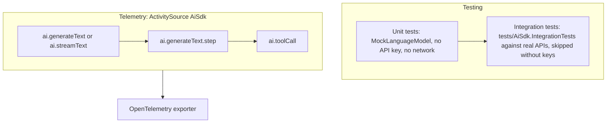

# Testing and Telemetry

> 🇪🇸 [Leer en español](es-Pruebas-y-telemetria)



## Testing

```csharp
var model = new MockLanguageModel()
    .ReturnsToolCall("get_weather", new { city = "Lima" })
    .ReturnsText("It's 21°C in Lima");

var result = await agent.GenerateAsync("...");
Assert.Equal(2, model.Requests.Count);
```

Integration tests against the real APIs live in `tests/AiSdk.IntegrationTests`: they run with
`dotnet test`, and each provider is skipped if its API key is not set (`ANTHROPIC_API_KEY`, `OPENAI_API_KEY`,
`GEMINI_API_KEY`, `MISTRAL_API_KEY`, `COHERE_API_KEY`, Bedrock with `AWS_REGION` + `AISDK_TEST_BEDROCK_MODEL`);
the model is changed with `AISDK_TEST_<PROVIDER>_MODEL` (e.g. `AISDK_TEST_OPENAI_MODEL=gpt-6-luna`). `LiveFeatureTests` validates
skills, skill generation, the router, artifacts + Excel and map-reduce compression with real models.
CI runs them with the repository secrets.

> [!NOTE]
> Current status: the OpenAI live tests pass (11 tests, including skills, router, artifacts and map-reduce).
> Anthropic, Gemini and Mistral are still pending. See the [Roadmap](Roadmap).

## Telemetry

Every call emits an `Activity` on the `"AiSdk"` source (`ai.generateText`, `ai.streamText`,
`ai.generateText.step`, `ai.toolCall`):

```csharp
builder.Services.AddOpenTelemetry().WithTracing(t => t.AddSource(AiTelemetry.SourceName));
```

---

**Next:** [Feature Map](Feature-Map) ➡️
