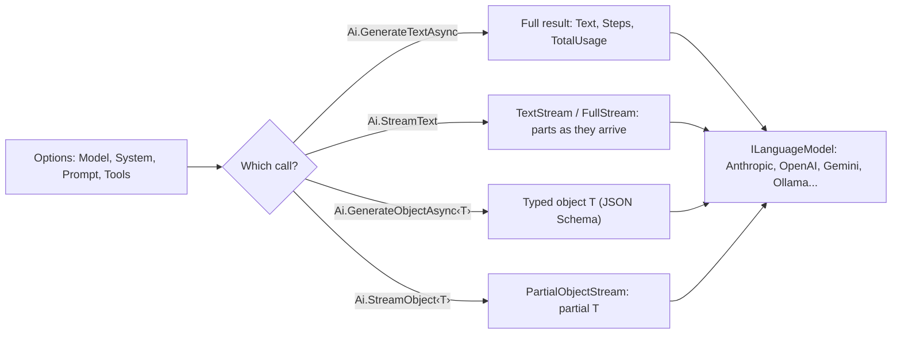

# Text, streaming and typed objects

> 🇪🇸 [Leer en español](es-Texto-streaming-y-objetos)



## ✍️ Generating text

```csharp
using AiSdk;
using AiSdk.Anthropic;

var model = AnthropicProvider.Default.Messages("claude-opus-5-5"); // ANTHROPIC_API_KEY

var result = await Ai.GenerateTextAsync(new GenerateTextOptions
{
    Model = model,
    System = "Answer in English.",
    Prompt = "What is .NET?",
    ProviderOptions = AnthropicOptions.Create(effort: "medium", refusalFallback: true),
});

Console.WriteLine(result.Text);
Console.WriteLine(result.TotalUsage.OutputTokens);
```

Switching providers is a one-line change:

```csharp
using AiSdk.OpenAI;
var model = OpenAIProvider.Default.Chat("gpt-5");                                   // OPENAI_API_KEY
var local = OpenAIProvider.Compatible("ollama", "http://localhost:11434/v1").Chat("llama3.2");
```

## 🌊 Streaming

```csharp
var stream = Ai.StreamText(new GenerateTextOptions { Model = model, Prompt = "A haiku about C#" });

await foreach (var chunk in stream.TextStream)
    Console.Write(chunk);

var usage = await stream.TotalUsage;   // also: Text, Steps, FinishReason, ResponseMessages
```

`FullStream` exposes every part: `TextDeltaPart`, `ReasoningDeltaPart`, `ToolInputStartPart`,
`ToolCallStreamPart`, `ToolResultStreamPart`, `StartStepPart`/`FinishStepPart`, `FinishPart`, `ErrorPart`…
Streams can be consumed multiple times and by multiple consumers.

## 🧱 Structured output

```csharp
[Description("A recipe")]
public sealed record Recipe(string Name, List<string> Ingredients, int Minutes);

var recipe = (await Ai.GenerateObjectAsync<Recipe>(new() { Model = model, Prompt = "Chilean beef empanadas" })).Object;

// streaming partial objects
await foreach (var partial in Ai.StreamObject<Recipe>(new() { Model = model, Prompt = "..." }).PartialObjectStream)
    Console.WriteLine(partial.Name);

// together with tools, in an agent
var result = await Ai.GenerateTextAsync(new() { Model = model, Prompt = "...", Tools = [weather],
    Output = Output.Object<Weather>(), StopWhen = StopCondition.StepCountIs(5) });
var w = result.GetOutput<Weather>();

Output.Array<Recipe>();                 // lists
Output.Choice("positive", "negative");  // classification
```

The schema is generated with `System.Text.Json.Schema.JsonSchemaExporter`, honoring `[Description]`,
nullability, enums and required constructor parameters. Providers convert it to strict mode
(`additionalProperties: false`) when they require it.

> [!TIP]
> Add `[Description]` attributes to your records and properties: they become part of the JSON Schema and noticeably improve the model's output.

## 🎛️ Streaming: smoothing and tagged reasoning

```csharp
var stream = Ai.StreamText(new GenerateTextOptions
{
    Model = deepseek.WithMiddleware(Middlewares.ExtractReasoning("think")),   // <think>...</think> → ReasoningPart
    Prompt = "...",
    StreamTransform = StreamTransforms.Smooth(TimeSpan.FromMilliseconds(15)), // word by word
});
```

`Middlewares.SimulateStreaming()` lets you stream from a model that only implements complete responses.

---

➡️ Next: [Tools and agents](Tools-and-Agents)
