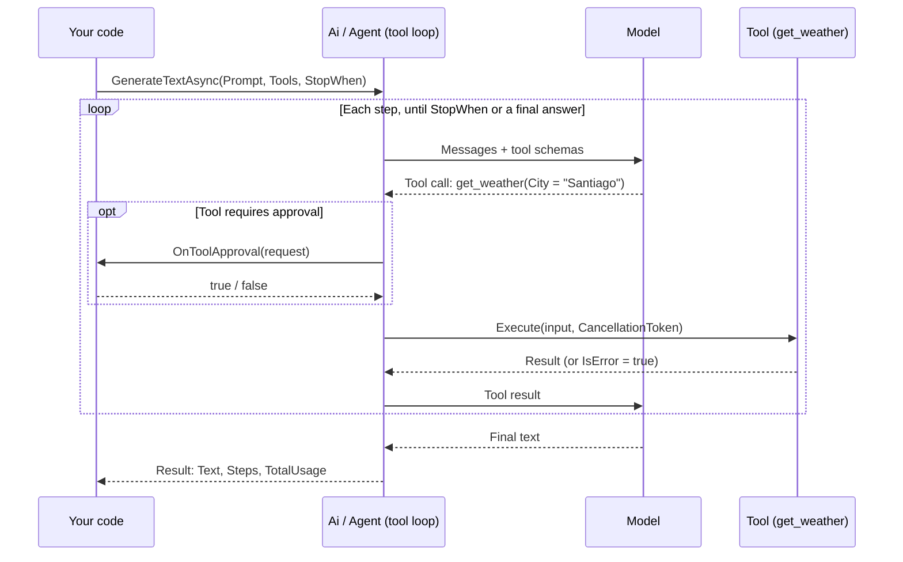

# Tools and agents

> 🇪🇸 [Leer en español](es-Herramientas-y-agentes)

## 🔁 The tool loop at a glance



## 🛠️ Tools and the agent loop

```csharp
public sealed record WeatherQuery([property: Description("City")] string City);
public sealed record Weather(string City, int TemperatureC);

var weather = Tool.Create<WeatherQuery, Weather>(
    "get_weather", "Gets the weather for a city",
    async (q, ct) => await weatherService.GetAsync(q.City, ct));

// Or from any delegate/method; CancellationToken, ToolExecutionContext and IServiceProvider are injected.
var convert = Tool.FromDelegate("c_to_f", "Converts °C to °F",
    ([Description("Temperature in °C")] double c) => c * 9 / 5 + 32);

var result = await Ai.GenerateTextAsync(new GenerateTextOptions
{
    Model = model,
    Prompt = "What's the temperature in Santiago, in °F?",
    Tools = [weather, convert],
    StopWhen = StopCondition.StepCountIs(5),
    OnStepFinish = step => { Console.WriteLine(step.ToolCalls.Count); return ValueTask.CompletedTask; },
});
```

Tool errors (exceptions, invalid JSON, unknown tool) are returned to the model as results with
`IsError = true`, so it can correct itself. Tools without `Execute` (`Tool.Define<T>`) are resolved on the
client: the loop stops and they are left in `result.PendingToolCalls`.

## 🤖 Agents

**By configuration** (AI SDK style):

```csharp
var agent = new ToolLoopAgent(new AgentSettings
{
    Model = model,
    Instructions = "You are a weather assistant.",
    Tools = [weather, convert],
    // Default StopWhen: StepCountIs(20)
});

var result = await agent.GenerateAsync("Compare Santiago and Lima");
var stream = agent.Stream("Compare Santiago and Lima");
```

**By class** (Laravel style), ideal with dependency injection:

```csharp
public sealed class SupportAgent(ILanguageModel model, IOrderService orders) : Agent
{
    protected override ILanguageModel Model => model;
    protected override string Instructions => "You are the store's support agent.";
    protected override IEnumerable<Tool> Tools =>
    [
        Tool.FromDelegate("lookup_order", "Looks up an order",
            ([Description("Order id")] string id, CancellationToken ct) => orders.FindAsync(id, ct)),
    ];
    protected override StopCondition StopWhen => StopCondition.StepCountIs(10);
}
```

**Conversation memory:**

```csharp
var chat = agent.CreateSession("conversation-123", store);   // IConversationStore (in-memory by default)
await chat.SendAsync("My name is Ana");
var r = await chat.SendAsync("What's my name?");
```

`ModelMessage` is JSON-serializable (with a `type` discriminator), so implementing
`IConversationStore` on top of EF Core, Redis or Cosmos DB is straightforward.

**Sub-agents / multi-agent:**

```csharp
var orchestrator = new ToolLoopAgent(new AgentSettings
{
    Model = model,
    Tools = [researchAgent.AsTool(), writerAgent.AsTool("writer", "Writes the final report")],
});
```

> [!TIP]
> For ready-made patterns (parallel, router, supervisor, handoffs…) see [Multi-agent orchestration](Multi-Agent-Orchestration).

**Human-in-the-loop:**

```csharp
var deleteUser = Tool.Create<DeleteInput, string>("delete_user", "Deletes a user", Delete).RequireApproval();

await Ai.GenerateTextAsync(new GenerateTextOptions
{
    Model = model, Prompt = "...", Tools = [deleteUser], StopWhen = StopCondition.StepCountIs(5),
    OnToolApproval = async req => await AskOperatorAsync(req.ToolCall),   // false → the model is informed
});
```

**Per-step control** (`PrepareStep`): switch models, force tools or trim the context.

```csharp
PrepareStep = ctx => ValueTask.FromResult<PrepareStepResult?>(ctx.StepNumber switch
{
    0 => new() { ActiveTools = ["search"] },
    > 5 => new() { Messages = ctx.Messages.TakeLast(10).ToList() },
    _ => null,
}),
```

## 🩹 Tool call repair

```csharp
RepairToolCall = ToolCallRepair.FirstOf(
    ToolCallRepair.FixToolNameCase(),              // "Get-Weather" → "get_weather"
    ToolCallRepair.WithModel(fastModel)),          // asks a model to fix the input according to the schema
```

It is invoked when the tool does not exist, the JSON is broken or the input does not match the schema
(`ToolCallRepairReason`). If the repair returns null, the error is reported to the model as before.

## 📣 Callbacks

```csharp
var stream = Ai.StreamText(new GenerateTextOptions
{
    Model = model,
    Prompt = "...",
    OnChunk = part => { /* text, reasoning, tools, sources */ return ValueTask.CompletedTask; },
    OnFinish = result => SaveUsageAsync(result.TotalUsage),
    OnError = ex => LogAsync(ex),
    OnAbort = steps => LogAsync($"Cancelled after {steps.Count} steps"),
    CancellationToken = http.RequestAborted,
});
```

When cancelled, the stream ends with `AbortPart` (the `abort` part in the UI protocol).

## 🛟 Fallback between providers

```csharp
var ollama = OpenAIProvider.Compatible("ollama", "http://localhost:11434/v1");
var model = anthropic.Messages("claude-opus-5-5")
    .WithFallback(openai.Responses("gpt-5"), ollama.Chat("llama3.2"));

// or in the registry / DI
registry.Fallback("chat", "anthropic:claude-opus-5-5", "openai:gpt-5");
services.AddAiSdk(ai => ai.AddAnthropic().AddOpenAI().AddFallback("chat", "anthropic:claude-opus-5-5", "openai:gpt-5"));
```

Every error (except cancellations) moves on to the next model; with `new FallbackLanguageModel(models, shouldFallback, onFallback)`
you decide which errors switch models and get notified on every switch. When streaming, it only switches if the failure
happens before the first chunk.

> [!WARNING]
> Once the first chunk of a stream has been sent, a failure is **not** retried on the next model; it surfaces through the stream (`ErrorPart`, `OnError`).

---

➡️ Next: [Multi-agent orchestration](Multi-Agent-Orchestration)
