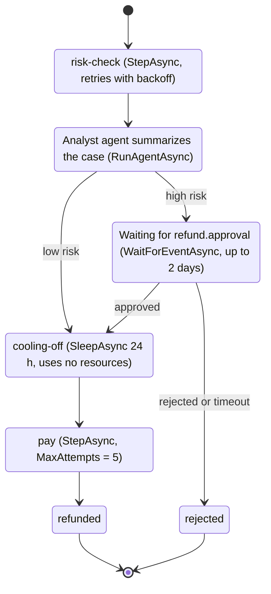

# Durable workflows and automations

> 🇪🇸 [Leer en español](es-Workflows-y-automatizaciones)

## ⏱️ Durable workflows, triggers and automations

`AiSdk.Workflows` runs long-lived processes that survive restarts (in the style of Temporal, Inngest or Vercel's
Workflow DevKit): every step is persisted and, on resume, completed steps are not repeated.

The `refund` workflow from the example below, step by step:



> [!NOTE]
> Each completed step is saved in the `IWorkflowStore`. If the process restarts while the run is sleeping or waiting for an event, it resumes right there without repeating `risk-check` or the agent call.

```csharp
var refund = Workflow.Create<RefundRequest, string>("refund", async (ctx, r) =>
{
    var risk = await ctx.StepAsync("risk-check", ct => scoring.EvaluateAsync(r, ct));          // retries with backoff
    var summary = await ctx.RunAgentAsync(analyst, $"Summarize case {r.OrderId}");             // agent as a step
    if (risk.High)
    {
        var ok = await ctx.WaitForEventAsync<Approval>("refund.approval", key: r.OrderId,        // human approval
                                                       timeout: TimeSpan.FromDays(2));
        if (ok is not { Approved: true }) return "rejected";
    }

    await ctx.SleepAsync("cooling-off", TimeSpan.FromHours(24));                               // sleeps without using resources
    await ctx.StepAsync("pay", ct => payments.RefundAsync(r, ct), new StepOptions { MaxAttempts = 5 });
    return "refunded";
});

builder.Services.AddAiSdkWorkflows(w =>
{
    w.UseFileSystemStore("data/workflows");                     // or UseStore(your IWorkflowStore: SQL, Redis...)
    w.AddWorkflow(refund);
    w.AddAutomation(Automation.Create("Daily report", new CronTrigger("0 9 * * 1-5", "America/Santiago"), "daily-report", new { }));
    w.AddAutomation(new Automation { Id = "crm", Name = "Leads", Trigger = new WebhookTrigger(secret), Workflow = "lead" });   // secret = WebhookSignature.CreateSecret()
    w.AddAutomation(new Automation { Id = "paid", Name = "Paid orders", Trigger = new EventTrigger("order.updated", new Dictionary<string, string> { ["status"] = "paid" }), Workflow = "invoice" });
});

app.MapWorkflows("/workflows", new WorkflowEndpointOptions
{
    CanStart = (http, workflow) => ValueTask.FromResult(workflow == "refund"),          // what users may start over HTTP
    CanSendEvent = async (http, e) =>                                                    // who may approve (required for events)
    {
        if (e.EventName != "refund.approval" || !http.User.IsInRole("approver") || e.WaitingRuns.Count == 0) return false;
        var engine = http.RequestServices.GetRequiredService<WorkflowEngine>();
        foreach (var run in e.WaitingRuns)                                               // nobody approves their own request
            if (await WorkflowEndpoints.GetRunOwnerAsync(engine, run) == EndpointSecurity.GetUserId(http)) return false;
        return true;
    },
});
// POST /workflows/refund/start · GET /workflows/runs/{id} · POST /workflows/events/refund.approval?key=O-77
// POST /workflows/hooks/crm (signed: X-Signature-256 + X-Webhook-Timestamp) · /automations · /runs/{id}/retry
```

Secure by default:

- Every endpoint except the webhooks requires authorization (`AllowAnonymous = true` to opt out explicitly).
- The owner comes from authentication (`ResolveUser`, by default the `NameIdentifier`/`sub` claim), never from the body:
  runs started over HTTP are recorded as `TriggeredBy = "user:{id}"` and automations get `Owner` set by the server.
  Each user only sees, cancels and retries their own runs and automations (`CanAccessRun`, `CanAccessAutomation`;
  `WorkflowEndpoints.GetRunOwnerAsync` helps build your own rules).
- `POST /events/{event}` answers 403 until you configure `CanSendEvent`: it receives the runs waiting for the event,
  so you decide who may approve (usually not the requester).
- POST requests require `Content-Type: application/json` (415 otherwise, also without a body), so a cross-site form
  cannot post a valid JSON body with the user's cookies.
- Webhook automations created over HTTP need a secret, and secrets are hidden when listing automations.

Triggers: `CronTrigger` (5 or 6 fields, with time zone), `IntervalTrigger`, `OnceTrigger`, `EventTrigger`
(with content filter) and `WebhookTrigger` (timestamped HMAC-SHA256 signature, compared in constant time). A background
service fires what is scheduled, resumes sleeping runs and recovers interrupted ones.
`engine.RetryAsync(runId)` retries a failed run from the step that failed. Triggers are validated when the automation
is created: a cron expression or time zone that does not exist on the machine, an interval under one second or a
webhook without a secret throw `ArgumentException`.

## 🔐 Webhooks

A `WebhookTrigger` requires a secret (at least 16 characters; `WebhookSignature.CreateSecret()` generates 256 bits).
By default the sender signs `"{timestamp}.{body}"` with HMAC-SHA256 and sends these headers:

| Header | Content |
|---|---|
| `X-Signature-256` | `sha256=` + hex HMAC-SHA256 of `"{timestamp}.{raw body}"` with the secret |
| `X-Webhook-Timestamp` | Unix time in seconds; must be within `WorkflowEngineOptions.WebhookTolerance` (5 min) |
| `X-Webhook-Id` | Optional unique delivery id: retries with the same id return the same run |

```csharp
// Sender side (or a test): sign the exact bytes you send.
var timestamp = DateTimeOffset.UtcNow.ToUnixTimeSeconds();
request.Headers.Add(WebhookSignature.SignatureHeader, WebhookSignature.Sign(secret, timestamp, body));
request.Headers.Add(WebhookSignature.TimestampHeader, timestamp.ToString(CultureInfo.InvariantCulture));
request.Headers.Add(WebhookSignature.DeliveryIdHeader, deliveryId);
```

A captured request cannot be replayed: the same signature returns the run it already created (also on another
replica) and, after the tolerance window, it is rejected. Senders that cannot sign this way can opt in explicitly:
`new WebhookTrigger(secret) { Verification = WebhookVerification.BodySignature }` (body-only HMAC, GitHub's
`X-Hub-Signature-256`; replays are only detected through `X-Webhook-Id` / `X-GitHub-Delivery`) or
`WebhookVerification.SharedSecret` (`X-Webhook-Secret` header). Unauthenticated webhooks require
`new WebhookTrigger { AllowUnauthenticated = true }`; in that case use the random id generated by `Automation.Create`
(128 bits), because the URL is the only protection. Code that calls the engine directly should use
`TriggerWebhookAsync(id, WebhookRequest.FromHeaders(body, name => headers[name]))`.

## 🧱 Reliability, several replicas and retention

- **Failing automations are isolated.** If an automation fails to fire (its workflow is no longer registered, the time
  zone does not exist, the store is down...), the others still fire. The error goes to `Automation.LastError` and
  `ConsecutiveFailures`, the next attempt is delayed with exponential backoff (`AutomationRetryDelay`, up to
  `MaxAutomationRetryDelay`) and after `MaxAutomationFailures` (5) it is disabled; `SetAutomationEnabledAsync(id, true)`
  re-enables it. `WorkflowEngineOptions.OnError` receives these errors.
- **Cancellation is final.** `CancelAsync` saves `Cancelled` and signals the run's `ctx.CancellationToken`; a workflow
  that keeps running cannot overwrite it (its saves are rejected) and does not start new steps.
- **Several replicas can share a store.** Saves use optimistic concurrency (`WorkflowRun.Version`,
  `Automation.Version`; a stale save throws `WorkflowConcurrencyException`). Each run is claimed with a lease
  (`LeaseOwner`, `LeaseExpiresAt`, `LeaseDuration` = 2 min) that is renewed while it progresses: another replica only
  resumes it if the lease expires (the replica died). Each scheduled occurrence creates a run with a deterministic id,
  so it fires once even if two replicas tick at the same time. `FileSystemWorkflowStore` supports several processes on
  the same machine (lock file); across machines use a database store.
- **Bounded growth.** The engine no longer lists every run on each tick: it uses indexed queries
  (`ListDueRunsAsync`, `ListRunsWaitingForEventAsync`, `ListDueAutomationsAsync`). Finished runs are deleted after
  `RunRetention` (30 days; `null` keeps them) or on demand with `engine.PurgeRunsAsync(before)`, and
  `InMemoryWorkflowStore` keeps at most `maxFinishedRuns` (10 000) finished runs.

> [!NOTE]
> Custom `IWorkflowStore` implementations must check the version on save (`UPDATE ... WHERE id = @id AND version = @version`,
> and an insert that fails if the id exists when the version is 0) and implement the indexed queries using the
> criteria in `WorkflowRunQueries`.

## 🗓️ Tasks scheduled by agents

("check prices every weekday at 9")

```csharp
w.ConfigureEngine((engine, sp) => engine.AddAgentTasks(new AgentTaskOptions
{
    Agent = sp => sp!.GetRequiredService<AssistantAgent>(),
    OnCompleted = (r, sp, ct) => mail.SendAsync(r.Owner, r.Task, r.Text, ct),   // delivers the result
    DefaultTimeZone = "America/Santiago",
}));

Tools = AgentTasks.CreateTools(engine, options),   // schedule_task, list/cancel/run_scheduled_task_now, get_task_result
```

Each user (`Context["userId"]`, see `OwnerKey`) only sees and manages their own tasks, with a configurable minimum interval
and maximum number of tasks. Without a user in the context the tools refuse to work (there are no shared tasks), and
when a task runs the agent receives its owner in `Context` too, so its tools act on behalf of that user. Cron
expressions are checked over a full week: the smallest gap between consecutive runs must reach `MinimumInterval`.

> [!WARNING]
> Webhooks are published without user authentication (`app.MapWorkflowWebhooks()`): the secret and the signature are their only protection. Do not use `AllowUnauthenticated` outside tests or trusted networks.

---

➡️ Next: [RAG and vector stores](RAG-and-Vector-Stores)
