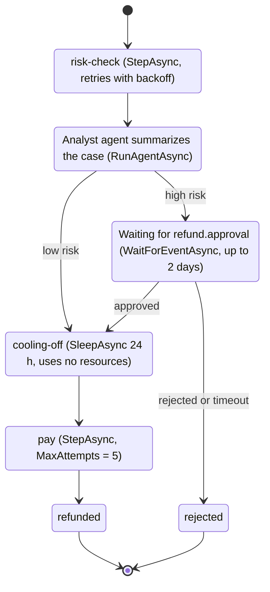

# Durable workflows and automations

> 🇪🇸 [Leer en español](es-Workflows-y-automatizaciones)

## ⏱️ Durable workflows, triggers and automations

`AiSdk.Workflows` runs long-lived processes that survive restarts (in the style of Temporal, Inngest or Vercel's
Workflow DevKit): every step is persisted and, on resume, completed steps are not repeated.

The `refund` workflow from the example below, step by step:



> [!NOTE]
> Each completed step is saved in the `IWorkflowStore`. If the process restarts while the run is sleeping or waiting for an event, it resumes right there without repeating `risk-check` or the agent call.

```csharp
var refund = Workflow.Create<RefundRequest, string>("refund", async (ctx, r) =>
{
    var risk = await ctx.StepAsync("risk-check", ct => scoring.EvaluateAsync(r, ct));          // retries with backoff
    var summary = await ctx.RunAgentAsync(analyst, $"Summarize case {r.OrderId}");             // agent as a step
    if (risk.High)
    {
        var ok = await ctx.WaitForEventAsync<Approval>("refund.approval", key: r.OrderId,        // human approval
                                                       timeout: TimeSpan.FromDays(2));
        if (ok is not { Approved: true }) return "rejected";
    }

    await ctx.SleepAsync("cooling-off", TimeSpan.FromHours(24));                               // sleeps without using resources
    await ctx.StepAsync("pay", ct => payments.RefundAsync(r, ct), new StepOptions { MaxAttempts = 5 });
    return "refunded";
});

builder.Services.AddAiSdkWorkflows(w =>
{
    w.UseFileSystemStore("data/workflows");                     // or UseStore(your IWorkflowStore: SQL, Redis...)
    w.AddWorkflow(refund);
    w.AddAutomation(Automation.Create("Daily report", new CronTrigger("0 9 * * 1-5", "America/Santiago"), "daily-report", new { }));
    w.AddAutomation(new Automation { Id = "crm", Name = "Leads", Trigger = new WebhookTrigger(secret), Workflow = "lead" });
    w.AddAutomation(new Automation { Id = "paid", Name = "Paid orders", Trigger = new EventTrigger("order.updated", new Dictionary<string, string> { ["status"] = "paid" }), Workflow = "invoice" });
});

app.MapWorkflows("/workflows", new WorkflowEndpointOptions
{
    CanStart = (http, workflow) => ValueTask.FromResult(workflow == "refund"),          // what users may start over HTTP
    CanSendEvent = async (http, e) =>                                                    // who may approve (required for events)
    {
        if (e.EventName != "refund.approval" || !http.User.IsInRole("approver") || e.WaitingRuns.Count == 0) return false;
        var engine = http.RequestServices.GetRequiredService<WorkflowEngine>();
        foreach (var run in e.WaitingRuns)                                               // nobody approves their own request
            if (await WorkflowEndpoints.GetRunOwnerAsync(engine, run) == EndpointSecurity.GetUserId(http)) return false;
        return true;
    },
});
// POST /workflows/refund/start · GET /workflows/runs/{id} · POST /workflows/events/refund.approval?key=O-77
// POST /workflows/hooks/crm (X-Webhook-Secret or HMAC signature X-Signature-256) · /automations · /runs/{id}/retry
```

Secure by default:

- Every endpoint except the webhooks requires authorization (`AllowAnonymous = true` to opt out explicitly).
- The owner comes from authentication (`ResolveUser`, by default the `NameIdentifier`/`sub` claim), never from the body:
  runs started over HTTP are recorded as `TriggeredBy = "user:{id}"` and automations get `Owner` set by the server.
  Each user only sees, cancels and retries their own runs and automations (`CanAccessRun`, `CanAccessAutomation`;
  `WorkflowEndpoints.GetRunOwnerAsync` helps build your own rules).
- `POST /events/{event}` answers 403 until you configure `CanSendEvent`: it receives the runs waiting for the event,
  so you decide who may approve (usually not the requester).
- POST requests require `Content-Type: application/json` (415 otherwise, also without a body), so a cross-site form
  cannot post a valid JSON body with the user's cookies.
- Webhook automations created over HTTP need a secret, and secrets are hidden when listing automations.

Triggers: `CronTrigger` (5 or 6 fields, with time zone), `IntervalTrigger`, `OnceTrigger`, `EventTrigger`
(with content filter) and `WebhookTrigger` (secret or HMAC-SHA256 signature, compared in constant time). A background
service fires what is scheduled, resumes sleeping runs and recovers interrupted ones on startup.
`engine.RetryAsync(runId)` retries a failed run from the step that failed.

## 🗓️ Tasks scheduled by agents

("check prices every weekday at 9")

```csharp
w.ConfigureEngine((engine, sp) => engine.AddAgentTasks(new AgentTaskOptions
{
    Agent = sp => sp!.GetRequiredService<AssistantAgent>(),
    OnCompleted = (r, sp, ct) => mail.SendAsync(r.Owner, r.Task, r.Text, ct),   // delivers the result
    DefaultTimeZone = "America/Santiago",
}));

Tools = AgentTasks.CreateTools(engine, options),   // schedule_task, list/cancel/run_scheduled_task_now, get_task_result
```

Each user (`Context["userId"]`) only sees and manages their own tasks, with a configurable minimum interval and maximum number of tasks.

> [!WARNING]
> A `WebhookTrigger` without a secret accepts any caller that can reach `/hooks/{id}`: always set one, especially if you publish the webhooks without user authentication (`app.MapWorkflowWebhooks()`).

---

➡️ Next: [RAG and vector stores](RAG-and-Vector-Stores)
