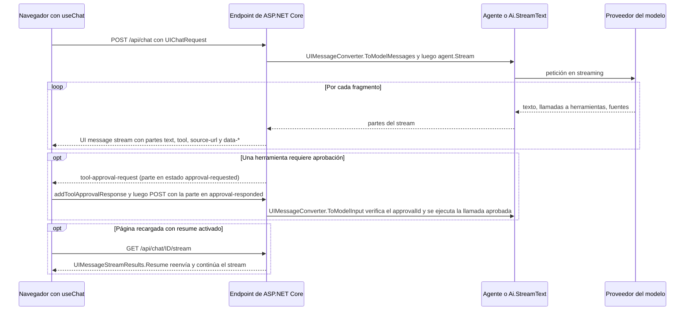

# ASP.NET Core y useChat

> 🇬🇧 [Read in English](ASP.NET-Core-and-useChat)



## ASP.NET Core + `useChat`

```csharp
builder.Services.AddAiSdk(ai => ai
    .AddAnthropic()
    .AddOpenAI()
    .AddAlias("chat", "anthropic:claude-opus-5-5")
    .AddDefaultModel("chat")
    .AddAgent<SupportAgent>());

app.MapPost("/api/chat", (UIChatRequest req, SupportAgent agent, HttpContext http) =>
    agent.Stream(new AgentCallOptions
    {
        Messages = UIMessageConverter.ToModelMessages(req.Messages),
        CancellationToken = http.RequestAborted,
    }).ToUIMessageStreamResult());
```

En el frontend: `useChat({ transport: new DefaultChatTransport({ api: "/api/chat" }) })`.

**Datos propios** (partes `data-*` en `useChat`): desde una herramienta con `ctx.WriteData("progress", new { percent = 50 }, id: "p")`,
o componiendo el stream:

```csharp
app.MapPost("/api/report", (UIChatRequest req, ILanguageModel model) =>
    UIMessageStreamResults.Create(writer =>
    {
        writer.WriteData("status", new { step = "buscando" }, id: "status");
        writer.Merge(Ai.StreamText(new() { Model = model, Messages = UIMessageConverter.ToModelMessages(req.Messages) }));
        return Task.CompletedTask;
    }));
```

**Streams reanudables**: la generación continúa aunque el usuario recargue la página y `useChat({ resume: true })` la retoma.

```csharp
builder.Services.AddAiSdk(ai => ai.AddAnthropic().AddResumableStreams());   // o tu IResumableStreamStore sobre Redis

app.MapPost("/api/chat", (UIChatRequest req, SupportAgent agent, IResumableStreamStore store) =>
    agent.Stream(UIMessageConverter.ToModelMessages(req.Messages)).ToResumableUIMessageStreamResult(store, req.Id!))
    .RequireAuthorization();

app.MapGet("/api/chat/{id}/stream", (string id, IResumableStreamStore store) => UIMessageStreamResults.Resume(store, id))
    .RequireAuthorization();
```

El stream se guarda bajo el id de chat **y su dueño**: el usuario autenticado o el `owner` que indiques (por ejemplo, un
id de sesión que emite tu servidor en una aplicación anónima). Otro usuario que conozca o adivine el id de chat no puede
reemplazarlo ni reanudarlo. Sin dueño, `ToResumableUIMessageStreamResult` falla y `Resume` responde 204.

## ✅ Aprobación de herramientas con `useChat`

Una herramienta marcada con `.RequireApproval()` se ejecuta en el servidor solo después de que el usuario la aprueba en el
chat, con el protocolo propio del AI SDK (`tool-approval-request`, estados de parte `approval-requested` /
`approval-responded` / `output-denied`, `addToolApprovalResponse`). Funciona con `ai@6` y `ai@7`.

```csharp
app.MapPost("/api/chat", (UIChatRequest req, SupportAgent agent, HttpContext http) =>
{
    var chatId = req.Id ?? Guid.NewGuid().ToString("N");
    var approvals = ToolApprovalProtection.ForChat(http, chatId);   // approvalIds firmados para este usuario y chat
    var input = UIMessageConverter.ToModelInput(req.Messages, new()
    {
        ToolApprovals = approvals,
        ServerExecutedTools = ["send_email"],
    });
    return agent.Stream(new AgentCallOptions
    {
        Messages = input.Messages,
        ToolApprovals = input.ToolApprovals,   // respuestas verificadas: las aprobadas se ejecutan antes de llamar al modelo
        DeferToolApprovals = true,             // las nuevas llamadas que requieren aprobación se envían al navegador
        CancellationToken = http.RequestAborted,
    }).ToUIMessageStreamResult(toolApprovals: approvals);   // también ToResumableUIMessageStreamResult(..., toolApprovals:)
}).RequireAuthorization();
```

```tsx
import { useChat } from "@ai-sdk/react";
import { DefaultChatTransport, lastAssistantMessageIsCompleteWithApprovalResponses } from "ai";

const { messages, sendMessage, addToolApprovalResponse } = useChat({
  transport: new DefaultChatTransport({ api: "/api/chat" }),
  sendAutomaticallyWhen: lastAssistantMessageIsCompleteWithApprovalResponses, // reenvía la respuesta de inmediato
});

// Dentro de messages.map(m => m.parts.map(part => ...)):
if (part.type === "tool-send_email") {
  switch (part.state) {
    case "approval-requested":
      return (
        <div key={part.toolCallId}>
          ¿Enviar un correo a {part.input.to}?
          <button onClick={() => addToolApprovalResponse({ id: part.approval.id, approved: true })}>Aprobar</button>
          <button onClick={() => addToolApprovalResponse({ id: part.approval.id, approved: false, reason: "Ahora no" })}>
            Denegar
          </button>
        </div>
      );
    case "output-available": return <div key={part.toolCallId}>Enviado.</div>;
    case "output-denied": return <div key={part.toolCallId}>No se envió: lo denegaste.</div>;
    case "output-error": return <div key={part.toolCallId}>{part.errorText}</div>;
  }
}
```

1. El modelo llama a `send_email`; el bucle se detiene y el stream envía `tool-approval-request` (`approvalId`,
   `toolCallId`), así que `useChat` muestra la parte en el estado `approval-requested` con su `input`.
2. `addToolApprovalResponse` la pasa a `approval-responded` y `sendAutomaticallyWhen` vuelve a enviar la conversación.
3. `ToModelInput` devuelve la decisión solo si su `approvalId` verifica para esa misma llamada. Una llamada aprobada se
   ejecuta con la entrada que produjo el modelo (`tool-output-available`); una denegada nunca se ejecuta, el navegador
   recibe `tool-output-denied` (`output-denied`) y el modelo recibe "el usuario la denegó" junto con el motivo.

**Por qué no se pueden falsificar las aprobaciones.** El navegador reenvía toda la conversación, así que podría inventar
una llamada, cambiar la entrada de una real o reutilizar una aprobación. Por eso el `approvalId` no es aleatorio: es un
token de ASP.NET Core Data Protection que vincula la aprobación al usuario, al chat, al id de la llamada, a la herramienta
y a un SHA-256 de la entrada (JSON canónico, que no cambia con `JSON.parse`/`stringify` del navegador), y caduca en una
hora (`lifetime`). Un id inventado, la aprobación de otro usuario o de otro chat, una expirada, o un id válido con la
entrada o el id de llamada cambiados se rechaza: la herramienta no se ejecuta y el modelo recibe un error. El servidor no
guarda estado: dentro de su vigencia, el mismo usuario podría reenviar una aprobación que ya usó. Si quien aprueba no es
quien conversa, o una llamada no debe repetirse nunca, guarda la conversación en el servidor
(`AgentSession.StreamApprovalsAsync`) o usa un [workflow](es-Workflows-y-automatizaciones) con un evento de aprobación.
Con varias instancias, comparte el anillo de claves de Data Protection; fuera de ASP.NET Core usa
`ToolApprovalProtector.CreateHmac(key, scope)`.

## 🔒 Seguridad

El navegador no es de confianza: todo lo que trae un `UIChatRequest` (mensajes, id de chat, resultados de herramientas)
se puede falsificar.

- `UIMessageConverter.ToModelMessages` descarta los mensajes `system` que envía el cliente (para aceptarlos:
  `new UIMessageConverterOptions { AllowSystemMessages = true }`) e ignora las partes inválidas (URLs `data:` mal
  formadas, URLs que no son http/https, tipos JSON inesperados) en lugar de fallar con un 500.
- El cliente reenvía los resultados de las herramientas que ejecutó tu servidor: decláralas en
  `new UIMessageConverterOptions { ServerExecutedTools = ["get_weather"] }` para descartar esas partes falsificables.
  Mantén las instrucciones y los datos sensibles en el servidor (instrucciones del agente, historial con `AgentSession`).
- Las aprobaciones de herramientas solo se aceptan con un `approvalId` que tu servidor firmó para ese usuario, chat y
  llamada exacta (`UIMessageConverter.ToModelInput` + `ToolApprovalProtection.ForChat`); `ToModelMessages` las ignora.
  Sin `toolApprovals` en el stream, una llamada que espera aprobación se informa como error (falla cerrado).
- Los errores se enmascaran: el navegador recibe un mensaje genérico para los errores del stream **y de las
  herramientas** (`tool-output-error`); el modelo sí ve el texto real. Para mostrar el detalle pasa `onError`; los
  errores de herramientas llegan como `ToolErrorException` (`onError: ex => env.IsDevelopment() ? ex.Message : "Se produjo un error."`).
- `MapArtifacts`, `MapWorkflows` y `MapSkills` exigen autorización por defecto: configura la autenticación
  (`AddAuthentication` + `AddAuthorization`) o desactívala explícitamente con `AllowAnonymous = true`. Ver
  [Artifacts](es-Artifacts-y-documentos-Office) y [Workflows](es-Workflows-y-automatizaciones).
- CORS: permite solo los orígenes de tu frontend (`WithOrigins(...)`), nunca `AllowAnyOrigin`. Un token en cabecera
  (`Authorization: Bearer`, con `DefaultChatTransport({ headers })`) evita CSRF; con cookies mantén `SameSite`.

> [!TIP]
> Consulta `samples/ChatApi` para ver un ejemplo completo y ejecutable.

## Microsoft.Extensions.AI

`AiSdk.Net.Extensions.AI` conecta AiSdk.Net y Microsoft.Extensions.AI (MEAI) en ambas direcciones.

### Usar un cliente de MEAI en AiSdk.Net

```csharp
using AiSdk.Extensions.AI;

IChatClient azure = /* AzureOpenAIClient, OllamaApiClient, ... */;
ILanguageModel model = azure.AsLanguageModel();   // ahora sirve para Ai.*, agentes y middleware
IEmbeddingModel embeddings = generator.AsEmbeddingModel();   // desde un IEmbeddingGenerator<string, Embedding<float>>
```

### Usar un proveedor de AiSdk.Net desde código MEAI

`AsIChatClient()` expone cualquier `ILanguageModel` como `IChatClient`, y `AsIEmbeddingGenerator()` expone cualquier
`IEmbeddingModel` como `IEmbeddingGenerator<string, Embedding<float>>`. Así Semantic Kernel, Microsoft Agent Framework,
el middleware de MEAI (`FunctionInvokingChatClient`, OpenTelemetry, caché), Aspire y las librerías de evaluación pueden
usar cualquier proveedor de AiSdk.Net:

```csharp
using AiSdk.Anthropic;
using AiSdk.Extensions.AI;
using AiSdk.OpenAI;
using Microsoft.Extensions.AI;

IChatClient client = AnthropicProvider.Default.Messages("claude-opus-5-5")
    .AsIChatClient()
    .AsBuilder()
    .UseFunctionInvocation()   // MEAI ejecuta las herramientas
    .Build();

var response = await client.GetResponseAsync("¿Qué tiempo hace en Santiago?", new ChatOptions
{
    Tools = [AIFunctionFactory.Create((string city) => $"Soleado en {city}", "get_weather", "Obtiene el clima")],
});

IEmbeddingGenerator<string, Embedding<float>> generator =
    OpenAIProvider.Default.Embedding("text-embedding-3-small").AsIEmbeddingGenerator();
```

Cómo traduce el adaptador:

| MEAI | AiSdk.Net |
|---|---|
| `ChatMessage` con `TextContent`, `TextReasoningContent`, `DataContent`/`UriContent`/`HostedFileContent`, `FunctionCallContent`, `FunctionResultContent` | `ModelMessage` con `TextPart`, `ReasoningPart`, `ImagePart`/`FilePart`, `ToolCallPart`, `ToolResultPart` (los resultados van en un mensaje de herramienta) |
| `ChatOptions.Instructions` | Un mensaje de sistema antes de la conversación |
| `Temperature`, `TopP`, `TopK`, `MaxOutputTokens`, penalizaciones, `StopSequences`, `Seed` | Los mismos ajustes de la petición |
| `ResponseFormat` (JSON / esquema JSON), así que `GetResponseAsync<T>()` funciona | `ResponseFormat.Json(schema, name, description)` |
| `Tools` (`AIFunctionDeclaration`: nombre, descripción, esquema) y `ToolMode` | Declaraciones de herramientas y `ToolChoice`; las herramientas hospedadas se ignoran |
| `RawRepresentationFactory` que devuelve `ProviderOptions` o un `LanguageModelRequest` | Opciones del proveedor, cabeceras y herramientas definidas por el proveedor |
| `ChatResponse`: `Usage`, `FinishReason`, `ResponseId`, `ModelId`, `CreatedAt` | `Usage` (incluidos tokens de razonamiento y en caché), motivo de fin, metadatos de la respuesta |
| `GetService<ChatClientMetadata>()` | Nombre del proveedor, id del modelo y el endpoint opcional pasado a `AsIChatClient(uri)` |

> [!IMPORTANT]
> El `IChatClient` nunca ejecuta herramientas: cada llamada hace una sola llamada al modelo y devuelve
> `FunctionCallContent`, para que las ejecute `FunctionInvokingChatClient` (o tu código). Las herramientas que ejecutó
> el propio proveedor (búsqueda web, ejecución de código) llegan con `InformationalOnly = true` y no se vuelven a ejecutar.

- Las firmas de razonamiento y demás metadatos del proveedor viajan en `TextReasoningContent.ProtectedData` y en
  `AdditionalProperties`, así que sobreviven al streaming y a un historial guardado como JSON.
- `ChatOptions.ModelId`, `ConversationId`, `AllowMultipleToolCalls` y `Reasoning` no se traducen: el modelo es fijo y
  los modelos de AiSdk.Net no guardan estado. Usa `ProviderOptions` para ajustes propios del proveedor, como el esfuerzo
  de razonamiento.
- Convertir de vuelta desenvuelve en lugar de envolver dos veces: `model.AsIChatClient().AsLanguageModel()` devuelve
  `model`. A través de un pipeline de MEAI (por ejemplo `.UseOpenTelemetry()`), las opciones del proveedor, las
  cabeceras y las herramientas definidas por el proveedor siguen llegando al modelo de AiSdk.Net.

---

**Siguiente:** [Pruebas y telemetría](es-Pruebas-y-telemetria) ➡️
