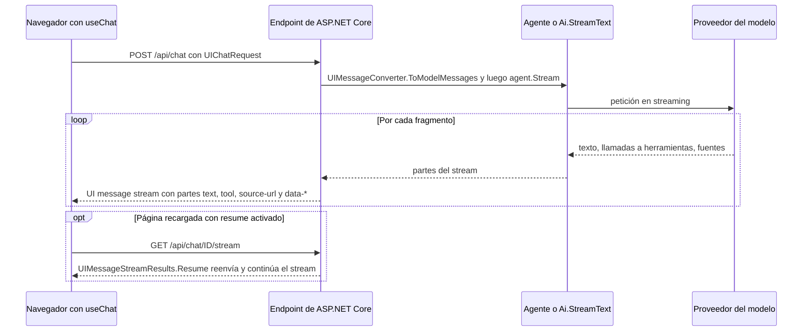

# ASP.NET Core y useChat

> 🇬🇧 [Read in English](ASP.NET-Core-and-useChat)



## ASP.NET Core + `useChat`

```csharp
builder.Services.AddAiSdk(ai => ai
    .AddAnthropic()
    .AddOpenAI()
    .AddAlias("chat", "anthropic:claude-opus-5-5")
    .AddDefaultModel("chat")
    .AddAgent<SupportAgent>());

app.MapPost("/api/chat", (UIChatRequest req, SupportAgent agent, HttpContext http) =>
    agent.Stream(new AgentCallOptions
    {
        Messages = UIMessageConverter.ToModelMessages(req.Messages),
        CancellationToken = http.RequestAborted,
    }).ToUIMessageStreamResult());
```

En el frontend: `useChat({ transport: new DefaultChatTransport({ api: "/api/chat" }) })`.

**Datos propios** (partes `data-*` en `useChat`): desde una herramienta con `ctx.WriteData("progress", new { percent = 50 }, id: "p")`,
o componiendo el stream:

```csharp
app.MapPost("/api/report", (UIChatRequest req, ILanguageModel model) =>
    UIMessageStreamResults.Create(writer =>
    {
        writer.WriteData("status", new { step = "buscando" }, id: "status");
        writer.Merge(Ai.StreamText(new() { Model = model, Messages = UIMessageConverter.ToModelMessages(req.Messages) }));
        return Task.CompletedTask;
    }));
```

**Streams reanudables**: la generación continúa aunque el usuario recargue la página y `useChat({ resume: true })` la retoma.

```csharp
builder.Services.AddAiSdk(ai => ai.AddAnthropic().AddResumableStreams());   // o tu IResumableStreamStore sobre Redis

app.MapPost("/api/chat", (UIChatRequest req, SupportAgent agent, IResumableStreamStore store) =>
    agent.Stream(UIMessageConverter.ToModelMessages(req.Messages)).ToResumableUIMessageStreamResult(store, req.Id!))
    .RequireAuthorization();

app.MapGet("/api/chat/{id}/stream", (string id, IResumableStreamStore store) => UIMessageStreamResults.Resume(store, id))
    .RequireAuthorization();
```

El stream se guarda bajo el id de chat **y su dueño**: el usuario autenticado o el `owner` que indiques (por ejemplo, un
id de sesión que emite tu servidor en una aplicación anónima). Otro usuario que conozca o adivine el id de chat no puede
reemplazarlo ni reanudarlo. Sin dueño, `ToResumableUIMessageStreamResult` falla y `Resume` responde 204.

## 🔒 Seguridad

El navegador no es de confianza: todo lo que trae un `UIChatRequest` (mensajes, id de chat, resultados de herramientas)
se puede falsificar.

- `UIMessageConverter.ToModelMessages` descarta los mensajes `system` que envía el cliente (para aceptarlos:
  `new UIMessageConverterOptions { AllowSystemMessages = true }`) e ignora las partes inválidas (URLs `data:` mal
  formadas, URLs que no son http/https, tipos JSON inesperados) en lugar de fallar con un 500.
- El cliente reenvía los resultados de las herramientas que ejecutó tu servidor: decláralas en
  `new UIMessageConverterOptions { ServerExecutedTools = ["get_weather"] }` para descartar esas partes falsificables.
  Mantén las instrucciones y los datos sensibles en el servidor (instrucciones del agente, historial con `AgentSession`).
- Los errores se enmascaran: el navegador recibe un mensaje genérico para los errores del stream **y de las
  herramientas** (`tool-output-error`); el modelo sí ve el texto real. Para mostrar el detalle pasa `onError`; los
  errores de herramientas llegan como `ToolErrorException` (`onError: ex => env.IsDevelopment() ? ex.Message : "Se produjo un error."`).
- `MapArtifacts`, `MapWorkflows` y `MapSkills` exigen autorización por defecto: configura la autenticación
  (`AddAuthentication` + `AddAuthorization`) o desactívala explícitamente con `AllowAnonymous = true`. Ver
  [Artifacts](es-Artifacts-y-documentos-Office) y [Workflows](es-Workflows-y-automatizaciones).
- CORS: permite solo los orígenes de tu frontend (`WithOrigins(...)`), nunca `AllowAnyOrigin`. Un token en cabecera
  (`Authorization: Bearer`, con `DefaultChatTransport({ headers })`) evita CSRF; con cookies mantén `SameSite`.

> [!TIP]
> Consulta `samples/ChatApi` para ver un ejemplo completo y ejecutable.

## Microsoft.Extensions.AI

```csharp
using AiSdk.Extensions.AI;

IChatClient azure = /* AzureOpenAIClient, OllamaApiClient, ... */;
ILanguageModel model = azure.AsLanguageModel();   // ahora sirve para Ai.*, agentes y middleware
```

---

**Siguiente:** [Pruebas y telemetría](es-Pruebas-y-telemetria) ➡️
