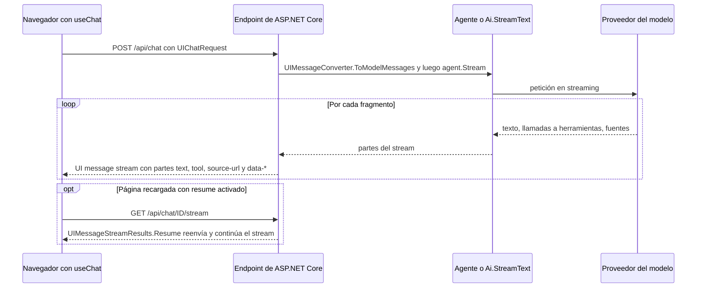

# ASP.NET Core y useChat

> 🇬🇧 [Read in English](ASP.NET-Core-and-useChat)



## ASP.NET Core + `useChat`

```csharp
builder.Services.AddAiSdk(ai => ai
    .AddAnthropic()
    .AddOpenAI()
    .AddAlias("chat", "anthropic:claude-opus-5-5")
    .AddDefaultModel("chat")
    .AddAgent<SupportAgent>());

app.MapPost("/api/chat", (UIChatRequest req, SupportAgent agent, HttpContext http) =>
    agent.Stream(new AgentCallOptions
    {
        Messages = UIMessageConverter.ToModelMessages(req.Messages),
        CancellationToken = http.RequestAborted,
    }).ToUIMessageStreamResult());
```

En el frontend: `useChat({ transport: new DefaultChatTransport({ api: "/api/chat" }) })`.

**Datos propios** (partes `data-*` en `useChat`): desde una herramienta con `ctx.WriteData("progress", new { percent = 50 }, id: "p")`,
o componiendo el stream:

```csharp
app.MapPost("/api/report", (UIChatRequest req, ILanguageModel model) =>
    UIMessageStreamResults.Create(writer =>
    {
        writer.WriteData("status", new { step = "buscando" }, id: "status");
        writer.Merge(Ai.StreamText(new() { Model = model, Messages = UIMessageConverter.ToModelMessages(req.Messages) }));
        return Task.CompletedTask;
    }));
```

**Streams reanudables**: la generación continúa aunque el usuario recargue la página y `useChat({ resume: true })` la retoma.

```csharp
builder.Services.AddAiSdk(ai => ai.AddAnthropic().AddResumableStreams());   // o tu IResumableStreamStore sobre Redis

app.MapPost("/api/chat", (UIChatRequest req, SupportAgent agent, IResumableStreamStore store) =>
    agent.Stream(UIMessageConverter.ToModelMessages(req.Messages)).ToResumableUIMessageStreamResult(store, req.Id!));

app.MapGet("/api/chat/{id}/stream", (string id, IResumableStreamStore store) => UIMessageStreamResults.Resume(store, id));
```

> [!TIP]
> Consulta `samples/ChatApi` para ver un ejemplo completo y ejecutable.

## Microsoft.Extensions.AI

```csharp
using AiSdk.Extensions.AI;

IChatClient azure = /* AzureOpenAIClient, OllamaApiClient, ... */;
ILanguageModel model = azure.AsLanguageModel();   // ahora sirve para Ai.*, agentes y middleware
```

---

**Siguiente:** [Pruebas y telemetría](es-Pruebas-y-telemetria) ➡️
