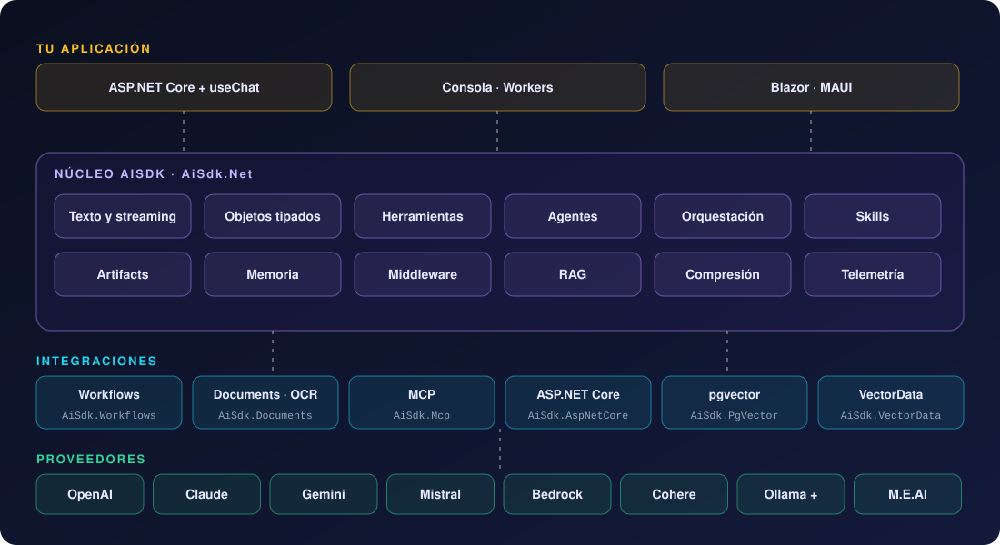
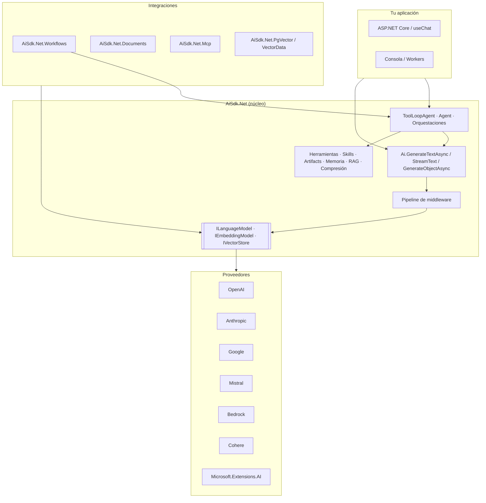
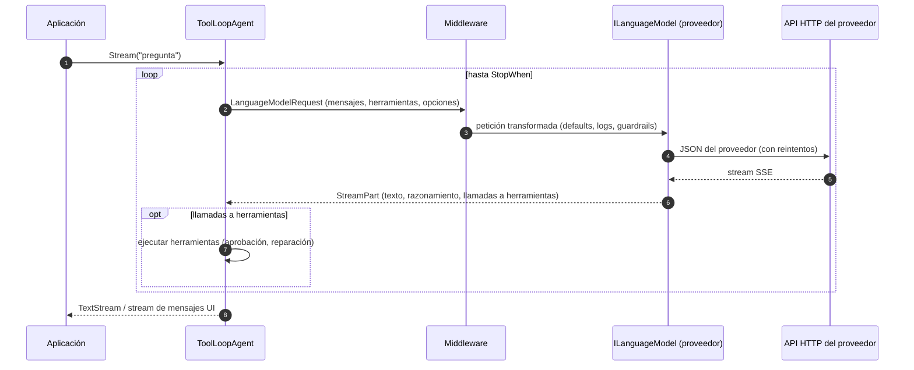

# 🏛️ Arquitectura

> 🇬🇧 [Read in English](Architecture)



AiSdk.Net es un conjunto de paquetes pequeños alrededor de un núcleo. Tu aplicación usa la **API del núcleo**
(`Ai.*`, agentes, orquestaciones); el núcleo habla con los modelos solo a través de la abstracción
`ILanguageModel`, así que proveedores, middleware y dobles de prueba son intercambiables.

## 🧱 Capas



## 🔄 Vida de una petición



## 📁 Estructura del repositorio

```
src/
  AiSdk/                      núcleo
  AiSdk.OpenAI/               proveedor OpenAI + servidores compatibles
  AiSdk.Anthropic/            proveedor Claude
  AiSdk.Google/               proveedor Gemini
  AiSdk.Mistral/              proveedor Mistral
  AiSdk.Bedrock/              proveedor Amazon Bedrock
  AiSdk.Cohere/               reranking y embeddings de Cohere
  AiSdk.Mcp/                  cliente MCP (stdio + HTTP)
  AiSdk.Extensions.AI/        adaptador Microsoft.Extensions.AI
  AiSdk.Extensions.DependencyInjection/
  AiSdk.AspNetCore/
  AiSdk.Documents/            documentos → Markdown, OCR, middleware de adjuntos; generación de Word/PDF/Excel
  AiSdk.Workflows/            workflows durables, triggers y automatizaciones
  AiSdk.PgVector/             almacén PostgreSQL + pgvector
  AiSdk.VectorData/           adaptador Microsoft.Extensions.VectorData
skills/aisdk-net/             Agent Skill que enseña a los agentes de código a usar este SDK
docs/
  assets/                     SVG animados e ícono del paquete
  wiki/                       esta wiki (sincronizada por .github/workflows/wiki.yml)
  quality/                    informes de calidad (CPM, auditoría de pruebas, trusted publishing)
  nuget/                      README incluido en los paquetes NuGet
samples/
  QuickStart/                 ejemplos de consola (usa `mock` para no necesitar API key)
  ChatApi/                    backend para useChat
tests/AiSdk.Tests/            pruebas unitarias (modelos simulados + HTTP falso)
tests/AiSdk.IntegrationTests/ pruebas en vivo contra las APIs reales (opcionales)
```

## 🧭 Principios de diseño

| Principio | En la práctica |
|---|---|
| **Una API, muchos proveedores** | Cada proveedor implementa `ILanguageModel`; cambias de modelo con una línea o con un alias de `ProviderRegistry` |
| **Paquetes pequeños** | El núcleo no depende de ningún proveedor; instalas solo lo que usas |
| **Nombres conocidos** | Sigue el AI SDK de Vercel (`generateText` → `GenerateTextAsync`) y los conceptos de Laravel AI, ver [Equivalencias](es-Equivalencias) |
| **Fácil de probar** | `MockLanguageModel` y handlers HTTP falsos; las pruebas unitarias no usan red |
| **Observable** | Spans y métricas en cada llamada, herramienta y agente, con las convenciones GenAI de OpenTelemetry |
| **Seguro por defecto** | Las skills no confiables no ejecutan scripts, se rechaza path traversal, se verifican los secretos de webhooks |

---

**Siguiente:** [Calidad](es-Calidad) ➡️
