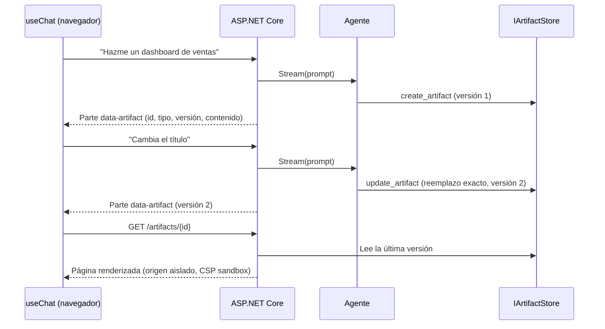

# Artifacts y documentos Office

> 🇬🇧 [Read in English](Artifacts-and-Office-Documents)



## 🖼️ Artifacts (como Claude)

Los agentes crean contenido sustancial que se muestra aparte del chat (páginas HTML, componentes React,
documentos, código, diagramas Mermaid/SVG), lo editan con reemplazos exactos y guardan cada versión.

```csharp
var store = new FileSystemArtifactStore("data/artifacts");          // o InMemoryArtifactStore, o tu IArtifactStore
var agent = new ToolLoopAgent(new()
{
    Model = claude,
    Instructions = ArtifactTools.Instructions,                     // cuándo y cómo crear artifacts
    Tools = ArtifactTools.Create(store, new() { Url = a => $"/artifacts/{a.Id}" }),
});

// En cada petición: el usuario sale de tu autenticación, nunca del cuerpo de la petición.
var result = agent.Stream(new AgentCallOptions
{
    Messages = UIMessageConverter.ToModelMessages(req.Messages),
    Context = new Dictionary<string, object?> { ["conversationId"] = req.Id, ["userId"] = EndpointSecurity.GetUserId(http) },
});

app.MapArtifacts("/artifacts");   // exige autorización; cada usuario solo ve sus artifacts (CSP sandbox)
```

Herramientas: `create_artifact`, `update_artifact` (reemplazo exacto), `rewrite_artifact`, `read_artifact`, `list_artifacts`.
Cada cambio llega a `useChat` como parte `data-artifact` (con id, tipo, versión y contenido) para mostrarlo en un panel;
`ArtifactRenderer.ToHtml(artifact)` convierte Markdown, Mermaid, React, SVG o CSV en una página autónoma.

Las herramientas necesitan `Context["userId"]` (el dueño, de tu autenticación) y/o `Context["conversationId"]`, y
**fallan sin ninguno de los dos** (`new ArtifactToolOptions { AllowUnscoped = true }` para aplicaciones de un solo usuario
o scripts). Cada conversación solo ve y edita sus artifacts, y un usuario nunca ve los de otro aunque el id de
conversación (que elige el cliente) coincida. Los artifacts guardan su `Owner`; `ArtifactScope.CanAccess` aplica la
misma regla en tu código.

### Servir artifacts de forma segura

- `MapArtifacts` exige autorización (`new ArtifactEndpointOptions { AllowAnonymous = true }` para desactivarla) y sirve
  cada artifact solo a su dueño (`Artifact.Owner` igual al usuario autenticado). Personalízalo con
  `CanAccess = (http, artifact) => ...` (equipos, administradores, conversaciones compartidas); lo que no puedes ver responde 404.
- `GET /artifacts?conversationId=` lista los metadatos de esa conversación que puedes ver; sin él, tus propios artifacts.
  Nunca lista todo el almacén, y `FileSystemArtifactStore.ListAsync` ya no lee los binarios (`Data` es null en los listados).
- Todo lo que escribe el modelo se sirve con `Content-Security-Policy: sandbox ...` y `X-Content-Type-Options: nosniff`;
  el HTML, SVG o XML crudo (`/raw`) y los archivos se descargan (`Content-Disposition: attachment`).
- Los artifacts guardados antes de 0.2 no tienen `Owner` y no se sirven por defecto: complétalo o decide con `CanAccess`.

> [!IMPORTANT]
> Como defensa en profundidad, sirve los artifacts desde un origen propio (por ejemplo `artifacts.example.com`, sin las
> cookies de la aplicación) y muéstralos en un `<iframe>`.

> [!TIP]
> El lado del frontend (`useChat` y la parte `data-artifact`) se explica en [ASP.NET Core y useChat](es-ASP.NET-Core-y-useChat).

## 📄 Generar Word, PDF y Excel

```csharp
var style = new DocumentStyleOptions { Title = "Informe Q3", Author = "Ventas", TitlePage = true, HeaderText = "Confidencial" };
File.WriteAllBytes("informe.docx", DocumentGenerator.ToDocx(markdown, style));   // estilos reales de Word, editable
File.WriteAllBytes("informe.pdf", DocumentGenerator.ToPdf(markdown, style));     // sin navegador ni dependencias nativas

var xlsx = new SpreadsheetBuilder()
    .AddSheet("Ventas", ventas, new SheetOptions { Totals = true })               // desde objetos: tipos y formatos automáticos
    .AddSheet("Cálculo", [new("Item"), new("Precio", ColumnType.Currency), new("Cant."), new("Subtotal", ColumnType.Currency)],
              [["Mesa", 120.5, 2, "=B2*C2"]])                                    // fórmulas con "="
    .AddMarkdownTables(textoConTablas)                                            // una hoja por tabla Markdown
    .Build();
```

- **Word**: títulos, listas numeradas y con viñetas, tablas con encabezado, enlaces, citas, código, portada,
  encabezado y "Página n de N". Validado con el validador oficial de OpenXml.
- **PDF**: diagramación propia (ajuste de línea, tablas que se parten entre páginas repitiendo el encabezado, enlaces,
  código, citas, `\pagebreak`). Incluye las fuentes *AiSdk Sans/Mono* (derivadas de Liberation, licencia OFL) con
  acentos, ñ, griego y símbolos; para otros alfabetos: `PdfFonts.FromSingle(File.ReadAllBytes("NotoSansCJK.ttf"))`.
- **Excel**: columnas tipadas (moneda, porcentaje, fechas...), encabezado con estilo, filtros, panel fijo, anchos
  automáticos, fila de totales con `SUM` y fórmulas; entiende números como `1.234,50` y `12,5%`.

Para que el **agente** genere los archivos (se guardan como artifacts descargables):

```csharp
Tools = DocumentTools.Create(new DocumentToolOptions { Store = store, ArtifactOptions = new() { Url = a => $"/artifacts/{a.Id}" } }),
// create_word_document, create_pdf, create_spreadsheet  (+ DocumentTools.Instructions en el system prompt)
```

---

> [!NOTE]
> Para el camino inverso (leer PDF, Office, imágenes o audio como Markdown) ver [Documentos, OCR y contexto](es-Documentos-OCR-y-contexto).

---

➡️ Siguiente: [Workflows y automatizaciones](es-Workflows-y-automatizaciones)
