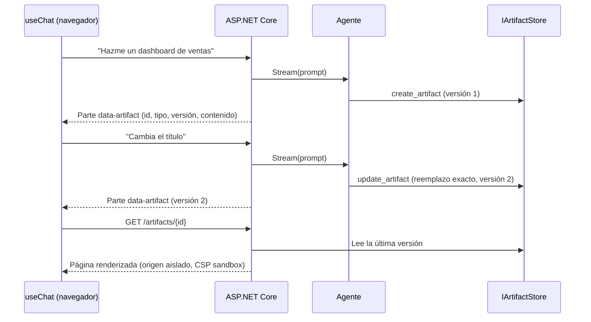

# Artifacts y documentos Office

> 🇬🇧 [Read in English](Artifacts-and-Office-Documents)



## 🖼️ Artifacts (como Claude)

Los agentes crean contenido sustancial que se muestra aparte del chat (páginas HTML, componentes React,
documentos, código, diagramas Mermaid/SVG), lo editan con reemplazos exactos y guardan cada versión.

```csharp
var store = new FileSystemArtifactStore("data/artifacts");          // o InMemoryArtifactStore, o tu IArtifactStore
var agent = new ToolLoopAgent(new()
{
    Model = claude,
    Instructions = ArtifactTools.Instructions,                     // cuándo y cómo crear artifacts
    Tools = ArtifactTools.Create(store, new() { Url = a => $"/artifacts/{a.Id}" }),
});

app.MapArtifacts("/artifacts");   // GET /artifacts/{id}: página renderizada en un origen aislado (CSP sandbox)
```

Herramientas: `create_artifact`, `update_artifact` (reemplazo exacto), `rewrite_artifact`, `read_artifact`, `list_artifacts`.
Cada cambio llega a `useChat` como parte `data-artifact` (con id, tipo, versión y contenido) para mostrarlo en un panel;
`ArtifactRenderer.ToHtml(artifact)` convierte Markdown, Mermaid, React, SVG o CSV en una página autónoma.
Con `Context["conversationId"]` cada conversación solo ve y edita sus artifacts.

> [!TIP]
> El lado del frontend (`useChat` y la parte `data-artifact`) se explica en [ASP.NET Core y useChat](es-ASP.NET-Core-y-useChat).

## 📄 Generar Word, PDF y Excel

```csharp
var style = new DocumentStyleOptions { Title = "Informe Q3", Author = "Ventas", TitlePage = true, HeaderText = "Confidencial" };
File.WriteAllBytes("informe.docx", DocumentGenerator.ToDocx(markdown, style));   // estilos reales de Word, editable
File.WriteAllBytes("informe.pdf", DocumentGenerator.ToPdf(markdown, style));     // sin navegador ni dependencias nativas

var xlsx = new SpreadsheetBuilder { AllowFormulas = true }                       // datos de confianza: "=..." es fórmula
    .AddSheet("Ventas", ventas, new SheetOptions { Totals = true })               // desde objetos: tipos y formatos automáticos
    .AddSheet("Cálculo", [new("Item"), new("Precio", ColumnType.Currency), new("Cant."), new("Subtotal", ColumnType.Currency)],
              [["Mesa", 120.5, 2, "=B2*C2"]])                                    // fórmulas con "="
    .AddMarkdownTables(textoConTablas)                                            // una hoja por tabla Markdown
    .Build();
```

- **Word**: títulos, listas numeradas y con viñetas, tablas con encabezado, enlaces, citas, código, portada,
  encabezado y "Página n de N". Validado con el validador oficial de OpenXml.
- **PDF**: diagramación propia (ajuste de línea, tablas que se parten entre páginas repitiendo el encabezado, enlaces,
  código, citas, `\pagebreak`). Incluye las fuentes *AiSdk Sans/Mono* (derivadas de Liberation, licencia OFL) con
  acentos, ñ, griego y símbolos; para otros alfabetos: `PdfFonts.FromSingle(File.ReadAllBytes("NotoSansCJK.ttf"))`.
- **Excel**: columnas tipadas (moneda, porcentaje, fechas...), encabezado con estilo, filtros, panel fijo, anchos
  automáticos, fila de totales con `SUM` y fórmulas; entiende números como `1.234,50` y `12,5%`.
- **Enlaces** en Word y PDF: solo se crean para `http`, `https` y `mailto`; `file:`, rutas UNC, `javascript:` o
  `data:` quedan como texto.

> [!WARNING]
> **Las fórmulas están desactivadas por defecto** (desde la 0.2). Los textos que empiezan con `=`, `+`, `-` o `@` se
> escriben como texto (con el prefijo de comilla de Excel), así los datos de usuarios finales (`AddSheet<T>`) o de un
> modelo (`AddMarkdownTables`, `ToXlsx`) no se convierten en `=HYPERLINK(...)`, `=WEBSERVICE(...)` ni DDE que filtren
> datos al abrir el archivo. Actívelas con `AllowFormulas = true` para datos de confianza, opcionalmente con
> `FormulaFilter = SpreadsheetBuilder.IsSafeFormula` (solo funciones de cálculo: sin red, enlaces, DDE ni otros libros).

Para que el **agente** genere los archivos (se guardan como artifacts descargables):

```csharp
Tools = DocumentTools.Create(new DocumentToolOptions { Store = store, ArtifactOptions = new() { Url = a => $"/artifacts/{a.Id}" } }),
// create_word_document, create_pdf, create_spreadsheet  (+ DocumentTools.Instructions en el system prompt)
```

`create_spreadsheet` conserva las fórmulas de cálculo del modelo (`=B2*C2`, `=SUM(D2:D9)`), pero solo las que acepta
`DocumentToolOptions.FormulaFilter` (por defecto `SpreadsheetBuilder.IsSafeFormula`); las demás se escriben como
texto. El modelo puede estar siguiendo instrucciones inyectadas en una página o un correo que leyó, y una fórmula de
red filtraría datos cuando el usuario abra el archivo. `AllowFormulas = false` escribe todo como texto.

---

> [!NOTE]
> Para el camino inverso (leer PDF, Office, imágenes o audio como Markdown) ver [Documentos, OCR y contexto](es-Documentos-OCR-y-contexto).

---

➡️ Siguiente: [Workflows y automatizaciones](es-Workflows-y-automatizaciones)
