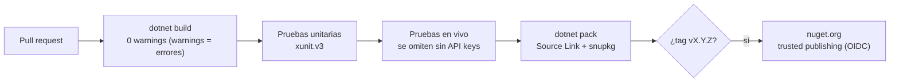

# ✅ Calidad

> 🇬🇧 [Read in English](Quality)

AiSdk.Net sigue las guías oficiales de [dotnet/skills](https://github.com/dotnet/skills) para mantenerse
profesional y sustentable. Cada punto de esta página lo exige la compilación o la CI, no solo la documentación.



| Área | Qué hacemos | Informe |
|---|---|---|
| 📦 Dependencias | **Central Package Management**: una versión por paquete en `Directory.Packages.props` | [convert-to-cpm.es.md](https://github.com/bluesmilecl/AiSdk.Net/blob/HEAD/docs/quality/convert-to-cpm.es.md) |
| 🏗️ Compilación | `Directory.Build.props` por capas (raíz, `src/`, `tests/`): metadatos NuGet, Source Link, símbolos y documentación XML en un solo lugar | |
| 🔍 Analizadores | `AnalysisLevel=latest-recommended`, `TreatWarningsAsErrors`: **0 warnings** | |
| 🧪 Pruebas | Más de 450 pruebas unitarias con **xunit.v3**, `TestContext.Current.CancellationToken`, omisiones explícitas | |
| 🕵️ Auditoría de pruebas | Anti-patrones (carreras por tiempos, dependencias de reloj y SO, aserciones permisivas): todos los hallazgos altos corregidos | [test-anti-patterns.es.md](https://github.com/bluesmilecl/AiSdk.Net/blob/HEAD/docs/quality/test-anti-patterns.es.md) |
| 🌍 Validación en vivo | `LiveFeatureTests` prueba skills, router, artifacts + Excel y resúmenes map-reduce con modelos reales | |
| 🔐 Publicación | **Trusted publishing** de NuGet con OIDC, sin API keys de larga duración | [nuget-trusted-publishing.es.md](https://github.com/bluesmilecl/AiSdk.Net/blob/HEAD/docs/quality/nuget-trusted-publishing.es.md) |
| 🛡️ Cadena de suministro | Acciones fijadas por hash, `GITHUB_TOKEN` de solo lectura por defecto, claves de los proveedores solo en la rama principal, atestación de procedencia SLSA de cada `.nupkg` (`gh attestation verify`), NuGetAudit (las vulnerabilidades altas y críticas rompen la compilación), CodeQL y OpenSSF Scorecard | [`.github/workflows`](https://github.com/bluesmilecl/AiSdk.Net/tree/HEAD/.github/workflows) |

## Versiones y compatibilidad

- **Versionado Semántico desde la 1.0.** Las versiones menores y de corrección nunca rompen la API pública; los cambios
  incompatibles esperan a la siguiente versión mayor y se anuncian con `[Obsolete]` al menos una versión menor antes.
- **La API pública está controlada** con `Microsoft.CodeAnalysis.PublicApiAnalyzers`: cada proyecto tiene
  `PublicAPI.Shipped.txt` (lo publicado) y `PublicAPI.Unshipped.txt` (lo que agrega la próxima versión). La compilación
  falla si un miembro público cambia sin actualizarlos, así nada cambia por accidente.
- **Fuera de la garantía:**
  - Las APIs marcadas `[Experimental]` (por ejemplo `AISDKMCP001`, roots y sampling de MCP): pueden cambiar en una
    versión menor.
  - Los tipos de `AiSdk.Internal` (`JsonUtil`, `StreamAccumulator`): son públicos para los paquetes de proveedores,
    pero pueden cambiar.
  - El texto de los mensajes (excepciones, avisos, textos que recibe el modelo): están localizados (inglés, español) y
    pueden cambiar de redacción. No los interpretes con código.
  - La telemetría sigue las convenciones semánticas GenAI de OpenTelemetry, que aún están en desarrollo: los cambios de
    atributos las siguen y se anotan en `CHANGELOG.md`.
- **Plataforma soportada:** .NET 10. Las correcciones de seguridad van a la última versión 1.x (ver `SECURITY.md`).

## Ejecutar las verificaciones en local

```bash
dotnet build AiSdk.slnx            # debe terminar con 0 warnings
dotnet test tests/AiSdk.Tests
OPENAI_API_KEY=... dotnet test tests/AiSdk.IntegrationTests   # pruebas en vivo opcionales
```

---

**Siguiente:** [Hoja de ruta](es-Hoja-de-ruta) ➡️
