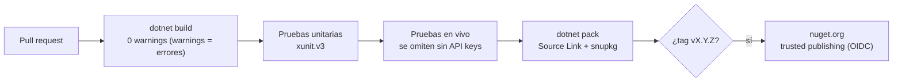

# ✅ Calidad

> 🇬🇧 [Read in English](Quality)

AiSdk.Net sigue las guías oficiales de [dotnet/skills](https://github.com/dotnet/skills) para mantenerse
profesional y sustentable. Cada punto de esta página lo exige la compilación o la CI, no solo la documentación.



| Área | Qué hacemos | Informe |
|---|---|---|
| 📦 Dependencias | **Central Package Management**: una versión por paquete en `Directory.Packages.props` | [convert-to-cpm.es.md](https://github.com/bluesmilecl/sdk-agent-ia-net/blob/HEAD/docs/quality/convert-to-cpm.es.md) |
| 🏗️ Compilación | `Directory.Build.props` por capas (raíz, `src/`, `tests/`): metadatos NuGet, Source Link, símbolos y documentación XML en un solo lugar | |
| 🔍 Analizadores | `AnalysisLevel=latest-recommended`, `TreatWarningsAsErrors`: **0 warnings** | |
| 🧪 Pruebas | Más de 200 pruebas unitarias con **xunit.v3**, `TestContext.Current.CancellationToken`, omisiones explícitas | |
| 🕵️ Auditoría de pruebas | Anti-patrones (carreras por tiempos, dependencias de reloj y SO, aserciones permisivas): todos los hallazgos altos corregidos | [test-anti-patterns.es.md](https://github.com/bluesmilecl/sdk-agent-ia-net/blob/HEAD/docs/quality/test-anti-patterns.es.md) |
| 🌍 Validación en vivo | `LiveFeatureTests` prueba skills, router, artifacts + Excel y resúmenes map-reduce con modelos reales | |
| 🔐 Publicación | **Trusted publishing** de NuGet con OIDC, sin API keys de larga duración | [nuget-trusted-publishing.es.md](https://github.com/bluesmilecl/sdk-agent-ia-net/blob/HEAD/docs/quality/nuget-trusted-publishing.es.md) |

## Ejecutar las verificaciones en local

```bash
dotnet build AiSdk.slnx            # debe terminar con 0 warnings
dotnet test tests/AiSdk.Tests
OPENAI_API_KEY=... dotnet test tests/AiSdk.IntegrationTests   # pruebas en vivo opcionales
```

---

**Siguiente:** [Hoja de ruta](es-Hoja-de-ruta) ➡️
