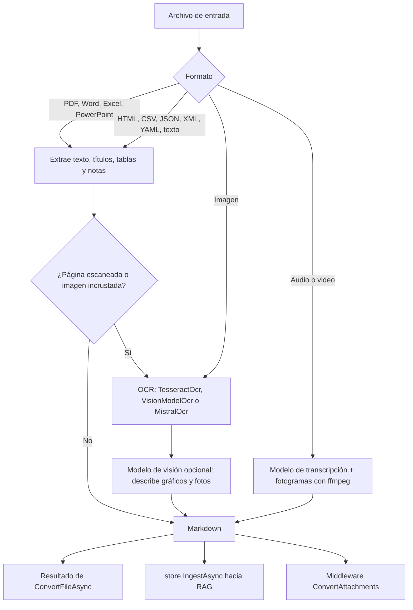

# Documentos, OCR y compresión de contexto

> 🇬🇧 [Read in English](Documents-OCR-and-Context)



## Documentos a Markdown y OCR

`AiSdk.Documents` convierte archivos al formato que los modelos leen mejor y con menos tokens
(similar a MarkItDown o Docling). Las imágenes y páginas escaneadas pasan por OCR; los modelos con visión
describen gráficos y fotos; el audio y el video se transcriben.

| Formato | Resultado |
|---|---|
| PDF | Texto en orden de lectura, títulos por tamaño de fuente, sin encabezados/pies repetidos; páginas escaneadas con OCR |
| Word (.docx) | Títulos, listas numeradas y con viñetas, negrita/cursiva, enlaces, tablas, imágenes incrustadas (OCR/descripción) |
| Excel (.xlsx) | Una tabla por hoja, fechas y resultados de fórmulas, límite de filas configurable |
| PowerPoint (.pptx) | Una sección por diapositiva con título, viñetas, tablas, imágenes y notas del orador |
| HTML, CSV/TSV, JSON, XML, YAML, texto | Markdown limpio, tablas y bloques de código |
| Imágenes | Texto (OCR) y/o descripción con un modelo de visión |
| Audio / video | Transcripción con marcas de tiempo; en video, línea de tiempo con escenas (fotogramas con `ffmpeg`) |

```csharp
var converter = new MarkdownConverter(new MarkdownConverterOptions
{
    Ocr = new TesseractOcr("spa+eng"),            // local; o MistralProvider.Default.Ocr(), o new VisionModelOcr(claude)
    VisionModel = anthropic.Messages("claude-opus-5-5"),   // opcional: describe gráficos, fotos y fotogramas
    Transcription = openai.Transcription("gpt-4o-transcribe"),   // opcional: audio y video
    Language = "es",
});

var result = await converter.ConvertFileAsync("contrato-escaneado.pdf");
Console.WriteLine(result.Markdown);          // también: Pages, Title, Warnings, EstimatedTokens

// Directo a RAG: por página y fragmento, con metadatos source/page/title
await store.IngestAsync(converter, await DocumentSource.FromFileAsync("manual.docx"));
```

Motores OCR incluidos: `TesseractOcr` (sin enviar datos a terceros; `apt install tesseract-ocr tesseract-ocr-spa`),
`VisionModelOcr` (cualquier modelo con visión; lee tablas y escritura a mano) y `MistralOcr` (acepta PDF completos).
Para PDF escaneados se usa `pdftoppm` (poppler-utils) si está instalado o, si no, la imagen incrustada de cada página.
Las páginas escaneadas se rasterizan y reconocen de a una (a lo más `MaxConcurrency` a la vez), así un escaneo largo
nunca tiene todas sus imágenes en memoria; si una página no se puede rasterizar se usa su imagen incrustada. Si el
documento viene de `DocumentSource.FromFileAsync`, `pdftoppm` lee el archivo original en vez de una copia temporal.
`Progress` informa las páginas, cuántas van a OCR y cuántas terminaron:

```csharp
var converter = new MarkdownConverter(new()
{
    Ocr = new TesseractOcr("spa+eng"),
    Progress = new Progress<DocumentConversionProgress>(p => Console.WriteLine($"OCR {p.OcrPagesDone}/{p.OcrPages} de {p.Pages} páginas")),
});
```

**Herramientas externas** (`tesseract`, `pdftoppm`, `ffmpeg`): se lanzan con `ExternalProcess.Runner`. Por defecto
cada herramienta recibe solo las variables de `ExternalProcessOptions.CommonEnvironmentVariables` (nunca las claves de
API ni las cadenas de conexión de la aplicación), se detiene junto con sus procesos hijos a los 10 minutos (`Timeout`)
y puede escribir a lo más 64 MB en su salida estándar (`MaxOutputBytes`). `ffmpeg` y `ffprobe` solo leen el archivo
local (`-protocol_whitelist file`) con formatos de audio y video (`-format_whitelist`: sin listas HLS, DASH ni `concat`
que pedirían URLs u otros archivos) y solo los primeros `MaxMediaDuration`. Los archivos temporales quedan en un
directorio privado (0700 en Unix). Reemplace el ejecutor al iniciar la aplicación para usar un envoltorio (sandbox,
`nice`, un contenedor) o cambiar esos límites; `TesseractOcr`, `PdftoppmRasterizer` y
`MarkdownConverterOptions.ProcessRunner` también aceptan uno propio:

```csharp
ExternalProcess.Runner = new ExternalProcessRunner(new ExternalProcessOptions
{
    Wrapper = "nice",                                    // ejecuta: nice -n 10 tesseract ...
    WrapperArguments = ["-n", "10"],
    AllowedEnvironmentVariables = [.. ExternalProcessOptions.CommonEnvironmentVariables, "SANDBOX_*"],
    EnvironmentVariables = new Dictionary<string, string?> { ["OMP_THREAD_LIMIT"] = "1" },   // un hilo por Tesseract
    Timeout = TimeSpan.FromMinutes(2),
});
```

> [!WARNING]
> Desde la 0.2 las herramientas ya no heredan todo el entorno de la aplicación. Si una necesita otra variable,
> agréguela a `AllowedEnvironmentVariables`; `AllowedEnvironmentVariables = null` vuelve al comportamiento anterior.

### Límites para documentos no confiables

Un documento puede ser pequeño y aun así pedir mucho trabajo (unos KB de PDF con miles de páginas en blanco, una hoja
comprimida con una celda en la columna ZZZZZZ, HTML muy anidado). `MarkdownConverterOptions` acota ese trabajo; al
superar un límite se devuelve un resultado parcial y se explica en `result.Warnings`:

| Opción | Por defecto | Al superarlo |
|---|---|---|
| `MaxInputBytes` | 100 MB | `DocumentTooLargeException` (con archivos, antes de leerlos) |
| `MaxPdfPages` | 1000 | solo se procesan las primeras páginas |
| `MaxOcrPages` | 100 | las páginas escaneadas e imágenes incrustadas restantes no van a OCR ni a visión (acota procesos y llamadas pagadas) |
| `MaxRasterPixels` | 5000 px | las páginas enormes se rasterizan a menos de 200 ppp; las imágenes incrustadas más grandes se omiten |
| `MaxNestingDepth` | 128 | HTML: lo más profundo se convierte a texto plano; Office: `InvalidDataException` (el SDK de Open XML carga las partes de forma recursiva) |
| `MaxHtmlBytes` | 10 MB | se omite el resto del HTML |
| `MaxOfficePartChars` | 32 millones | `InvalidDataException` (las hojas de Excel se leen hasta ese punto) |
| `MaxRowsPerSheet` | 1000 | las demás filas se cuentan, no se escriben (también en CSV) |
| `MaxEmbeddedImageBytes` | 20 MB | la imagen se omite |
| `MaxMediaDuration` | 1 hora | solo se analiza el comienzo del video |

Límites fijos: las tablas Markdown tienen a lo más 1.000.000 de celdas (`MarkdownTable.DefaultMaxCells`), las de Word a
lo más 63 columnas (también con `gridSpan`), las referencias de Excel más allá de la columna `XFD` se ignoran, los
niveles de lista van de 0 a 8 y las líneas de un CSV se leen hasta 16.384 columnas. El HTML se analiza una vez
vigilando la profundidad, el ruido (`script`, `style`, `nav`...) se quita del DOM y la conversión corre en un hilo con
pila propia amplia: un HTML hostil no puede botar el proceso. Para leer subidas use
`DocumentSource.FromStreamAsync(stream, maxBytes: ...)`.

> [!NOTE]
> `TesseractOcr` se ejecuta completamente en tu máquina, por lo que es la opción adecuada cuando los documentos no pueden salir de tu infraestructura.

**Modelos sin visión ni soporte de archivos**: el middleware reemplaza imágenes, PDF, Office, audio y video por su
Markdown antes de llamar al modelo (con caché, para no reprocesar el historial en cada turno):

```csharp
var model = mistral.Chat("mistral-small-latest")
    .WithMiddleware(DocumentMiddlewares.ConvertAttachments(converter, new AttachmentConversionOptions
    {
        Native = NativeAttachments.None,              // o Images | Pdf si el modelo los soporta
        MaxTokensPerAttachment = 8000,
        CompressionEmbeddings = openai.Embedding("text-embedding-3-small"),   // conserva lo relevante a la pregunta
    }));
```

Cada adjunto se reemplaza por `<document name="..." type="...">Markdown</document>`. El nombre se escapa y cualquier
`<document` o `</document` del contenido se neutraliza (`&lt;/document`), así un archivo no puede cerrar el envoltorio
e inyectar texto fuera de él.

`DownloadUrls = true` (desactivado por defecto) también convierte adjuntos referenciados por URL. La URL la elige quien
escribe el mensaje y el contenido se muestra al modelo, así que las descargas pasan por `UrlDownloader`: solo http y
https, conexión directa (sin proxy) a la IP ya validada, nunca a loopback, redes privadas (RFC 1918), link-local
(incluido el servicio de metadatos de la nube 169.254.169.254), CGNAT, direcciones locales únicas IPv6, multicast ni sus
formas IPv4 mapeadas; a lo más 5 redirecciones, validando cada una; a lo más 25 MB (comprobado mientras se lee) y 30
segundos. Las URLs `data:` tienen el mismo máximo. Se ajusta con `MarkdownConverterOptions.UrlDownload`:

```csharp
var converter = new MarkdownConverter(new()
{
    UrlDownload = new UrlDownloadOptions
    {
        UrlValidator = url => url.Host.EndsWith(".ejemplo.cl", StringComparison.OrdinalIgnoreCase),   // lista permitida, en cada salto
        MaxBytes = 10 * 1024 * 1024,
        // AllowPrivateNetworks = true,   // solo si las URLs vienen de una fuente de confianza
    },
});
```

> [!WARNING]
> Desde la 0.2 `MarkdownConverterOptions.HttpClient` ya no existe: lo reemplaza `UrlDownload`. Un `HttpClient` propio no
> podía aplicar estas comprobaciones. El descargador no usa proxy (validaría la IP del proxy, no la del destino); detrás
> de un proxy obligatorio, descargue el archivo usted y pase sus bytes.

## Compresión de contexto

```csharp
// Conversaciones largas: recorta resultados de herramientas antiguos y resume los turnos viejos
// (incremental y cacheado) con un modelo barato; nunca separa una llamada a herramienta de su resultado.
var model = claude.WithMiddleware(Middlewares.CompressContext(
    maxInputTokens: 50_000, summarizer: anthropic.Messages("claude-haiku-5-5"), keepRecentMessages: 8));

// Textos largos
var relevante = await ContextCompressor.SelectRelevantAsync(embeddings, textoLargo, pregunta, maxTokens: 3000);
var resumen = await ContextCompressor.SummarizeAsync(modeloBarato, textoLargo, targetTokens: 2000, focus: "plazos y montos");
var tokens = TokenEstimator.Estimate(textoLargo);
```

---

**Siguiente:** [MCP](es-MCP) ➡️
