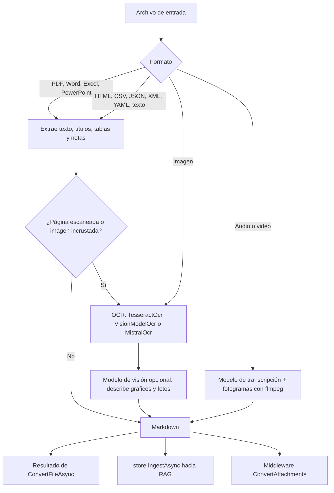

# Documentos, OCR y compresión de contexto

> 🇬🇧 [Read in English](Documents-OCR-and-Context)



## Documentos a Markdown y OCR

`AiSdk.Documents` convierte archivos al formato que los modelos leen mejor y con menos tokens
(similar a MarkItDown o Docling). Las imágenes y páginas escaneadas pasan por OCR; los modelos con visión
describen gráficos y fotos; el audio y el video se transcriben.

| Formato | Resultado |
|---|---|
| PDF | Texto en orden de lectura, títulos por tamaño de fuente, sin encabezados/pies repetidos; páginas escaneadas con OCR |
| Word (.docx) | Títulos, listas numeradas y con viñetas, negrita/cursiva, enlaces, tablas, imágenes incrustadas (OCR/descripción) |
| Excel (.xlsx) | Una tabla por hoja, fechas y resultados de fórmulas, límite de filas configurable |
| PowerPoint (.pptx) | Una sección por diapositiva con título, viñetas, tablas, imágenes y notas del orador |
| HTML, CSV/TSV, JSON, XML, YAML, texto | Markdown limpio, tablas y bloques de código |
| Imágenes | Texto (OCR) y/o descripción con un modelo de visión |
| Audio / video | Transcripción con marcas de tiempo; en video, línea de tiempo con escenas (fotogramas con `ffmpeg`) |

```csharp
var converter = new MarkdownConverter(new MarkdownConverterOptions
{
    Ocr = new TesseractOcr("spa+eng"),            // local; o MistralProvider.Default.Ocr(), o new VisionModelOcr(claude)
    VisionModel = anthropic.Messages("claude-opus-5-5"),   // opcional: describe gráficos, fotos y fotogramas
    Transcription = openai.Transcription("gpt-4o-transcribe"),   // opcional: audio y video
    Language = "es",
});

var result = await converter.ConvertFileAsync("contrato-escaneado.pdf");
Console.WriteLine(result.Markdown);          // también: Pages, Title, Warnings, EstimatedTokens

// Directo a RAG: por página y fragmento, con metadatos source/page/title
await store.IngestAsync(converter, await DocumentSource.FromFileAsync("manual.docx"));
```

Motores OCR incluidos: `TesseractOcr` (sin enviar datos a terceros; `apt install tesseract-ocr tesseract-ocr-spa`),
`VisionModelOcr` (cualquier modelo con visión; lee tablas y escritura a mano) y `MistralOcr` (acepta PDF completos).
Para PDF escaneados se usa `pdftoppm` (poppler-utils) si está instalado o, si no, la imagen incrustada de cada página.

> [!NOTE]
> `TesseractOcr` se ejecuta completamente en tu máquina, por lo que es la opción adecuada cuando los documentos no pueden salir de tu infraestructura.

**Modelos sin visión ni soporte de archivos**: el middleware reemplaza imágenes, PDF, Office, audio y video por su
Markdown antes de llamar al modelo (con caché, para no reprocesar el historial en cada turno):

```csharp
var model = mistral.Chat("mistral-small-latest")
    .WithMiddleware(DocumentMiddlewares.ConvertAttachments(converter, new AttachmentConversionOptions
    {
        Native = NativeAttachments.None,              // o Images | Pdf si el modelo los soporta
        MaxTokensPerAttachment = 8000,
        CompressionEmbeddings = openai.Embedding("text-embedding-3-small"),   // conserva lo relevante a la pregunta
    }));
```

## Compresión de contexto

```csharp
// Conversaciones largas: recorta resultados de herramientas antiguos y resume los turnos viejos
// (incremental y cacheado) con un modelo barato; nunca separa una llamada a herramienta de su resultado.
var model = claude.WithMiddleware(Middlewares.CompressContext(
    maxInputTokens: 50_000, summarizer: anthropic.Messages("claude-haiku-5-5"), keepRecentMessages: 8));

// Textos largos
var relevante = await ContextCompressor.SelectRelevantAsync(embeddings, textoLargo, pregunta, maxTokens: 3000);
var resumen = await ContextCompressor.SummarizeAsync(modeloBarato, textoLargo, targetTokens: 2000, focus: "plazos y montos");
var tokens = TokenEstimator.Estimate(textoLargo);
```

---

**Siguiente:** [MCP](es-MCP) ➡️
