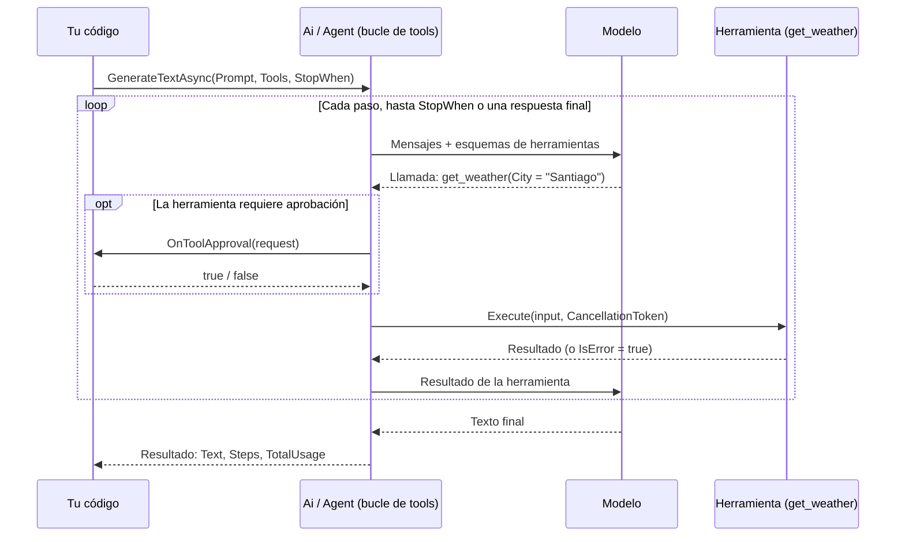

# Herramientas y agentes

> 🇬🇧 [Read in English](Tools-and-Agents)

## 🔁 El bucle de herramientas de un vistazo



## 🛠️ Herramientas y bucle de agente

```csharp
public sealed record WeatherQuery([property: Description("Ciudad")] string City);
public sealed record Weather(string City, int TemperatureC);

var weather = Tool.Create<WeatherQuery, Weather>(
    "get_weather", "Obtiene el clima de una ciudad",
    async (q, ct) => await weatherService.GetAsync(q.City, ct));

// O desde cualquier delegado/método; CancellationToken, ToolExecutionContext e IServiceProvider se inyectan.
var convert = Tool.FromDelegate("c_to_f", "Convierte °C a °F",
    ([Description("Temperatura en °C")] double c) => c * 9 / 5 + 32);

var result = await Ai.GenerateTextAsync(new GenerateTextOptions
{
    Model = model,
    Prompt = "¿Qué temperatura hace en Santiago, en °F?",
    Tools = [weather, convert],
    StopWhen = StopCondition.StepCountIs(5),
    OnStepFinish = step => { Console.WriteLine(step.ToolCalls.Count); return ValueTask.CompletedTask; },
});
```

Los errores de las herramientas (excepciones, JSON inválido, herramienta desconocida) se devuelven al modelo
como resultados con `IsError = true`, para que pueda corregirse. Las herramientas sin `Execute`
(`Tool.Define<T>`) se resuelven en el cliente: el bucle se detiene y quedan en `result.PendingToolCalls`. Cuando el
modelo pide varias herramientas en un mismo paso se ejecutan en paralelo, como máximo `MaxParallelToolCalls` a la vez
(8 por defecto; con 1 se ejecutan en orden).

## 🤖 Agentes

**Por configuración** (estilo AI SDK):

```csharp
var agent = new ToolLoopAgent(new AgentSettings
{
    Model = model,
    Instructions = "Eres un asistente meteorológico.",
    Tools = [weather, convert],
    // StopWhen por defecto: StepCountIs(20)
});

var result = await agent.GenerateAsync("Compara Santiago y Lima");
var stream = agent.Stream("Compara Santiago y Lima");
```

**Por clase** (estilo Laravel), ideal con inyección de dependencias:

```csharp
public sealed class SupportAgent(ILanguageModel model, IOrderService orders) : Agent
{
    protected override ILanguageModel Model => model;
    protected override string Instructions => "Eres el agente de soporte de la tienda.";
    protected override IEnumerable<Tool> Tools =>
    [
        Tool.FromDelegate("lookup_order", "Busca un pedido",
            ([Description("Id del pedido")] string id, CancellationToken ct) => orders.FindAsync(id, ct)),
    ];
    protected override StopCondition StopWhen => StopCondition.StepCountIs(10);
}
```

**Memoria de conversación:**

```csharp
var chat = agent.CreateSession("conversacion-123", store);   // IConversationStore (en memoria por defecto)
await chat.SendAsync("Me llamo Ana");
var r = await chat.SendAsync("¿Cómo me llamo?");
```

`ModelMessage` es serializable a JSON (con discriminador `type`), así que implementar
`IConversationStore` sobre EF Core, Redis o Cosmos DB es directo.

Una sesión nunca conserva llamadas a herramientas sin resultado (que harían fallar en el proveedor todas las peticiones
siguientes): si la conversación continúa mientras una llamada está pendiente (una herramienta de cliente o una aprobación
diferida), se cierra con un resultado de error que también se guarda, y los historiales guardados por la 0.1.0 con
llamadas colgantes se reparan en memoria. Para responder herramientas de cliente, envía un `ModelMessage.Tool(...)` con
sus resultados; `GetPendingToolCallsAsync` lista lo pendiente.

**Sub-agentes / multi-agente:**

```csharp
var orchestrator = new ToolLoopAgent(new AgentSettings
{
    Model = model,
    Tools = [researchAgent.AsTool(), writerAgent.AsTool("writer", "Redacta el informe final")],
});
```

Un sub-agente sin manejador de aprobación propio usa el del agente que lo llama (`OnToolApproval`) y, si se detiene con
llamadas sin resolver, la herramienta falla con un error explícito en vez de devolver un texto vacío.

> [!TIP]
> Para patrones listos (paralelo, router, supervisor, traspasos…) ver [Orquestación multi-agente](es-Orquestacion-multi-agente).

**Human-in-the-loop:**

```csharp
var deleteUser = Tool.Create<DeleteInput, string>("delete_user", "Elimina un usuario", Delete).RequireApproval();

await Ai.GenerateTextAsync(new GenerateTextOptions
{
    Model = model, Prompt = "...", Tools = [deleteUser], StopWhen = StopCondition.StepCountIs(5),
    OnToolApproval = async req => await AskOperatorAsync(req.ToolCall),   // false → se informa al modelo
});
```

Sin `OnToolApproval`, una herramienta que requiere aprobación **no se ejecuta**: el modelo recibe un error explícito
("requiere aprobación y no hay un manejador de aprobación configurado") y el historial sigue siendo válido. Para aprobar
**más tarde** (por ejemplo en otra petición HTTP, como `tool-approval-request` del AI SDK), difiere las aprobaciones y
reanuda:

```csharp
var first = await Ai.GenerateTextAsync(new() { Model = model, Messages = history, Tools = [deleteUser], DeferToolApprovals = true });
foreach (var pending in first.PendingApprovals) { /* muestra pending.ToolCall al usuario */ }
history.AddRange(first.ResponseMessages);                                  // guarda el historial en el servidor

var resumed = await Ai.GenerateTextAsync(new()
{
    Model = model, Messages = history, Tools = [deleteUser],
    ToolApprovals = [new ToolApprovalResponse(callId, Approved: true)],    // o Approved: false, Reason: "..."
});

// Con una sesión (AgentSettings.DeferToolApprovals = true):
await chat.SendApprovalsAsync([new ToolApprovalResponse(callId, Approved: true)]);
```

Las llamadas aprobadas se ejecutan antes de volver a llamar al modelo y sus resultados forman parte de los
`ResponseMessages` del primer paso; las denegadas, y las pendientes sin decisión, se informan al modelo como errores.

> [!WARNING]
> Las aprobaciones se aplican a las llamadas de los mensajes que entregas. Guarda el historial en el servidor (como hace
> `AgentSession`) en vez de confiar en un historial enviado por el cliente, o un cliente podría lograr que se apruebe una
> llamada inventada.

**Control por paso** (`PrepareStep`): cambiar de modelo, forzar herramientas o recortar el contexto.

```csharp
PrepareStep = ctx => ValueTask.FromResult<PrepareStepResult?>(ctx.StepNumber switch
{
    0 => new() { ActiveTools = ["search"] },
    > 5 => new() { Messages = ctx.Messages.TakeLast(10).ToList() },
    _ => null,
}),
```

## 🩹 Reparación de llamadas a herramientas

```csharp
RepairToolCall = ToolCallRepair.FirstOf(
    ToolCallRepair.FixToolNameCase(),              // "Get-Weather" → "get_weather"
    ToolCallRepair.WithModel(modeloRapido)),       // pide a un modelo que corrija la entrada según el esquema
```

Se invoca cuando la herramienta no existe, el JSON está roto o la entrada no cumple el esquema
(`ToolCallRepairReason`). Si la reparación devuelve null, el error se informa al modelo como antes. La reparación recibe
la cancelación de la generación en `ToolCallRepairContext.CancellationToken` (`WithModel` la respeta).

## 📣 Callbacks

```csharp
var stream = Ai.StreamText(new GenerateTextOptions
{
    Model = model,
    Prompt = "...",
    OnChunk = part => { /* texto, razonamiento, tools, fuentes */ return ValueTask.CompletedTask; },
    OnFinish = result => SaveUsageAsync(result.TotalUsage),
    OnError = ex => LogAsync(ex),
    OnAbort = steps => LogAsync($"Cancelado tras {steps.Count} pasos"),
    CancellationToken = http.RequestAborted,
});
```

Al cancelar, el stream termina con `AbortPart` (parte `abort` en el protocolo UI).

## 🛟 Fallback entre proveedores

```csharp
var ollama = OpenAIProvider.Compatible("ollama", "http://localhost:11434/v1");
var model = anthropic.Messages("claude-opus-5-5")
    .WithFallback(openai.Responses("gpt-5"), ollama.Chat("llama3.2"));

// o en el registro / DI
registry.Fallback("chat", "anthropic:claude-opus-5-5", "openai:gpt-5");
services.AddAiSdk(ai => ai.AddAnthropic().AddOpenAI().AddFallback("chat", "anthropic:claude-opus-5-5", "openai:gpt-5"));
```

Cada error (salvo cancelaciones) pasa al siguiente modelo; con `new FallbackLanguageModel(models, shouldFallback, onFallback)`
decides qué errores cambian de modelo y recibes un aviso en cada cambio. En streaming solo cambia si el fallo
ocurre antes del primer fragmento.

> [!WARNING]
> Una vez enviado el primer fragmento de un stream, un fallo **no** se reintenta con el siguiente modelo; llega por el stream (`ErrorPart`, `OnError`).

---

➡️ Siguiente: [Orquestación multi-agente](es-Orquestacion-multi-agente)
