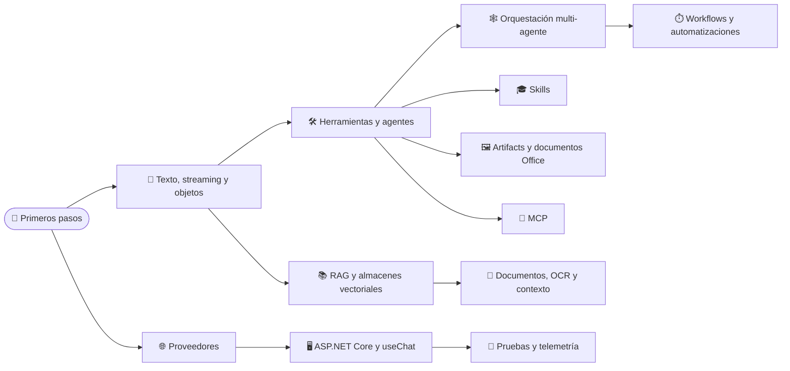

[English](Home) · **Español**

# Bienvenido a la wiki de AiSdk.Net 👋

**AiSdk.Net** es el SDK open source de IA y agentes para **.NET 10**, creado por
**Esteban Cortes** ([@ecr17dev](https://github.com/ecr17dev)). Una sola API independiente del proveedor para
texto, streaming, objetos tipados, herramientas, agentes, orquestación multi-agente, RAG, Skills, workflows
durables y MCP.

> [!TIP]
> ¿Recién llegas? Lee [Primeros pasos](es-Primeros-pasos), ejecuta `dotnet run --project samples/QuickStart -- mock agent`
> (no necesita API key) y luego explora las guías.

## 🗺️ Mapa de la documentación

## 📖 Guías

| | Guía | Qué aprenderás |
|:---:|---|---|
| 🚀 | [Primeros pasos](es-Primeros-pasos) | Paquetes, instalación y cómo ejecutar los ejemplos |
| 💬 | [Texto, streaming y objetos](es-Texto-streaming-y-objetos) | `GenerateTextAsync`, `StreamText`, objetos tipados con JSON Schema |
| 🛠️ | [Herramientas y agentes](es-Herramientas-y-agentes) | El bucle de herramientas, `ToolLoopAgent`, agentes por clase, aprobaciones, callbacks |
| 🕸️ | [Orquestación multi-agente](es-Orquestacion-multi-agente) | Cadena, paralelo, router, supervisor, traspasos, evaluador-optimizador |
| 🎓 | [Skills](es-Skills) | Agent Skills: cargar, crear, validar y ejecutar skills; Skills de Anthropic |
| 🖼️ | [Artifacts y documentos Office](es-Artifacts-y-documentos-Office) | Artifacts como Claude y generación de Word, PDF y Excel |
| ⏱️ | [Workflows y automatizaciones](es-Workflows-y-automatizaciones) | Pasos durables, esperas, aprobaciones, cron, eventos y webhooks |
| 📚 | [RAG y almacenes vectoriales](es-RAG-y-almacenes-vectoriales) | Fragmentación, filtros, búsqueda híbrida, reranking, pgvector, VectorData |
| 🔎 | [Documentos, OCR y contexto](es-Documentos-OCR-y-contexto) | Cualquier archivo a Markdown, OCR, modelos sin visión, compresión |
| 🔌 | [MCP](es-MCP) | Cliente Model Context Protocol: herramientas, recursos, prompts, sampling |
| 🌐 | [Proveedores](es-Proveedores) | OpenAI, Claude, Gemini, Mistral, Bedrock, Cohere, registro, middleware |
| 🖥️ | [ASP.NET Core y useChat](es-ASP.NET-Core-y-useChat) | Backend para AI SDK UI, streams reanudables, Microsoft.Extensions.AI |
| 🧪 | [Pruebas y telemetría](es-Pruebas-y-telemetria) | `MockLanguageModel`, pruebas en vivo, OpenTelemetry |

## 📌 Referencia

| | Página |
|:---:|---|
| 🏛️ | [Arquitectura](es-Arquitectura) |
| 🔁 | [Equivalencias (Vercel AI SDK / Laravel AI)](es-Equivalencias) |
| ✅ | [Calidad](es-Calidad) |
| 🗺️ | [Hoja de ruta](es-Hoja-de-ruta) |
| ❓ | [Preguntas frecuentes](es-Preguntas-frecuentes) |

## 🤝 Contribuir

¿Encontraste un error o quieres mejorar una página? La wiki se genera desde
[`docs/wiki`](https://github.com/bluesmilecl/AiSdk.Net/tree/HEAD/docs/wiki) del repositorio principal:
abre un pull request allí (ver [CONTRIBUTING.es.md](https://github.com/bluesmilecl/AiSdk.Net/blob/HEAD/CONTRIBUTING.es.md)).
