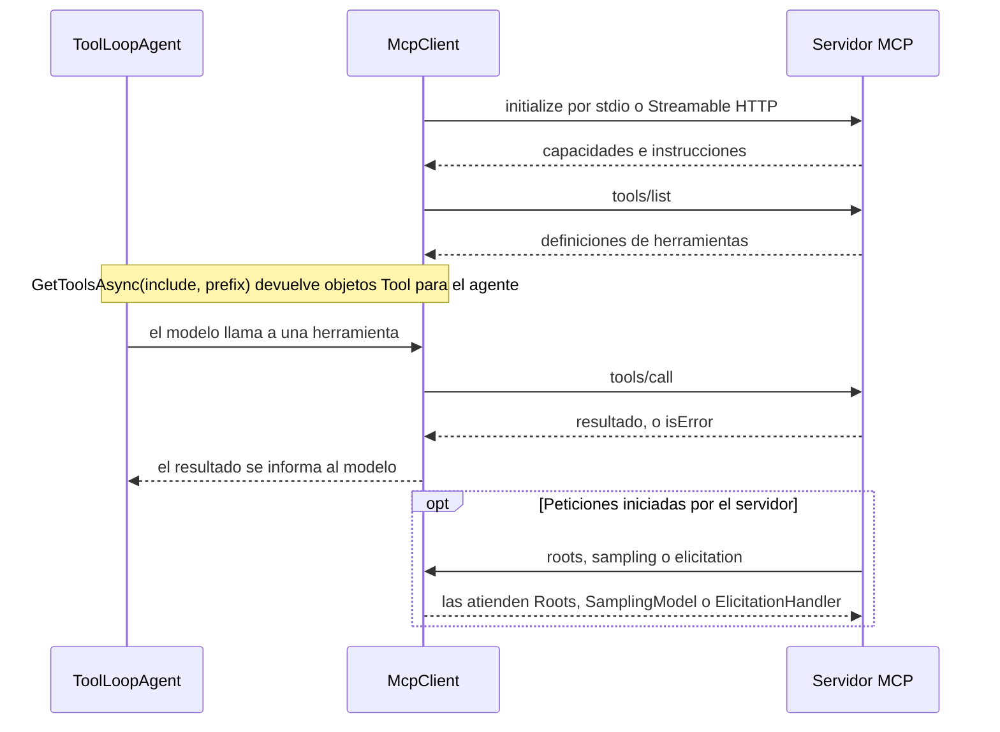

# MCP (Model Context Protocol)

> 🇬🇧 [Read in English](MCP)



```csharp
using AiSdk.Mcp;

// stdio: lanza el servidor como proceso
await using var files = await McpClient.ConnectAsync(
    new StdioMcpTransport("npx", ["-y", "@modelcontextprotocol/server-filesystem", "/datos"]));

// Streamable HTTP (con cabeceras de autenticación); gestiona Mcp-Session-Id automáticamente
await using var remote = await McpClient.ConnectAsync(
    new HttpMcpTransport("https://mcp.ejemplo.com/mcp", new Dictionary<string, string> { ["Authorization"] = "Bearer ..." }));

List<Tool> tools = [.. await files.GetToolsAsync(), .. await remote.GetToolsAsync(prefix: "remoto_")];
var agent = new ToolLoopAgent(new AgentSettings { Model = model, Tools = tools, Instructions = files.Instructions });
```

Además de herramientas: `ListResourcesAsync`, `ReadResourceAsync` / `ReadResourceAsPartsAsync`,
`ListResourceTemplatesAsync`, `ListPromptsAsync` y `GetPromptAsync` (devuelve `ModelMessage` listos para usar).
Con `McpClientOptions` el cliente también atiende peticiones del servidor: `Roots`, `SamplingModel`
(el servidor genera texto con un modelo tuyo) y `ElicitationHandler` (pide datos al usuario).

`GetToolsAsync(include, prefix)` filtra herramientas y evita colisiones de nombre. Si una herramienta MCP
devuelve `isError`, el error se informa al modelo. También están `ListToolsAsync`, `CallToolAsync` y
`SendRequestAsync` para uso directo.

> [!TIP]
> Usa un `prefix` distinto para cada servidor cuando combines varios servidores MCP, así dos herramientas con el mismo nombre nunca chocan.

---

**Siguiente:** [Proveedores](es-Proveedores) ➡️
