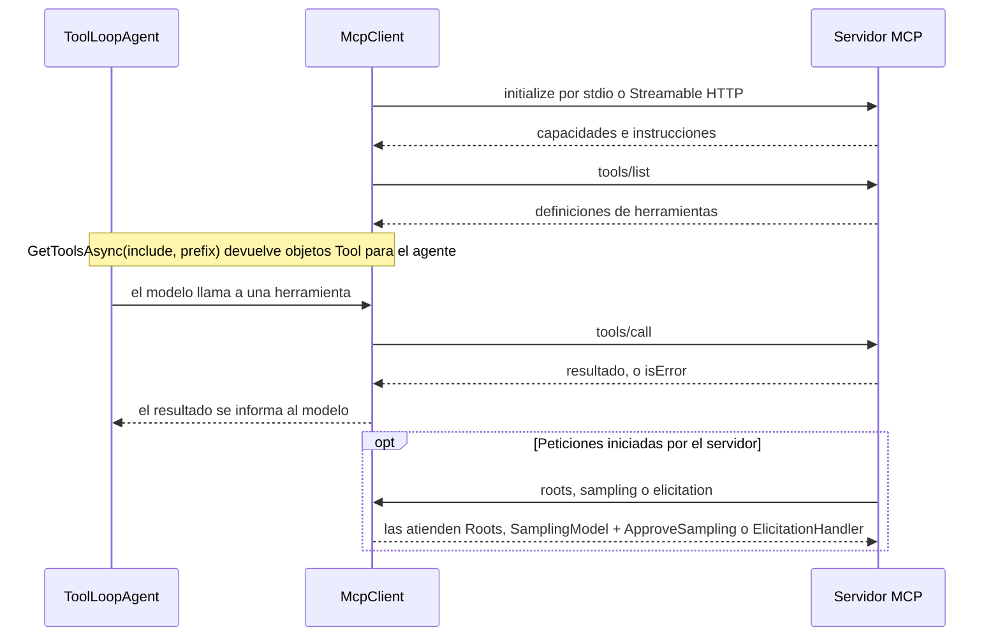

# MCP (Model Context Protocol)

> 🇬🇧 [Read in English](MCP)



```csharp
using AiSdk.Mcp;

// stdio: lanza el servidor como proceso
await using var files = await McpClient.ConnectAsync(
    new StdioMcpTransport("npx", ["-y", "@modelcontextprotocol/server-filesystem", "/datos"]));

// Streamable HTTP (con cabeceras de autenticación); gestiona Mcp-Session-Id automáticamente
await using var remote = await McpClient.ConnectAsync(
    new HttpMcpTransport("https://mcp.ejemplo.com/mcp", new Dictionary<string, string> { ["Authorization"] = "Bearer ..." }));

List<Tool> tools = [.. await files.GetToolsAsync(), .. await remote.GetToolsAsync(prefix: "remoto_")];
var agent = new ToolLoopAgent(new AgentSettings { Model = model, Tools = tools, Instructions = files.Instructions });
```

Además de herramientas: `ListResourcesAsync`, `ReadResourceAsync` / `ReadResourceAsPartsAsync`,
`ListResourceTemplatesAsync`, `ListPromptsAsync` y `GetPromptAsync` (devuelve `ModelMessage` listos para usar).
Con `McpClientOptions` el cliente también atiende peticiones del servidor: `Roots`, `SamplingModel` + `ApproveSampling`
(el servidor genera texto con un modelo tuyo, con el consentimiento del usuario) y `ElicitationHandler` (pide datos al usuario).

`GetToolsAsync(include, prefix, existingTools)` filtra herramientas y evita colisiones de nombre. Si una herramienta MCP
devuelve `isError`, el error se informa al modelo. También están `ListToolsAsync`, `CallToolAsync` y
`SendRequestAsync` para uso directo.

> [!TIP]
> Usa un `prefix` distinto (o `McpClientOptions.ToolNamePrefix`) para cada servidor cuando combines varios servidores MCP, y pasa las demás herramientas en `existingTools`: si dos nombres chocan, falla de inmediato con un error claro en vez de que el proveedor rechace la petición.

## 🔒 Seguridad

Un servidor MCP es código de terceros: trata sus herramientas, descripciones y peticiones como entrada no confiable.

**Los servidores stdio reciben un entorno mínimo.** `StdioMcpTransport` ya no pasa todo el entorno del host
(API keys, cadenas de conexión...). El proceso hijo solo recibe `StdioMcpTransport.DefaultInheritedVariables`
(`HOME, LOGNAME, PATH, SHELL, TERM, USER` en Linux/macOS; `APPDATA, HOMEDRIVE, HOMEPATH, LOCALAPPDATA, PATH,
PROCESSOR_ARCHITECTURE, SYSTEMDRIVE, SYSTEMROOT, TEMP, USERNAME, USERPROFILE` en Windows), los nombres de
`InheritedVariables` y las variables que pases explícitamente. `InheritEnvironment = true` recupera el comportamiento
anterior: úsalo solo con servidores de confianza.

```csharp
new StdioMcpTransport("npx", ["-y", "@acme/mcp-server"], new Dictionary<string, string> { ["ACME_TOKEN"] = token })
{
    InheritedVariables = ["HTTPS_PROXY", "NODE_EXTRA_CA_CERTS"],   // variables extra del host que el servidor puede ver
};
```

**El sampling necesita el consentimiento del usuario.** `ConnectAsync` rechaza un `SamplingModel` solo: cada
`sampling/createMessage` pasa por `ApproveSampling`, que muestra el prompt de sistema y los mensajes del servidor y
devuelve la petición a ejecutar (puede editarla) o `null` para rechazarla. `ReviewSamplingResult` permite revisar la
respuesta antes de enviarla. El `maxTokens` del servidor se recorta a `MaxSamplingTokens` (4096), se atienden como mucho
`MaxConcurrentServerRequests` (4) peticiones del servidor a la vez (las demás reciben un error) y el servidor solo recibe
mensajes de error genéricos (el detalle va al evento `ServerRequestFailed`). Un `SamplingHandler` propio se encarga él
mismo del consentimiento; lanza `McpRequestRejectedException` para rechazar.

```csharp
await using var mcp = await McpClient.ConnectAsync(transport, new McpClientOptions
{
    SamplingModel = model,
    ApproveSampling = async (request, ct) =>
        await ui.ConfirmarAsync($"El servidor quiere usar el modelo:\n{request.SystemPrompt}", ct) ? request : null,
});
```

**HTTP robusto.** `RequestTimeout` cubre la petición completa, incluida la lectura del cuerpo de la respuesta; las
respuestas y eventos SSE mayores que `HttpMcpTransport.MaxMessageBytes` (16 MiB) se rechazan; un stream SSE cortado o
con datos inválidos hace fallar de inmediato la petición pendiente; `DisposeAsync` nunca lanza y siempre cierra la sesión
(`DELETE`). Los listados paginados se detienen ante un cursor repetido y tras `MaxListPages` (100) páginas.

**Las herramientas quedan fijadas.** La primera vez que se lista una herramienta, el cliente guarda un hash SHA-256 de
su definición (nombre, título, descripción, esquema de entrada y anotaciones). Si un listado posterior trae otra
definición (un "rug pull"), se dispara `ToolDefinitionChanged` y, con la política por defecto `ToolChangePolicy = Reject`,
la herramienta queda marcada (`McpToolInfo.DefinitionChanged`), `GetToolsAsync` la omite y `CallToolAsync` se niega a
llamarla. Guarda `client.ToolHashes` y pásalos en `PinnedToolHashes` para detectar cambios entre conexiones. Con
`RequireToolApproval = true` todas las herramientas del servidor requieren aprobación humana (`OnToolApproval`).

> [!WARNING]
> Las descripciones de las herramientas llegan tal cual al modelo y pueden esconder instrucciones ("tool poisoning").
> Conecta solo servidores de confianza, revisa sus herramientas antes del primer uso (fijarlas protege lo que aprobaste,
> no lo que nunca miraste) y exige aprobación para las herramientas con efectos.

---

**Siguiente:** [Proveedores](es-Proveedores) ➡️
