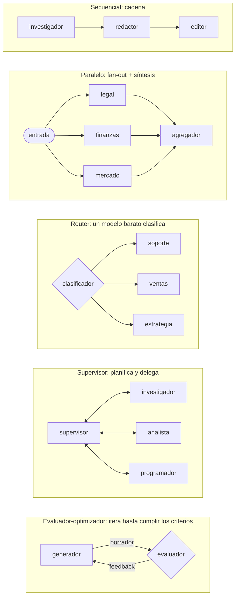

# Orquestación multi-agente

> 🇬🇧 [Read in English](Multi-Agent-Orchestration)

Patrones listos (ver *Building effective agents* de Anthropic). Todos los agentes y orquestaciones son
`IOrchestrationNode`: se anidan, se exponen como herramienta (`AsTool`) y se ejecutan como pasos de un workflow.



> [!NOTE]
> `Handoffs` no aparece arriba: ahí los agentes se traspasan la conversación entre sí (p. ej. `triage` → `ventas` → `facturacion`) en vez de ser llamados por un coordinador.

```csharp
var team = Orchestrations.Parallel([legal, finanzas, mercado], aggregator: director);   // fan-out + síntesis
var pipeline = Orchestrations.Sequential(investigador, redactor, editor);               // cadena
var router = Orchestrations.Router(modeloBarato, soporte, ventas, team.Named("estrategia", "Preguntas de negocio"));
var jefe = Orchestrations.Supervisor(claude, investigador, analista, programador);      // planifica y delega (en paralelo)
var chat = Orchestrations.Handoffs(triage, ventas, facturacion);                        // se traspasan la conversación
var revisado = Orchestrations.EvaluatorOptimizer(redactor, evaluador, "Tono formal, sin errores, máx. 200 palabras");

var result = await router.RunAsync("¿Conviene abrir en Lima?", new OrchestrationOptions
{
    OnEvent = e => { Console.WriteLine(e); return ValueTask.CompletedTask; },   // inicio/fin de agentes, rutas, traspasos...
    OnToolApproval = req => PreguntarAlOperadorAsync(req.ToolCall),            // para agentes sin manejador propio
});
Console.WriteLine($"{result.Text} — {result.TotalUsage.TotalTokens} tokens, {result.Runs.Count} llamadas");

// Funciones como pasos, y orquestaciones como herramientas de otro agente
var limpiar = OrchestrationNodes.Function("limpiar", texto => texto.Trim());
var agente = new ToolLoopAgent(new() { Model = claude, Tools = [team.AsTool("comite", "Consulta al comité")] });

// Traspasos dentro de un chat existente (continúa con el agente que corresponda)
var turno = await chat.RunAsync(historial, startAgent: "triage");
```

---

Las herramientas que requieren aprobación dentro de una orquestación consultan `OrchestrationOptions.OnToolApproval` (o
el manejador del agente que delega, cuando la orquestación es una herramienta); sin ningún manejador se deniegan con un
error explícito. Una orquestación no se puede reanudar, así que un agente que se detiene esperando una aprobación diferida
falla en vez de devolver un texto vacío.

> [!TIP]
> Las orquestaciones también son nodos, así que puedes ejecutarlas como pasos durables de un workflow: ver [Workflows y automatizaciones](es-Workflows-y-automatizaciones).

---

➡️ Siguiente: [Skills](es-Skills)
