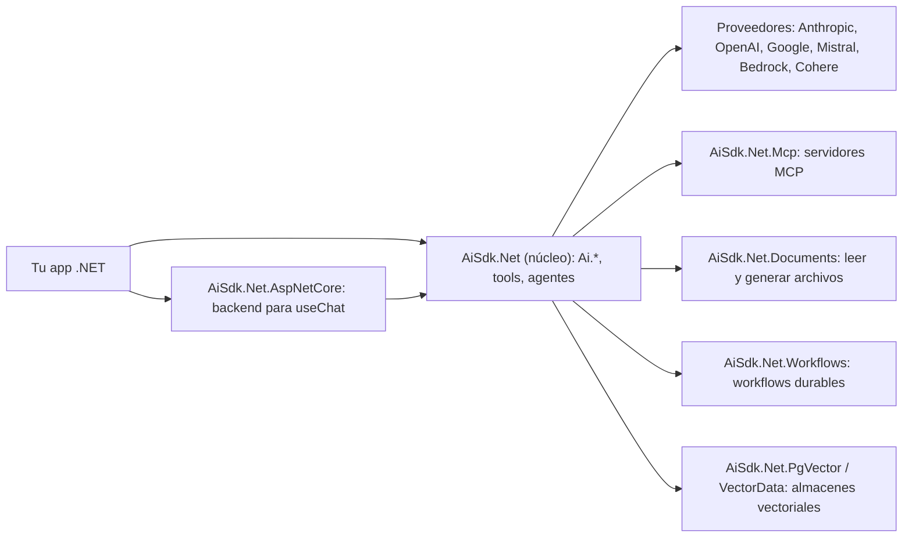

# Primeros pasos

> 🇬🇧 [Read in English](Getting-Started)

## 🗺️ Cómo encajan los paquetes



## 📦 Instalación

```bash
dotnet add package AiSdk.Net --prerelease               # núcleo
dotnet add package AiSdk.Net.Anthropic --prerelease     # o AiSdk.Net.OpenAI, .Google, .Mistral, .Bedrock, .Cohere
dotnet add package AiSdk.Net.Mcp --prerelease           # cliente MCP
dotnet add package AiSdk.Net.AspNetCore --prerelease    # backend para useChat
dotnet add package AiSdk.Net.Documents --prerelease     # leer (PDF/Office/imágenes/audio/video → Markdown + OCR) y generar Word/PDF/Excel
dotnet add package AiSdk.Net.Workflows --prerelease     # workflows durables, triggers y automatizaciones
dotnet add package AiSdk.Net.Workflows.Postgres --prerelease  # almacén de workflows en PostgreSQL (varias máquinas)
dotnet add package AiSdk.Net.PgVector --prerelease      # almacén PostgreSQL + pgvector
dotnet add package AiSdk.Net.VectorData --prerelease    # Qdrant, Pinecone, Azure AI Search… vía Microsoft.Extensions.VectorData
```

> [!NOTE]
> Los paquetes se llaman `AiSdk.Net.*` (el id `AiSdk` ya existe en nuget.org); los namespaces son `AiSdk.*`.
> Se publican con el workflow `release.yml` al crear un tag `vX.Y.Z` con trusted publishing de NuGet (ver [Calidad](es-Calidad)).

| Paquete | Contenido |
|---|---|
| `AiSdk.Net` | Núcleo: API `Ai.*`, tools, agentes, orquestaciones multi-agente, artifacts, `Output`, middleware, registro, embeddings, UI stream, `MockLanguageModel` |
| `AiSdk.Net.OpenAI` | OpenAI: API Responses y Chat Completions, herramientas de servidor, embeddings, imágenes, voz y transcripción. `Chat` funciona con servidores compatibles (Ollama, Groq, DeepSeek, OpenRouter, LM Studio, vLLM…) |
| `AiSdk.Net.Anthropic` | Claude (Messages API): tools, streaming, razonamiento con firma, salida estructurada, herramientas de servidor (web search, web fetch, code execution), citas, caché de prompts, fallback ante rechazos |
| `AiSdk.Net.Google` | Gemini: tools, razonamiento con firmas, Google Search con fuentes, ejecución de código, URL context, embeddings, conteo de tokens e Imagen |
| `AiSdk.Net.Mistral` | Mistral AI: chat, razonamiento de Magistral, tools, salida estructurada y embeddings |
| `AiSdk.Net.Bedrock` | Amazon Bedrock (API Converse): Claude, Llama, Nova, Mistral… con SigV4 o API key; embeddings Titan y Cohere |
| `AiSdk.Net.Cohere` | Reranking (Rerank) y embeddings (Embed) |
| `AiSdk.Net.Mcp` | Cliente MCP (Model Context Protocol): herramientas, recursos, prompts, roots, sampling y elicitation; stdio y Streamable HTTP |
| `AiSdk.Net.Extensions.AI` | Adaptador de `Microsoft.Extensions.AI` (`IChatClient`, `IEmbeddingGenerator`) → cualquier proveedor de ese ecosistema |
| `AiSdk.Net.Extensions.DependencyInjection` | `services.AddAiSdk(...)`, `IHttpClientFactory`, agentes en el contenedor |
| `AiSdk.Net.AspNetCore` | `ToUIMessageStreamResult()` / `ToTextStreamResult()`, `MapArtifacts()` y `MapWorkflows()` para Minimal APIs |
| `AiSdk.Net.Documents` | `MarkdownConverter` (PDF, Word, Excel, PowerPoint, HTML, CSV/JSON, imágenes, audio, video), OCR con Tesseract, middleware `ConvertAttachments` para modelos sin visión; generación de Word, PDF y Excel (`DocxWriter`, `PdfWriter`, `SpreadsheetBuilder`, `DocumentTools`) |
| `AiSdk.Net.Workflows` | `WorkflowEngine`: pasos durables, `SleepAsync`, `WaitForEventAsync`, reintentos; automatizaciones por cron, intervalo, fecha, evento o webhook; `AgentTasks` para que los agentes programen tareas; `AddAiSdkWorkflows()` |
| `AiSdk.Net.Workflows.Postgres` | `PostgresWorkflowStore` y `UsePostgresStore()`: ejecuciones y automatizaciones en PostgreSQL, compartidas por varias réplicas (concurrencia optimista, índices parciales para las consultas del motor) |
| `AiSdk.Net.PgVector` | Almacén PostgreSQL + pgvector: HNSW, filtros en `jsonb`, búsqueda híbrida (vectores + texto completo con RRF) |
| `AiSdk.Net.VectorData` | `VectorDataStore`: cualquier conector de Microsoft.Extensions.VectorData (Qdrant, Pinecone, Azure AI Search, Redis, Weaviate, MongoDB, Cosmos DB, SQL Server, Elasticsearch…) |

## 🚀 Inicio rápido

```bash
dotnet build
dotnet test
# ejemplos (sin API key):
dotnet run --project samples/QuickStart -- mock agent
# con Claude o OpenAI:
export ANTHROPIC_API_KEY=...   # o OPENAI_API_KEY
dotnet run --project samples/QuickStart -- anthropic tools
dotnet run --project samples/QuickStart -- openai stream-object
```

Ejemplos disponibles: `text`, `stream`, `tools`, `agent`, `object`, `stream-object`, `session`, `subagents`,
`web-search`, `fallback`, `repair`, `mcp`, `image`, `speech`, `transcribe`, `rag`, `count-tokens`, `batch`,
`document`, `attachments`, `compress`, `orchestrate`, `artifact`, `generate-docs`, `workflow`, `skills`.

> [!TIP]
> El proveedor `mock` ejecuta los ejemplos sin conexión con un `MockLanguageModel` guionizado, así que puedes explorar la API sin API key.

```bash
# MCP con cualquier servidor (stdio):
dotnet run --project samples/QuickStart -- anthropic mcp npx -y @modelcontextprotocol/server-everything
# Cualquier documento a Markdown (PDF, Word, Excel, PowerPoint, imagen, audio, video):
dotnet run --project samples/QuickStart -- anthropic document informe.pdf
# Modelo sin visión leyendo una boleta escaneada (OCR local):
dotnet run --project samples/QuickStart -- mistral attachments boleta.png
```

---

➡️ Siguiente: [Texto, streaming y objetos](es-Texto-streaming-y-objetos)
