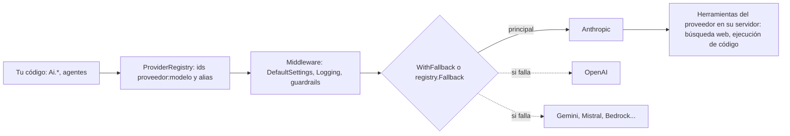

# Proveedores

> 🇬🇧 [Read in English](Providers)



## Middleware y registro de proveedores

```csharp
var model = AnthropicProvider.Default.Messages("claude-opus-5-5")
    .WithMiddleware(
        Middlewares.DefaultSettings(maxOutputTokens: 4000),
        Middlewares.Logging(Console.WriteLine),
        new MiGuardrailMiddleware());   // implementa ILanguageModelMiddleware

var registry = new ProviderRegistry()
    .Register(AnthropicProvider.Default)
    .Register(OpenAIProvider.Default)
    .Alias("rapido", "anthropic:claude-haiku-5-5");

var m = registry.LanguageModel("openai:gpt-5");
```

## Herramientas del proveedor y fuentes

Las ejecuta el proveedor en su servidor y los resultados llegan en la misma respuesta. El bucle no las
ejecuta localmente; las llamadas y resultados quedan en `result.Steps` con `ProviderExecuted = true`.

```csharp
// Claude
var result = await Ai.GenerateTextAsync(new GenerateTextOptions
{
    Model = anthropic.Messages("claude-opus-5-5"),
    Prompt = "¿Qué novedades trae .NET 10?",
    Tools = [AnthropicTools.WebSearch(maxUses: 3, allowedDomains: ["learn.microsoft.com"]), AnthropicTools.WebFetch()],
});

// OpenAI (API Responses)
var result2 = await Ai.GenerateTextAsync(new GenerateTextOptions
{
    Model = openai.Responses("gpt-5"),
    Prompt = "...",
    Tools = [OpenAITools.WebSearch(searchContextSize: "medium"), OpenAITools.CodeInterpreter()],
});

foreach (var source in result.Sources)
    Console.WriteLine($"{source.Title}: {source.Url}");
```

Disponibles: `AnthropicTools.WebSearch`, `WebFetch`, `CodeExecution`, `ServerTool(type, name)`;
`OpenAITools.WebSearch`, `CodeInterpreter`, `FileSearch`, `ServerTool(type, name)`. Con Claude, cuando la
API responde `pause_turn` (una herramienta de servidor necesita más tiempo), el proveedor continúa el turno
automáticamente. Las fuentes llegan al frontend como partes `source-url` del protocolo de `useChat`.

## Más proveedores

```csharp
var gemini  = GoogleProvider.Default.Gemini("gemini-2.5-flash");            // GEMINI_API_KEY
var mistral = MistralProvider.Default.Chat("mistral-large-latest");         // MISTRAL_API_KEY
var nova    = BedrockProvider.Default.Converse("amazon.nova-pro-v1:0");     // AWS_REGION + AWS_BEARER_TOKEN_BEDROCK o credenciales de AWS
var claudeBedrock = new BedrockProvider(o => { o.Region = "us-east-1"; o.CredentialsProvider = MisCredencialesAsync; })
    .Converse("us.anthropic.claude-sonnet-4-5-20250929-v1:0");

Tools = [GoogleTools.GoogleSearch(), GoogleTools.CodeExecution(), GoogleTools.UrlContext()];
ProviderOptions = GoogleOptions.Create(thinkingBudget: 2048, includeThoughts: true);

var image = await Ai.GenerateImageAsync(new() { Model = GoogleProvider.Default.Image("imagen-4.0-generate-001"), Prompt = "...", AspectRatio = "16:9" });
```

Bedrock firma las peticiones con AWS SigV4 (o usa la API key de Bedrock) y lee el formato binario
`event-stream` en streaming, sin depender del SDK de AWS.

## Imágenes, voz y transcripción

```csharp
var image = await Ai.GenerateImageAsync(new GenerateImageOptions
{
    Model = openai.Image("gpt-image-1"), Prompt = "Un robot programando en C#", Size = "1024x1024", N = 2,
});
await image.Image.SaveAsync("robot.png");

var speech = await Ai.GenerateSpeechAsync(new GenerateSpeechOptions
{
    Model = openai.Speech("gpt-4o-mini-tts"), Text = "Hola desde .NET", Voice = "nova", Instructions = "Tono alegre",
});

var transcript = await Ai.TranscribeAsync(new TranscribeOptions
{
    Model = openai.Transcription("whisper-1"), Audio = await File.ReadAllBytesAsync("audio.mp3"), Language = "es",
});
Console.WriteLine(transcript.Text);   // y transcript.Segments con tiempos (whisper-1)
```

Las interfaces `IImageModel`, `ISpeechModel` e `ITranscriptionModel` permiten añadir otros proveedores;
el registro las resuelve con `registry.ImageModel("openai:gpt-image-1")`, etc.

## Conteo de tokens, batches y archivos

```csharp
// Tokens de entrada antes de enviar (Anthropic, OpenAI Responses, Gemini)
int tokens = await Ai.CountTokensAsync(new GenerateTextOptions { Model = model, Prompt = "...", Tools = [weather] });

// Lotes asíncronos a mitad de precio (Anthropic Message Batches u OpenAI Batch API)
IBatchClient batches = anthropic.Batches("claude-opus-5-5");     // o openai.Batches("gpt-5")
var job = await batches.CreateAsync([await options.ToBatchItemAsync("pedido-1"), ...]);
await batches.WaitForCompletionAsync(job.Id);
await foreach (var item in batches.GetResultsAsync(job.Id))
    Console.WriteLine($"{item.CustomId}: {item.Text}");

// Files API: sube una vez y referencia por id
var file = await anthropic.Files.UploadAsync(bytes, "contrato.pdf", "application/pdf");
var reply = await Ai.GenerateTextAsync(new() { Model = model, Messages = [ModelMessage.User(FilePart.FromFileId(file.Id), new TextPart("Resume"))] });

// Vector stores de OpenAI para la herramienta FileSearch
var vs = await openai.VectorStores.CreateAsync("docs");
await openai.VectorStores.UploadFileAsync(vs.Id, bytes, "guia.md", "text/markdown");
await openai.VectorStores.WaitUntilReadyAsync(vs.Id);
Tools = [OpenAITools.FileSearch([vs.Id])];
```

## Notas sobre proveedores

**Anthropic (Claude)**
- `AnthropicOptions.Create(effort, thinkingDisplay, cacheControl, betas, refusalFallback)` genera las opciones
  más usadas (`output_config.effort`, `thinking: {type: "adaptive"}`, caché automático, `fallbacks: "default"`).
- Los bloques de razonamiento se conservan con su firma (`ProviderMetadata["anthropic.signature"]`) y se
  reenvían sin cambios en los turnos siguientes.
- Los modelos Claude recientes rechazan `Temperature`/`TopP`/`TopK` y el `ToolChoice` forzado
  (`Required`/`Tool`); usa `ToolChoice.Auto` y controla el esfuerzo con `effort`.
- Con streaming se envía `eager_input_streaming: true` en las herramientas (configurable con
  `AnthropicProviderOptions.EagerInputStreaming`).

**OpenAI y compatibles**
- `openai.Responses("gpt-5")` usa la API Responses (recomendada): herramientas de servidor, resúmenes de
  razonamiento y citas. `openai.Chat(...)` usa Chat Completions, que es lo que implementan los servidores
  compatibles. `registry.LanguageModel("openai:...")` elige Responses para OpenAI y Chat para servidores compatibles.
- `OpenAIOptions.Create(reasoningEffort, reasoningSummary, store, parallelToolCalls, serviceTier, user)`;
  con `store: false` se pide el razonamiento cifrado para reenviarlo en los turnos siguientes.
- `ProviderOptions["openai"]` se fusiona en el cuerpo de la petición.
- `UseLegacyMaxTokens = true` para servidores que solo aceptan `max_tokens`.

**Google Gemini**
- Las firmas de razonamiento (`thoughtSignature`) se conservan y reenvían junto a las llamadas a funciones.
- La salida estructurada usa `responseJsonSchema`; las herramientas usan `parametersJsonSchema`.
- `GoogleOptions.Create(thinkingBudget, includeThoughts, thinkingLevel, safetySettings)`.

**Mistral**: `max_tokens`, `random_seed`, `tool_choice: "any"` y los bloques `thinking` de Magistral se manejan automáticamente.

**Amazon Bedrock**: Converse no tiene modo JSON universal; la salida estructurada se pide con una instrucción
de sistema y se valida al parsear. Las opciones propias del modelo van en
`ProviderOptions["bedrock"]["additionalModelRequestFields"]`.

> [!TIP]
> Cualquier opción específica de un proveedor puede pasarse con `ProviderOptions`, que se fusiona
> (en profundidad) con el cuerpo JSON de la petición.

---

**Siguiente:** [ASP.NET Core y useChat](es-ASP.NET-Core-y-useChat) ➡️
