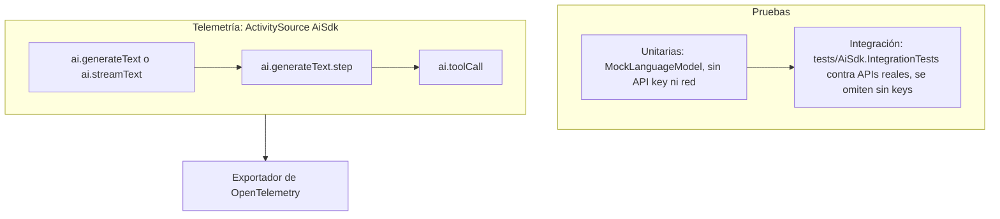

# Pruebas y telemetría

> 🇬🇧 [Read in English](Testing-and-Telemetry)



## Pruebas

```csharp
var model = new MockLanguageModel()
    .ReturnsToolCall("get_weather", new { city = "Lima" })
    .ReturnsText("En Lima hay 21°C");

var result = await agent.GenerateAsync("...");
Assert.Equal(2, model.Requests.Count);
```

Pruebas de integración contra las APIs reales en `tests/AiSdk.IntegrationTests`: se ejecutan con
`dotnet test` y cada proveedor se omite si su API key no está definida (`ANTHROPIC_API_KEY`, `OPENAI_API_KEY`,
`GEMINI_API_KEY`, `MISTRAL_API_KEY`, `COHERE_API_KEY`, Bedrock con `AWS_REGION` + `AISDK_TEST_BEDROCK_MODEL`);
el modelo se cambia con `AISDK_TEST_<PROVEEDOR>_MODEL` (p. ej. `AISDK_TEST_OPENAI_MODEL=gpt-6-luna`). `LiveFeatureTests` valida
skills, generación de skills, router, artifacts + Excel y compresión map-reduce con modelos reales.
La CI las ejecuta con los secretos del repositorio.

> [!NOTE]
> Estado actual: las pruebas en vivo de OpenAI pasan (11 pruebas, incluidas skills, router, artifacts y map-reduce).
> Anthropic, Gemini y Mistral siguen pendientes. Ver la [Hoja de ruta](es-Hoja-de-ruta).

## Telemetría

Todas las llamadas emiten `Activity` en la fuente `"AiSdk"` (`ai.generateText`, `ai.streamText`,
`ai.generateText.step`, `ai.toolCall`):

```csharp
builder.Services.AddOpenTelemetry().WithTracing(t => t.AddSource(AiTelemetry.SourceName));
```

---

**Siguiente:** [Equivalencias](es-Equivalencias) ➡️
