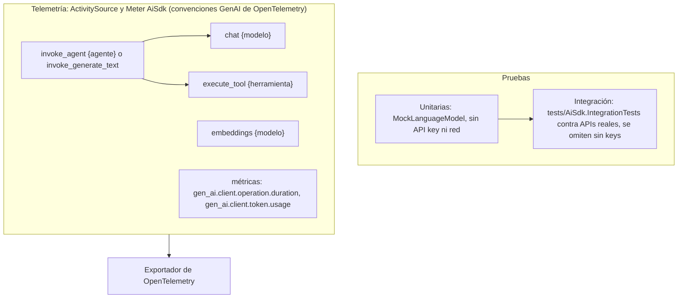

# Pruebas y telemetría

> 🇬🇧 [Read in English](Testing-and-Telemetry)



## Pruebas

```csharp
var model = new MockLanguageModel()
    .ReturnsToolCall("get_weather", new { city = "Lima" })
    .ReturnsText("En Lima hay 21°C");

var result = await agent.GenerateAsync("...");
Assert.Equal(2, model.Requests.Count);
```

Pruebas de integración contra las APIs reales en `tests/AiSdk.IntegrationTests`: se ejecutan con
`dotnet test` y cada proveedor se omite si su API key no está definida (`ANTHROPIC_API_KEY`, `OPENAI_API_KEY`,
`GEMINI_API_KEY`, `MISTRAL_API_KEY`, `COHERE_API_KEY`, Bedrock con `AWS_REGION` + `AISDK_TEST_BEDROCK_MODEL`);
el modelo se cambia con `AISDK_TEST_<PROVEEDOR>_MODEL` (p. ej. `AISDK_TEST_OPENAI_MODEL=gpt-6-luna`). `LiveFeatureTests` valida
skills, generación de skills, router, artifacts + Excel y compresión map-reduce con modelos reales.
La CI las ejecuta con los secretos del repositorio.

> [!NOTE]
> Estado actual: las pruebas en vivo de OpenAI pasan (11 pruebas, incluidas skills, router, artifacts y map-reduce).
> Anthropic, Gemini y Mistral siguen pendientes. Ver la [Hoja de ruta](es-Hoja-de-ruta).

## Telemetría

AiSdk sigue las [convenciones semánticas de OpenTelemetry para IA generativa](https://github.com/open-telemetry/semantic-conventions-genai),
así que sus trazas y métricas aparecen en el dashboard de Aspire, Grafana, Datadog, Azure Monitor y cualquier otro backend
de OpenTelemetry sin mapeos adicionales. Los spans salen del `ActivitySource` llamado `"AiSdk"` y las métricas del `Meter`
llamado `"AiSdk"` (ambos con la versión del paquete). Nada sale de tu aplicación hasta que configures OpenTelemetry:

```csharp
using AiSdk.Internal; // AiTelemetry

builder.Services.AddOpenTelemetry()
    .WithTracing(t => t.AddSource(AiTelemetry.SourceName))  // "AiSdk"
    .WithMetrics(m => m.AddMeter(AiTelemetry.MeterName));   // "AiSdk"
```

### Spans

Un agente que llama a una herramienta se ve así:

```text
invoke_agent support               Internal  (todo el bucle de herramientas)
├── chat gpt-5                     Client    (paso 1: el modelo pide una herramienta)
├── execute_tool lookup_order      Internal
└── chat gpt-5                     Client    (paso 2: respuesta final)
```

| Span | Tipo | Se emite para | Atributos principales |
| --- | --- | --- | --- |
| `invoke_agent {gen_ai.agent.name}` | Internal | Todo el bucle de un `Agent` o `ToolLoopAgent` (también en sesiones, orquestaciones y sub-agentes usados como herramienta) | `gen_ai.operation.name` = `invoke_agent`, `gen_ai.agent.name`, `gen_ai.agent.description`, `gen_ai.provider.name`, `gen_ai.request.model` (modelo configurado), `gen_ai.conversation.id` (`AgentSession`), parámetros de la petición, `gen_ai.response.finish_reasons`, `gen_ai.usage.input_tokens` / `output_tokens` (totales) |
| `invoke_generate_text`, `invoke_stream_text`, `invoke_generate_object`, `invoke_stream_object` | Internal | Todo el bucle de `Ai.GenerateTextAsync`, `Ai.StreamText`, `Ai.GenerateObjectAsync` y `Ai.StreamObject` cuando no lo ejecuta un agente | `gen_ai.operation.name` (igual al nombre del span), `gen_ai.provider.name`, `gen_ai.request.model`, `gen_ai.response.finish_reasons`, uso total |
| `chat {gen_ai.request.model}` | Client | Cada llamada al modelo (una por paso; los reintentos quedan dentro del span) | `gen_ai.operation.name` = `chat`, `gen_ai.provider.name`, `gen_ai.request.model`, `gen_ai.request.temperature`, `top_p`, `top_k`, `max_tokens`, `presence_penalty`, `frequency_penalty`, `stop_sequences`, `seed` (si se indican), `gen_ai.request.stream`, `gen_ai.output.type` (`json` en salida estructurada), `gen_ai.response.id`, `gen_ai.response.model`, `gen_ai.response.finish_reasons`, `gen_ai.response.time_to_first_chunk` (streaming), `gen_ai.usage.input_tokens`, `gen_ai.usage.output_tokens`, `gen_ai.usage.cache_read.input_tokens`, `gen_ai.usage.reasoning.output_tokens`, `gen_ai.conversation.id` |
| `execute_tool {gen_ai.tool.name}` | Internal | Cada herramienta que AiSdk ejecuta localmente | `gen_ai.operation.name` = `execute_tool`, `gen_ai.tool.name`, `gen_ai.tool.call.id`, `gen_ai.tool.type` = `function`, `gen_ai.tool.description`, `gen_ai.agent.name`, `gen_ai.conversation.id` |
| `embeddings {gen_ai.request.model}` | Client | Cada llamada de embeddings (`Ai.EmbedAsync`, cada lote de `Ai.EmbedManyAsync`, almacenes vectoriales) | `gen_ai.operation.name` = `embeddings`, `gen_ai.provider.name`, `gen_ai.request.model`, `gen_ai.usage.input_tokens` |

`gen_ai.agent.name` es el `Name` del agente. Un `ToolLoopAgent` sin nombre no informa nombre (span `invoke_agent`), porque
el valor por defecto `"agent"` no lo identifica.

`gen_ai.provider.name` usa los valores conocidos de las convenciones:

| Id del proveedor en AiSdk | `gen_ai.provider.name` |
| --- | --- |
| `openai` | `openai` |
| `anthropic` | `anthropic` |
| `google` | `gcp.gemini` |
| `bedrock` | `aws.bedrock` |
| `mistral` | `mistral` |
| `cohere` | `cohere` |
| `azure`, `vertex`, `xai`, `groq`, `deepseek`, `perplexity`, `ollama` | `azure.ai.openai`, `gcp.vertex_ai`, `x_ai`, `groq`, `deepseek`, `perplexity`, `ollama` |
| Cualquier otro, p. ej. `OpenAIProvider.Compatible("mi-gateway", ...)` | El mismo id (`mi-gateway`) |

### Métricas

Se registran en cada llamada `chat` y `embeddings`, con los límites de buckets que recomiendan las convenciones
(declarados como *advice* del instrumento, así que el SDK de OpenTelemetry los aplica sin configurar una vista):

| Métrica | Instrumento | Unidad | Atributos |
| --- | --- | --- | --- |
| `gen_ai.client.operation.duration` | Histograma | `s` | `gen_ai.operation.name` (`chat`, `embeddings`), `gen_ai.provider.name`, `gen_ai.request.model`, `gen_ai.response.model`, `error.type` (solo en fallos) |
| `gen_ai.client.token.usage` | Histograma | `{token}` | Los mismos, más `gen_ai.token.type` (`input` u `output`). Solo se registran los conteos que devuelve el proveedor. |

### Errores

Una operación fallida termina su span con estado `Error` (descripción: el mensaje de la excepción) y fija `error.type`,
también en la métrica de duración. `error.type` es el código HTTP en los errores del proveedor (`ApiCallException`, también
dentro de `RetryException`), por ejemplo `429` o `500`, y el nombre completo del tipo de la excepción en los demás casos
(por ejemplo `System.Net.Http.HttpRequestException`, o `System.Threading.Tasks.TaskCanceledException` en una cancelación).
Los errores que un reintento resolvió no se registran. Una herramienta que lanza una excepción marca solo su span
`execute_tool`: el modelo recibe el error y el bucle sigue.

### Privacidad

Nunca se registra el contenido de los mensajes: ni prompts, ni instrucciones de sistema, ni historial, ni respuestas del
modelo, ni argumentos o resultados de herramientas (no se emiten los atributos opcionales `gen_ai.input.messages`,
`gen_ai.output.messages`, `gen_ai.system_instructions`, `gen_ai.tool.definitions`, `gen_ai.tool.call.arguments` ni
`gen_ai.tool.call.result`). Las descripciones de agentes y herramientas sí se registran, porque vienen de tu código, y
también el mensaje de la excepción de una operación fallida (descripción del estado del span): no pongas datos sensibles
en las excepciones que lanzan tus herramientas.

### Versión de las convenciones

Los nombres y atributos de los spans coinciden con las últimas convenciones GenAI publicadas en `semantic-conventions`
(v1.41.0) y con la primera versión del nuevo repositorio `semantic-conventions-genai` (v0.1.0, estado Development). Las
métricas mantienen los nombres de v1.41.0 (`gen_ai.client.operation.duration`, `gen_ai.client.token.usage`), que son los
que leen hoy los dashboards; v0.1.0 los renombra (`gen_ai.client.inference.duration`,
`gen_ai.client.inference.operation.input_tokens`...). Los spans `chat` no llevan `server.address` ni `server.port`: agrega
`AddHttpClientInstrumentation()` para tenerlos en los spans HTTP anidados.

Para verificar la telemetría en tus propias pruebas, escucha con un `ActivityListener` y un `MeterListener` filtrados por
el nombre `"AiSdk"` (ver `tests/AiSdk.Tests/TelemetryTests.cs`).

---

**Siguiente:** [Equivalencias](es-Equivalencias) ➡️
