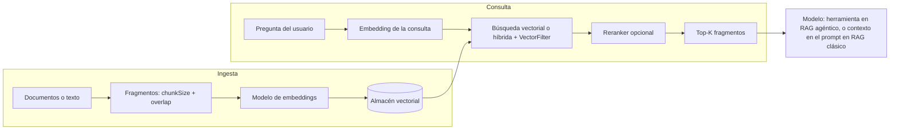

# RAG y almacenes vectoriales

> 🇬🇧 [Read in English](RAG-and-Vector-Stores)



## RAG: almacén vectorial y reranking

```csharp
var store = new InMemoryVectorStore(openai.Embedding("text-embedding-3-small"));   // o IVectorStore propio (pgvector, Qdrant...)
await store.AddTextsAsync([("manual", File.ReadAllText("manual.md"))], chunkSize: 1000, overlap: 100);

// RAG agéntico: el agente busca cuando lo necesita (con reranking opcional)
var agent = new ToolLoopAgent(new AgentSettings
{
    Model = model,
    Tools = [store.AsTool(topK: 5, reranker: CohereProvider.Default.Reranking())],
});

// RAG clásico: contexto en el prompt
var context = await store.BuildContextAsync("¿cómo instalo?");

// Reranking directo (Cohere, o EmbeddingRerankingModel con cualquier modelo de embeddings)
var ranked = await Ai.RerankAsync(CohereProvider.Default.Reranking(), "capital de Chile", documentos, topN: 3);
```

**Filtros por metadatos** (los traduce cada almacén a su lenguaje: SQL, filtros de Qdrant, OData…):

```csharp
var filtro = VectorFilter.Eq("tipo", "manual") & (VectorFilter.In("pais", "CL", "PE") | !VectorFilter.Exists("pais"));
var hits = await store.SearchAsync("garantía", topK: 5, filter: filtro);
var tool = store.AsTool(filter: VectorFilter.Eq("cliente", clienteId));   // multi-tenant
```

> [!TIP]
> Pasar un `VectorFilter` a `AsTool` es una forma sencilla de aislar clientes: el modelo nunca puede buscar fuera del filtro.

**PostgreSQL + pgvector** (`AiSdk.PgVector`): crea la tabla e índices (HNSW, GIN) automáticamente, y ofrece
búsqueda híbrida, que encuentra códigos, nombres y siglas que los embeddings pierden:

```csharp
await using var store = PgVectorStore.Create(connectionString, embeddings, new PgVectorStoreOptions
{
    Dimensions = 1536,
    Table = "documentos",
    TextSearchConfig = "spanish",   // configuración de búsqueda de texto de PostgreSQL (p. ej. "english", "spanish")
});
var hits = await store.HybridSearchAsync("error SKU-77812", topK: 5);
await store.DeleteWhereAsync(VectorFilter.Eq("source", "manual-viejo.pdf"));
var tool = store.AsTool(hybrid: true);
```

**Qdrant, Pinecone, Azure AI Search, Redis, Weaviate…** (`AiSdk.VectorData`): un adaptador sobre
Microsoft.Extensions.VectorData sirve para todos sus conectores. Los metadatos por los que se filtra se
declaran en `FilterableFields`:

```csharp
var qdrant = new QdrantVectorStore(new QdrantClient("localhost"), ownsClient: true);
var store = new VectorDataStore(qdrant, embeddings, new VectorDataStoreOptions
{
    CollectionName = "documentos",
    Dimensions = 1536,
    FilterableFields = ["tipo", "pais", "source"],
});
```

---

**Siguiente:** [Documentos, OCR y contexto](es-Documentos-OCR-y-contexto) ➡️
