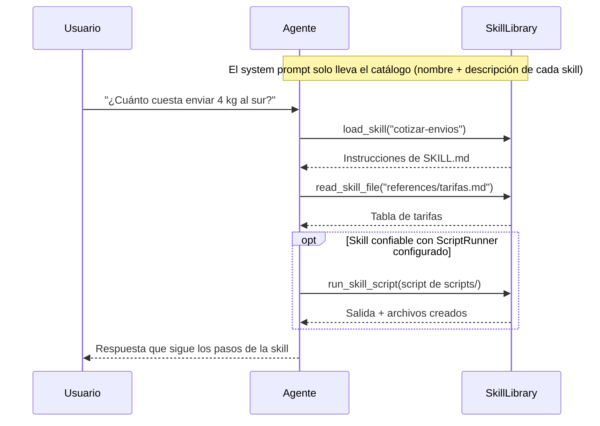

# Skills (Agent Skills)

> 🇬🇧 [Read in English](Skills)

Una skill es una carpeta con un `SKILL.md` (frontmatter `name` + `description` e instrucciones en Markdown) y
archivos opcionales en `references/`, `scripts/` y `assets/`. Es el mismo formato que usan Claude Code,
GitHub Copilot y [dotnet/skills](https://github.com/dotnet/skills). El agente solo ve el catálogo (nombre y
descripción) y carga el resto cuando lo necesita (`load_skill`, `read_skill_file`).

## 🪜 Revelación progresiva



## 🧩 Uso

```csharp
var library = new SkillLibrary();
library.LoadDirectory("skills", new SkillLoadOptions { Trusted = true });             // tus skills
await library.LoadFromGitHubAsync("dotnet/skills", path: "plugins/dotnet-test");      // de terceros (no confiables)

library.Add(new SkillBuilder("cotizar-envios")
    .WithDescription("Calcula el costo de envíos nacionales. USE FOR: cotizar envíos, tarifas por peso.")
    .WithInstructions("# Cotizar envíos\n\n1. Pide peso y región.\n2. Lee [tarifas](references/tarifas.md).")
    .AddFile("references/tarifas.md", "| Región | Base | Por kg |\n|---|---|---|\n| RM | $3.000 | $500 |")
    .Build());

var agent = new ToolLoopAgent(new AgentSettings
{
    Model = model,
    Skills = library,                                                                  // catálogo + herramientas
    SkillOptions = new SkillToolOptions { ScriptRunner = new ProcessSkillScriptRunner() },  // scripts: opt-in, solo confiables
});

var prompt = library.TryInvokeSlashCommand("/cotizar-envios 4 kg al sur");          // comandos del usuario
```

- **Validación** con las reglas del estándar (`SkillValidator.Validate`), límites de tamaño y rutas seguras;
  `Strict = false` acepta skills de terceros con desviaciones menores.
- **Crear skills:** `SkillLibrary.SaveAsync` / `PackAsync` (zip), `SkillGenerator.GenerateAsync(model, objetivo)`
  y las herramientas `create_skill` / `validate_skill` (`SkillAuthoringTools.Create`) para que un agente escriba las suyas.
- **Scripts** con entorno limpio (sin secretos), timeout y captura de archivos creados; las skills no confiables
  no ejecutan nada salvo `AllowUntrustedScripts`.
- **DI y ASP.NET Core:** `services.AddAiSdk(ai => ai.AddSkills("skills"))` y `app.MapSkills()` (catálogo, detalle, zip).
- **Anthropic:** Skills en contenedor (`AnthropicSkills.Options([AnthropicSkill.Excel, AnthropicSkill.Custom(id)])`),
  descarga de archivos generados (`GetGeneratedFileIds` + `Files.DownloadAsync`) y API `/v1/skills` (`anthropic.Skills`).
- El repositorio incluye `skills/aisdk-net`, una skill que enseña a un agente de código a usar este SDK.

> [!WARNING]
> La ejecución de scripts es opt-in: configura un `ScriptRunner` solo para skills en las que confías y mantén `AllowUntrustedScripts` desactivado para skills de terceros.

---

➡️ Siguiente: [Artifacts y documentos Office](es-Artifacts-y-documentos-Office)
