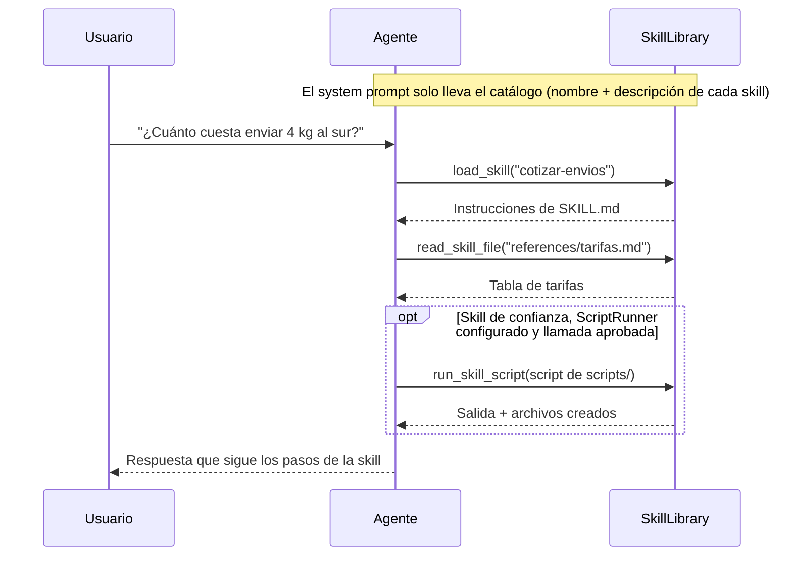

# Skills (Agent Skills)

> 🇬🇧 [Read in English](Skills)

Una skill es una carpeta con un `SKILL.md` (frontmatter `name` + `description` e instrucciones en Markdown) y
archivos opcionales en `references/`, `scripts/` y `assets/`. Es el mismo formato que usan Claude Code,
GitHub Copilot y [dotnet/skills](https://github.com/dotnet/skills). El agente solo ve el catálogo (nombre y
descripción) y carga el resto cuando lo necesita (`load_skill`, `read_skill_file`).

## 🪜 Revelación progresiva



## 🧩 Uso

```csharp
var library = new SkillLibrary();
library.LoadDirectory("skills", new SkillLoadOptions { Trusted = true });             // tus skills
await library.LoadFromGitHubAsync("dotnet/skills", path: "plugins/dotnet-test");      // de terceros (no confiables)

library.Add(new SkillBuilder("cotizar-envios")
    .WithDescription("Calcula el costo de envíos nacionales. USE FOR: cotizar envíos, tarifas por peso.")
    .WithInstructions("# Cotizar envíos\n\n1. Pide peso y región.\n2. Lee [tarifas](references/tarifas.md).")
    .AddFile("references/tarifas.md", "| Región | Base | Por kg |\n|---|---|---|\n| RM | $3.000 | $500 |")
    .Build());                                                                         // no confiable salvo Build(trusted: true)

var agent = new ToolLoopAgent(new AgentSettings
{
    Model = model,
    Skills = library,                                                                  // catálogo + herramientas
    SkillOptions = new SkillToolOptions { ScriptRunner = new ProcessSkillScriptRunner() },  // scripts: opt-in, solo confiables
    OnToolApproval = req => PreguntarAlOperadorAsync(req.ToolCall),                   // cada run_skill_script se aprueba
});

var prompt = library.TryInvokeSlashCommand("/cotizar-envios 4 kg al sur");          // comandos del usuario
```

- **Validación** con las reglas del estándar (`SkillValidator.Validate`), límites de tamaño y rutas seguras;
  `Strict = false` acepta skills de terceros con desviaciones menores.
- **Crear skills:** `SkillLibrary.SaveAsync` / `PackAsync` (zip), `SkillGenerator.GenerateAsync(model, objetivo)`
  y las herramientas `create_skill` / `validate_skill` (`SkillAuthoringTools.Create`) para que un agente escriba las suyas.
- **DI y ASP.NET Core:** `services.AddAiSdk(ai => ai.AddSkills("skills"))` y `app.MapSkills()` (catálogo, detalle, zip);
  los endpoints exigen autorización por defecto (`new SkillEndpointOptions { AllowAnonymous = true }` para desactivarla).
- **Anthropic:** Skills en contenedor (`AnthropicSkills.Options([AnthropicSkill.Excel, AnthropicSkill.Custom(id)])`),
  descarga de archivos generados (`GetGeneratedFileIds` + `Files.DownloadAsync`) y API `/v1/skills` (`anthropic.Skills`).
- El repositorio incluye `skills/aisdk-net`, una skill que enseña a un agente de código a usar este SDK.

## 🔐 Confianza y seguridad

- **La confianza es explícita.** Las skills de terceros (GitHub, zip) se cargan como no confiables;
  `LoadDirectory(dir, new() { Trusted = true })`, `AddSkills(dir)` y `LoadEmbedded` confían en tus propias carpetas, y
  `SkillBuilder.Build()` es no confiable salvo que llames a `Build(trusted: true)`.
- **La procedencia sobrevive a los reinicios.** Toda skill escrita por `create_skill`, y cualquier skill no confiable
  guardada con `SkillLibrary.SaveAsync`, lleva el marcador `.aisdk-provenance.json`. Una skill con ese marcador se carga
  siempre como no confiable, aunque esté en una carpeta de confianza: una inyección de prompt no se convierte en código de
  confianza al reiniciar. Para confiar en ella, revísala y borra el marcador. Además, `create_skill` rechaza scripts
  (`scripts/`, `.py`, `.sh`, `.js`...), archivos ocultos y carpetas existentes salvo que actives
  `SkillAuthoringOptions.AllowScripts` / `AllowOverwrite`.
- **Sin escapes por enlaces.** Los enlaces simbólicos y junctions dentro de una skill (archivos o carpetas, a cualquier
  profundidad) se ignoran: `references/x.md → /etc/hostname` no se puede leer con `read_skill_file`; los archivos ocultos
  tampoco.
- **Los scripts son opt-in y se aprueban.** Requieren un `ScriptRunner`, una skill de confianza (`AllowUntrustedScripts`
  sigue desactivado) y, por defecto, **aprobar cada llamada a `run_skill_script`** con `OnToolApproval`: las instrucciones
  de cualquier skill, o el resultado de otra herramienta, podrían inducir al modelo a ejecutar un script de confianza. Sin
  manejador la llamada falla con un error explícito; usa `SkillToolOptions.RequireScriptApproval = false` solo con scripts
  inocuos.
- **`ProcessSkillScriptRunner`** se ejecuta con un entorno limpio (sin secretos), detiene siempre el árbol de procesos
  (tiempo límite, error o cancelación del llamador), lee como máximo `MaxOutputChars` de stdout/stderr y limita los
  archivos devueltos (`MaxCreatedFiles`, `MaxCreatedFileBytes`, `MaxCreatedTotalBytes`; los enlaces y el resto quedan en
  `OmittedFiles`). No es un sandbox: ejecuta scripts de terceros en un contenedor (implementa `ISkillScriptRunner`).
- **La carga está aislada y acotada.** Una carga posterior nunca reemplaza en silencio una skill con el mismo nombre: se
  conserva la primera y el conflicto se informa en `LoadErrors` (`SkillLoadOptions.ReplaceExisting = true` para recargar a
  propósito). Cada skill rota falla por separado, y los zip / descargas de GitHub tienen límites (`MaxArchiveBytes`,
  `MaxArchiveExtractedBytes`, `MaxFileBytes`, `MaxFiles`).

> [!WARNING]
> Configura un `ScriptRunner` solo para skills en las que confías, mantén `AllowUntrustedScripts` desactivado para skills
> de terceros y deja activa la aprobación de scripts salvo que sean inocuos con cualquier argumento.

---

➡️ Siguiente: [Artifacts y documentos Office](es-Artifacts-y-documentos-Office)
